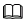

# XML类型<a name="ZH-CN_TOPIC_0289900228"></a>

> **说明：** 
>轻量版场景下，openGauss默认不支持XML类型。

openGauss支持XML类型，使用示例如下。

```sql
openGauss=# CREATE TABLE xmltest (id int, data xml);
CREATE TABLE
openGauss=# INSERT INTO xmltest VALUES (1, '<value>one</value>');
INSERT 0 1
openGauss=# INSERT INTO xmltest VALUES (2, '<value>two</value>');
INSERT 0 1
openGauss=# SELECT * FROM xmltest ORDER BY 1;
 id |        data
----+--------------------
  1 | <value>one</value>
  2 | <value>two</value>
(2 rows)

openGauss=# SELECT xmlconcat(xmlcomment('hello'), xmlelement(NAME qux, 'xml'), xmlcomment('world'));
               xmlconcat
----------------------------------------
 <!--hello--><qux>xml</qux><!--world-->
(1 row)

openGauss=# SELECT xmlconcat('', NULL, '');
 xmlconcat
-----------

(1 row)

```

> **说明：** 
>
>-   该功能默认未开启，如需使用，需要修改openGauss-server源码中的cmake/src/build_options.cmake文件，将143行set(USE_LIBXML OFF)去掉，重新使用build/script中cmake_package_mini.sh脚本编译数据库；详细使用指导见企业版。

