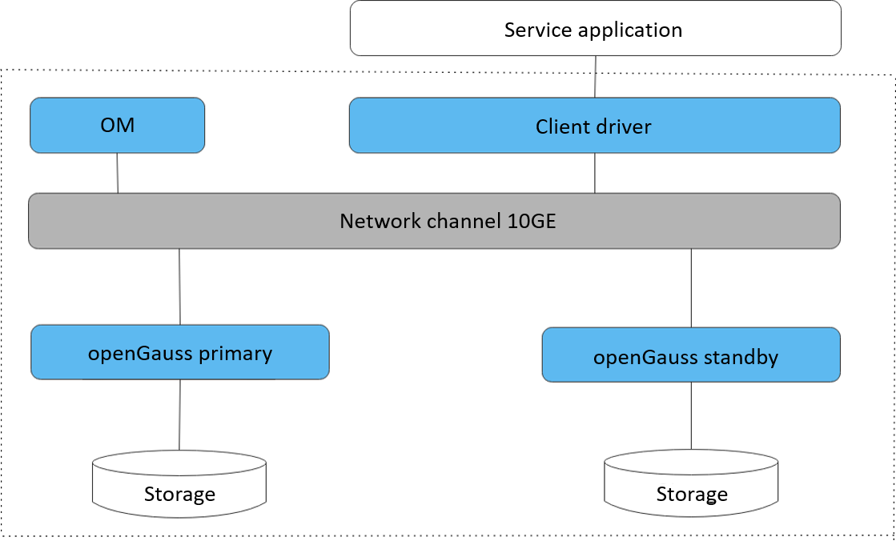

# Product Description 

This document describes the openGauss database in terms of its product positioning, system architecture, application scenarios, operating environment, technical specifications, basic functions and features, and enterprise-level enhanced features. 

## Product Positioning

openGauss is an HA rational database that supports the SQL2003 standard and primary/standby deployment.

- Multiple storage modes support composite service scenarios. The in-place update storage engine is introduced.
- The NUMA data structure supports high performance.
- HA is supported by primary/standby mode and cyclic redundancy check \(CRC\).
- Security features are supported, such as fully-encrypted computing and ledger database, to provide comprehensive end-to-end data security protection.
- The Table Access Method interface layer supports multiple storage engines.

openGauss is a multi-core-oriented open-source relational database that provides ultimate performance, full-link service and data security, AI-based tuning, and efficient O&M capabilities. This leading database at enterprise level is developed in collaboration with global partners and is released under the Mulan Permissive Software License v2. openGauss deeply integrates Huawei's years of R&D experience in the database field and continuously builds competitive features based on enterprise-level scenario requirements.

## Technical Characteristics

Compared with other databases, openGauss features multiple storage modes, NUMA-based kernel structure, and high availability.

- Multiple storage modes
    - Row-store, supporting frequent service data updates and the fusion engine \(Ustore\) and the original Astore
    - Column-store, supporting service data appending and analysis

- NUMA-based kernel structure
    - Partitions key data structures to reduce data access conflicts.
    - Provides NUMA-based key data structure to reduce the data structure access latency.
    - Binds cores to key service threads to prevent inter-core thread drift.

- High availability
    - Supports multiple deployment modes, such as primary/standby synchronization and primary/standby asynchronization.
    - Supports data page cyclic redundancy check \(CRC\), and automatically restores damaged data pages through the standby node.

- High security

    Provides fully-encrypted database capabilities and supports security features such as fully-encrypted equality query, access control, encryption authentication, database audit, and dynamic data masking to provide comprehensive end-to-end data security protection.

## System Architecture

openGauss is a standalone database where data is stored on a single physical node and data access tasks are pushed to service nodes. In this way, high concurrency of servers enables quick data processing. In addition, data can be copied to the standby server through log replication, ensuring high reliability and scalability.

openGauss is a standalone database and can be deployed in primary/standby mode.

[Figure 1](#en-us_topic_0283136530_en-us_topic_0237080634_en-us_topic_0231764167_fig5205420191411)  and  show the logical architecture of openGauss.

**Figure  1**  openGauss logical architecture  

**Table  1**  Architecture description

<table><thead align="left"><tr id="en-us_topic_0283136530_en-us_topic_0237080634_en-us_topic_0231764167_row4411284819151"><th class="cellrowborder" valign="top" width="14.469999999999999%" id="mcps1.2.3.1.1">
Name

</th>
<th class="cellrowborder" valign="top" width="85.53%" id="mcps1.2.3.1.2">
Description

</th>
</tr>
</thead>
<tbody><tr id="en-us_topic_0283136530_en-us_topic_0237080634_en-us_topic_0231764167_row6476976919151"><td class="cellrowborder" valign="top" width="14.469999999999999%" headers="mcps1.2.3.1.1 ">
Client driver

</td>
<td class="cellrowborder" valign="top" width="85.53%" headers="mcps1.2.3.1.2 ">
The client driver receives access requests from the application layer and returns execution results. It communicates with openGauss instances, sends application SQL commands, and receives openGauss execution results.

</td>
</tr>
<tr id="en-us_topic_0283136530_en-us_topic_0237080634_en-us_topic_0231764167_row5813821019151"><td class="cellrowborder" valign="top" width="14.469999999999999%" headers="mcps1.2.3.1.1 ">
openGauss (primary/standby)

</td>
<td class="cellrowborder" valign="top" width="85.53%" headers="mcps1.2.3.1.2 ">
The openGauss primary/standby DN stores service data, executes data query tasks, and returns execution results.

openGauss supports one primary and multiple standbys. You are advised to deploy them on different physical nodes.

</td>
</tr>
<tr id="en-us_topic_0283136530_en-us_topic_0237080634_en-us_topic_0231764167_row4354812919183"><td class="cellrowborder" valign="top" width="14.469999999999999%" headers="mcps1.2.3.1.1 ">
Storage

</td>
<td class="cellrowborder" valign="top" width="85.53%" headers="mcps1.2.3.1.2 ">
Functions as the server's local storage resources to store data permanently.

</td>
</tr>
</tbody>
</table>

## Application Scenarios

- Transaction applications

    Applications need to process highly concurrent online transactions containing a large volume of data, such as e-commerce, finance, O2O, telecom customer relationship management \(CRM\), and billing.

- IoT data

    In IoT scenarios, such as industrial monitoring, remote control, smart cities, smart homes, and loV, challenges come from a large number of sensors and monitoring devices, high sampling frequency, additional storage modes, and concurrent operation and analysis.
