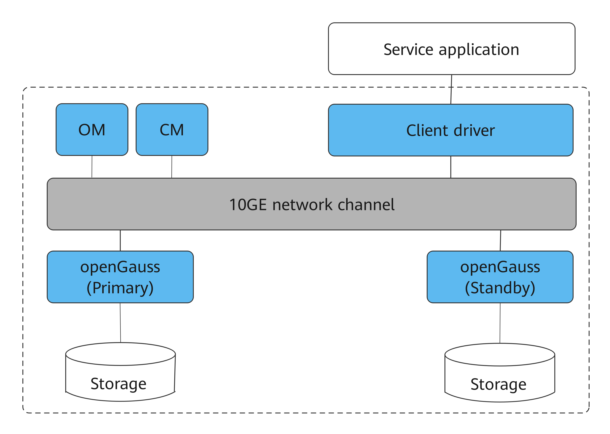

# Product Description 

This document describes the openGauss database in terms of its product positioning, system architecture, application scenarios, operating environment, technical specifications, basic functions and features, and enterprise-level enhanced features. 

## Product Positioning

openGauss is a HA rational database that supports the SQL2003 standard and primary/standby deployment.

- Multiple storage modes support composite service scenarios. The in-place update storage engine is introduced.
- The NUMA data structure supports high performance.
- HA is supported by Paxos consistency log replication protocol, primary/standby mode, and cyclic redundancy check \(CRC\).
- Security features are supported, such as fully-encrypted computing and ledger database, to provide comprehensive end-to-end data security protection.
- The Table Access Method interface layer supports multiple storage engines.

openGauss is a multi-core-oriented open-source relational database that provides ultimate performance, full-link service and data security, AI-based tuning, and efficient O&M capabilities. This leading database at enterprise level is developed in collaboration with global partners and is released under the Mulan Permissive Software License v2. openGauss deeply integrates Huawei's years of R&D experience in the database field and continuously builds competitive features based on enterprise-level scenario requirements.

## Technical Characteristics

Compared with other open-source databases, openGauss has the following characteristics:

- High performance
    - Provides the multi-core architecture-oriented concurrency control technology and Kunpeng hardware optimization, and achieves that the TPC-C benchmark performance reaches 1,500,000 tpmC in Kunpeng 2-socket servers.
    - Uses NUMA-Aware data structures as the key kernel structures to adapt to the trend of using multi-core NUMA architecture on hardware.
    - Provides the SQL bypass intelligent fast engine technology.
    - The Ustore storage engine is provided for frequent update scenarios.

- High availability \(HA\)
    - Supports multiple deployment modes, such as primary/standby synchronization, primary/standby asynchronization, and cascaded standby server deployment.
    - Supports data page cyclic redundancy check \(CRC\), and automatically restores damaged data pages through the standby node.
    - Recovers the standby node in parallel and promots it to primary to provide services within 10 seconds.
    - Log replication and primary selection framework are provided based on the Paxos distributed consistency protocol.

- High security

    Supports security features such as fully-encrypted computing, access control, encryption authentication, database audit, and dynamic data masking to provide comprehensive end-to-end data security protection.

- Easy O&M
    - Provides AI-based intelligent parameter tuning and index recommendation to automatically recommend AI parameters.
    - Provides slow SQL diagnosis and multi-dimensional self-monitoring views to help you understand system performance in real time, predict metric trends, detect exceptions, and analyze root causes of slow SQL statements.

- Fully open
    - Adopts the Mulan Permissive Software License, allowing code to be freely modified, used, and referenced.
    - Fully opens database kernel capabilities.
    - Provides excessive partner certifications, training systems, and university courses.

## Software Architecture

openGauss is a standalone database where data is stored on a single physical node and data access tasks are pushed to service nodes. In this way, high concurrency of servers enables quick data processing. In addition, data can be copied to the standby server through log replication, ensuring high reliability and scalability.

openGauss can be deployed in primary/standby mode.  [Figure 1](#fig552153723612)  shows the openGauss logical architecture.

**Figure  1**  openGauss logical architecture  

**Table  1**  Architecture description

<table><thead align="left"><tr id="en-us_concept_0283139007_en-us_topic_0237080634_en-us_topic_0231764167_row4411284819151"><th class="cellrowborder" valign="top" width="14.469999999999999%" id="mcps1.2.3.1.1">
Name

</th>
<th class="cellrowborder" valign="top" width="85.53%" id="mcps1.2.3.1.2">
Description

</th>
</tr>
</thead>
<tbody><tr id="en-us_concept_0283139007_en-us_topic_0237080634_en-us_topic_0231764167_row3200216592122"><td class="cellrowborder" valign="top" width="14.469999999999999%" headers="mcps1.2.3.1.1 ">
OM

</td>
<td class="cellrowborder" valign="top" width="85.53%" headers="mcps1.2.3.1.2 ">
Operation Manager (OM) provides management interfaces and tools for routine maintenance and configuration management of the database.

</td>
</tr>
<tr id="row117405422415"><td class="cellrowborder" valign="top" width="14.469999999999999%" headers="mcps1.2.3.1.1 ">
CM

</td>
<td class="cellrowborder" valign="top" width="85.53%" headers="mcps1.2.3.1.2 ">
Acronym for cluster manager, a data management module. It manages and monitors the running status of functional units and physical resources in a database system, ensuring stable running of the entire system.

</td>
</tr>
<tr id="en-us_concept_0283139007_en-us_topic_0237080634_en-us_topic_0231764167_row6476976919151"><td class="cellrowborder" valign="top" width="14.469999999999999%" headers="mcps1.2.3.1.1 ">
Client driver

</td>
<td class="cellrowborder" valign="top" width="85.53%" headers="mcps1.2.3.1.2 ">
Client driver receives access requests from the application layer and returns execution results. It communicates with openGauss instances, sends application SQL commands, and receives openGauss execution results.

</td>
</tr>
<tr id="en-us_concept_0283139007_en-us_topic_0237080634_en-us_topic_0231764167_row5813821019151"><td class="cellrowborder" valign="top" width="14.469999999999999%" headers="mcps1.2.3.1.1 ">
openGauss (primary/standby)

</td>
<td class="cellrowborder" valign="top" width="85.53%" headers="mcps1.2.3.1.2 ">
openGauss primary/standby DN stores service data, executes data query tasks, and returns execution results.

openGauss supports one primary and multiple standbys. You are advised to deploy them on different physical nodes.

</td>
</tr>
<tr id="en-us_concept_0283139007_en-us_topic_0237080634_en-us_topic_0231764167_row4354812919183"><td class="cellrowborder" valign="top" width="14.469999999999999%" headers="mcps1.2.3.1.1 ">
Storage

</td>
<td class="cellrowborder" valign="top" width="85.53%" headers="mcps1.2.3.1.2 ">
Functions as the server's local storage resources to store data permanently.

</td>
</tr>
</tbody>
</table>

## Application Scenarios

- Transaction applications

    Applications need to process highly concurrent online transactions containing a large volume of data, such as e-commerce, finance, O2O, telecom customer relationship management \(CRM\), and billing.

- IoT data

    In IoT scenarios, such as industrial monitoring, remote control, smart cities, smart homes, and loV, challenges come from a large number of sensors and monitoring devices, high sampling frequency, additional storage modes, and concurrent operation and analysis.
