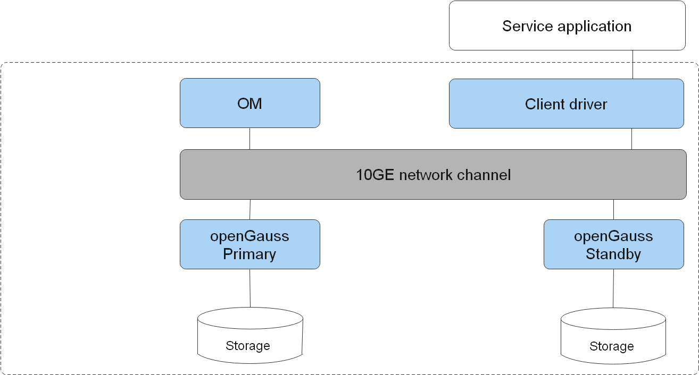

# Product Description 

This document describes the openGauss database in terms of its product positioning, system architecture, application scenarios, operating environment, technical specifications, basic functions and features, and enterprise-level enhanced features. 

## Technical Characteristics

Compared with other open-source databases, openGauss has the following characteristics:

- High performance
    - Provides the multi-core architecture-oriented concurrency control technology and Kunpeng hardware optimization, and achieves that the TPC-C benchmark performance reaches 1,500,000 tpmC in Kunpeng 2-socket servers.
    - Uses NUMA-Aware data structures as the key kernel structures to adapt to the trend of using multi-core NUMA architecture on hardware.
    - Provides the SQL bypass intelligent fast engine technology.
    - The Ustore storage engine is provided for frequent update scenarios.

- High availability \(HA\)
    - Supports multiple deployment modes, such as primary/standby synchronization, primary/standby asynchronization, and cascaded standby server deployment.
    - Supports data page cyclic redundancy check \(CRC\), and automatically restores damaged data pages through the standby node.
    - Recovers the standby node in parallel and promots it to primary to provide services within 10 seconds.
    - Log replication and primary selection framework are provided based on the Paxos distributed consistency protocol.

- High security

    Supports security features such as fully-encrypted computing, access control, encryption authentication, database audit, and dynamic data masking to provide comprehensive end-to-end data security protection.

- Easy O&M
    - Provides AI-based intelligent parameter tuning and index recommendation to automatically recommend AI parameters.
    - Provides slow SQL diagnosis and multi-dimensional self-monitoring views to help you understand system performance in real time, predict metric trends, detect exceptions, and analyze root causes of slow SQL statements.

- Fully open
    - Adopts the Mulan Permissive Software License, allowing code to be freely modified, used, and referenced.
    - Fully opens database kernel capabilities.
    - Provides excessive partner certifications, training systems, and university courses.

## Software Architecture

openGauss is a standalone system that supports one primary and up to eight standby servers.

Service data is stored on a single physical node, and data access tasks are pushed to service nodes and then executed. The high concurrency of servers enables quick response to data processing. In addition, data can be copied to the standby server through log replication, ensuring high reliability and scalability.

### Software Architecture

[Figure 1](#en-us_topic_0283136530_en-us_topic_0237080634_en-us_topic_0231764167_fig5205420191411)  shows the logical components of openGauss.

**Figure  1**  openGauss logical architecture  

**Table  1**  Architecture description

<table><thead align="left"><tr id="en-us_topic_0283136530_en-us_topic_0237080634_en-us_topic_0231764167_row4411284819151"><th class="cellrowborder" valign="top" width="14.469999999999999%" id="mcps1.2.3.1.1">
Name

</th>
<th class="cellrowborder" valign="top" width="85.53%" id="mcps1.2.3.1.2">
Description

</th>
</tr>
</thead>
<tbody><tr id="en-us_topic_0283136530_en-us_topic_0237080634_en-us_topic_0231764167_row3200216592122"><td class="cellrowborder" valign="top" width="14.469999999999999%" headers="mcps1.2.3.1.1 ">
OM

</td>
<td class="cellrowborder" valign="top" width="85.53%" headers="mcps1.2.3.1.2 ">
Operation Manager (OM) provides management interfaces and tools for routine maintenance and configuration management of the database. This module is optional and is often used in enterprise-level scenarios.

</td>
</tr>
<tr id="en-us_topic_0283136530_en-us_topic_0237080634_en-us_topic_0231764167_row6476976919151"><td class="cellrowborder" valign="top" width="14.469999999999999%" headers="mcps1.2.3.1.1 ">
Client driver

</td>
<td class="cellrowborder" valign="top" width="85.53%" headers="mcps1.2.3.1.2 ">
A client driver receives the access requests from applications, and returns the execution results to the applications. It communicates with openGauss instances, sends application SQL commands, and receives execution results. This module is mandatory. The client program gsql also depends on the driver to connect to the database.

</td>
</tr>
<tr id="en-us_topic_0283136530_en-us_topic_0237080634_en-us_topic_0231764167_row5813821019151"><td class="cellrowborder" valign="top" width="14.469999999999999%" headers="mcps1.2.3.1.1 ">
openGauss (Primary/Standby)

</td>
<td class="cellrowborder" valign="top" width="85.53%" headers="mcps1.2.3.1.2 ">
openGauss primary and standby DNs store service data, execute data queries, and return execution results to the client.

openGauss supports one primary and multiple standbys. You are advised to deploy them on different physical nodes.

The primary/standby mode is optional. openGauss can also be deployed in standalone mode. The primary/standby mode is often used in enterprise-level scenarios.

</td>
</tr>
<tr id="en-us_topic_0283136530_en-us_topic_0237080634_en-us_topic_0231764167_row4354812919183"><td class="cellrowborder" valign="top" width="14.469999999999999%" headers="mcps1.2.3.1.1 ">
Storage

</td>
<td class="cellrowborder" valign="top" width="85.53%" headers="mcps1.2.3.1.2 ">
It functions as the server's local storage resources to store data permanently.

</td>
</tr>
</tbody>
</table>

## Application Scenarios

- Transaction applications

    Applications need to process highly concurrent online transactions containing a large volume of data, such as e-commerce, finance, O2O, telecom customer relationship management \(CRM\), and billing.

- IoT data

    In IoT scenarios, such as industrial monitoring, remote control, smart cities, smart homes, and loV, challenges come from a large number of sensors and monitoring devices, high sampling frequency, additional storage modes, and concurrent operation and analysis.
