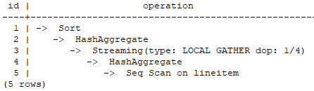

# Parallel Query

<!-- md-trans-meta sourceCommit=unknown translatedAt=2026-09-07T01:47:12.796Z -->

The SMP parallelism technology of openGauss leverages the multi-core CPU architecture of computers to implement multi-threaded parallel computing, so as to fully utilize CPU resources and improve query performance. In complex query scenarios, a single query takes a long time to execute and the system concurrency is low. By implementing operator-level parallelism through SMP, the query execution time can be effectively reduced, and the query performance and resource utilization can be improved. The overall implementation idea of the SMP parallel technology is as follows: for query operators that support parallelism, data is partitioned, several worker threads are started to compute separately, and finally the results are aggregated and returned to the front end. SMP parallel execution adds a data exchange operator (Stream) to implement data exchange among multiple worker threads, ensuring the correctness of the query and completing the overall query.

## Applicable Scenarios and Limitations<a name="section136321654121411"></a>

The SMP feature improves performance through operator parallelism, but it also consumes more system resources, including CPU, memory, I/O, and so on. In essence, SMP trades resources for time. In appropriate scenarios with sufficient resources, it can deliver a good performance improvement; however, in inappropriate scenarios or when resources are insufficient, it may instead cause performance degradation. The SMP feature is suitable for analytical query scenarios, which are characterized by long single-query execution time and low service concurrency. SMP parallel technology can reduce query latency and improve system throughput. However, in high-concurrency transactional service scenarios, because the latency of a single query itself is very short, using multi-threaded parallel technology instead increases query latency and reduces system throughput.

- Applicable scenarios
    - Operators that support parallelism. The following operators in a plan support parallelism:
        - Scan: Supports sequential scans of row-store ordinary tables and row-store partitioned tables, and sequential scans of column-store ordinary tables and column-store partitioned tables.
        - Join: HashJoin, NestLoop
        - Agg: HashAgg, SortAgg, PlainAgg, WindowAgg (only `partition by` is supported; `order by` is not supported).
        - Stream: Local Redistribute, Local Broadcast
        - Others: Result, Subqueryscan, Unique, Material, Setop, Append, VectoRow

    - SMP-specific operators. To implement parallelism, new Stream operators for data exchange between parallel threads are added for the SMP feature. These new operators can be regarded as subclasses of the Stream operator:
        - Local Gather: aggregates data from parallel threads within an instance.
        - Local Redistribute: redistributes data among threads within an instance based on the distribution key.
        - Local Broadcast: broadcasts data to every thread within an instance.
        - Local RoundRobin: distributes data among threads within an instance in a round-robin manner.

    - Example: The parallel plan of TPCH Q1 is used as an example.

        

        In this plan, the Scan and HashAgg operators are parallelized, and a Local Gather data exchange operator is added. Operator 3 is a Local Gather operator. The "dop: 1/4" marked on it indicates that the parallelism of the sending threads of this operator is 4, while that of the receiving threads is 1. That is, the lower-level operator 4 (HashAggregate) is executed with a parallelism of 4, while the upper-level operator 1\~2 is executed serially. Operator 3 aggregates data from parallel threads within the instance.

        The parallelism of each operator can be seen from the dop information marked on the Stream operators in the plan.

- Non-applicable scenarios
    - Index scans do not support parallel execution.
    - MergeJoin does not support parallel execution. This is a new feature in openGauss 7.0.0-RC1: if the optimal plan is MergeJoin, a serial plan is used.
    - WindowAgg order by does not support parallel execution.
    - Only the NO SCROLL cursor declared in cmd and the cursor expression used as an input parameter of a parallel function support parallel execution. Other cursors do not support parallel execution.
    - Queries in stored procedures and functions do not support parallel execution.
    - Parallelism is not supported for subquery subplans and initplans, or for operators that contain subqueries.
    - Query statements with the median operation do not support parallel execution.
    - Queries with global temporary tables do not support parallel execution.
    - Updates of materialized views do not support parallel execution.

## Impact of Resources on SMP Performance<a name="section310105992016"></a>

The SMP architecture is a solution that trades surplus resources for time. Planned parallelism inevitably increases resource consumption, including significant growth in CPU, memory, and I/O consumption. As the parallelism degree increases, resource consumption also increases. When these resources become a bottleneck, SMP cannot improve performance and may instead degrade the overall performance of the database instance. The following describes the impact of each type of resource on SMP performance.

- CPU resources

    In typical customer scenarios where the system CPU utilization is not high, the SMP parallel architecture can make fuller use of system CPU resources and improve system performance. However, when the database server has few CPU cores and the CPU utilization is already high, enabling SMP parallelism not only brings little performance improvement but may also cause performance degradation due to resource contention among multiple threads.

- Memory resources

    Parallel query increases memory usage, but the memory limit of each operator is still constrained by parameters such as work\_mem. Assume that work\_mem is 4 GB and the parallelism degree is 2. In this case, the memory limit allocated to each parallel thread is 2 GB. When work\_mem is small or the system memory is insufficient, using SMP parallelism may cause data to spill to disk, degrading query performance.

- I/O resources

    Parallel scanning inevitably increases I/O resource consumption. Therefore, parallel scanning can improve scan performance only when I/O resources are sufficient.

## Impact of Other Factors on SMP Performance<a name="section190917443263"></a>

In addition to resource factors, some other factors also affect SMP parallel performance, such as uneven data distribution in partitioned tables and system concurrency.

- Impact of Data Skew on SMP Performance

    When severe data skew exists in the data, parallelism is less effective. For example, if the amount of data for a certain value in the join column of a table is far greater than that for other values, after parallelism is enabled, the table data is hash-redistributed based on the join column values. As a result, the amount of data processed by one parallel thread is far greater than that processed by other threads, causing a long-tail problem and poor parallelism results.

- Impact of System Concurrency on SMP Performance

    The SMP feature increases resource usage, while fewer resources remain in high-concurrency scenarios. Therefore, enabling SMP parallelism in high-concurrency scenarios causes severe resource contention among queries. Once resource contention occurs, whether for CPU, I/O, or memory, overall performance degrades. Therefore, in high-concurrency scenarios, enabling SMP often fails to improve performance and may even cause performance degradation.

## Configuration Procedure<a name="section58511820192718"></a>

1. Observe the current system load. If the system has sufficient resources (resource utilization is less than 50%), perform [2](#li1174421213171); otherwise, exit.
2. <a name="li1174421213171"></a>Set query\_dop=1 (default value), use explain to generate the execution plan, and check whether the plan meets the applicable scenarios in [Applicable Scenarios and Limitations](#section136321654121411). If yes, proceed to [3](#li998191911172).
3. <a name="li998191911172"></a>Set query\_dop=value, and force the dop to 1 or `value` regardless of resource conditions and plan characteristics.
4. Before executing a query that meets the conditions, set an appropriate `query_dop` value, and disable `query_dop` after the statement execution is complete. An example is as follows.

    ```
    openGauss=# SET query_dop = 4;
    openGauss=# SELECT COUNT(*) FROM t1 GROUP BY a;
    ......
    openGauss=# SET query_dop = 1;
    ```

    >[!NOTE]Note  
    >- When resources permit, a higher degree of parallelism delivers better performance improvement.  
    >- The SMP degree of parallelism supports session-level setting. It is recommended that customers enable smp before executing a query that meets the requirements and disable smp after the execution is complete, to avoid impacting services during peak business hours.  
