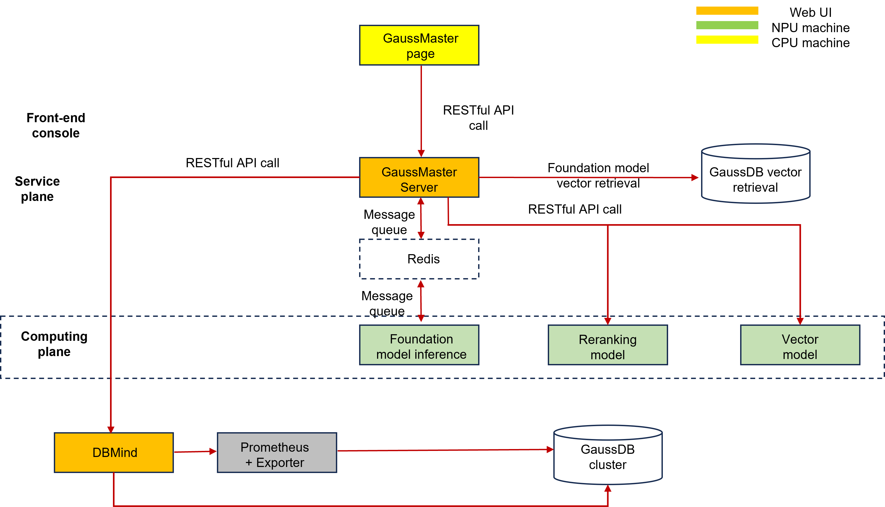
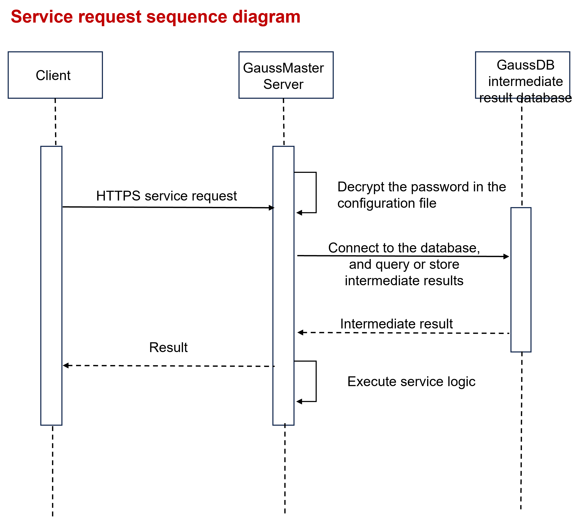
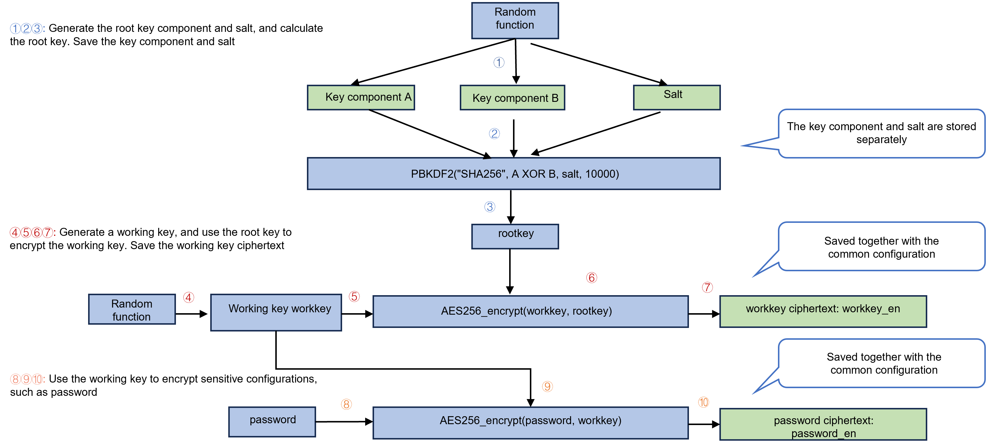
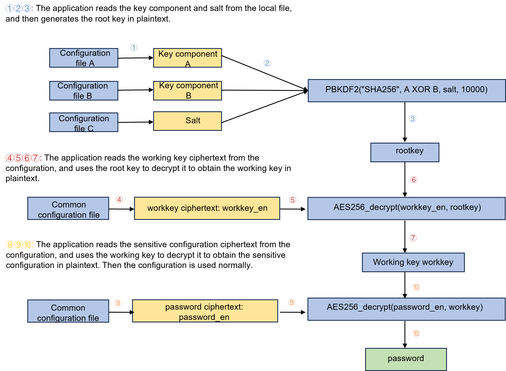

# Architecture Overview

<!-- md-trans-meta sourceCommit=unknown translatedAt=2026-09-07T01:47:17.008Z -->

## Logical Architecture

GaussMaster serves as the server and provides RESTful APIs for the cloud management and control side to call. The APIs support only HTTPS mutual authentication. Its logical architecture is shown in [Figure 1](#fig12416726131415):

**Figure 1**  Logical architecture  

## Security Design

Intermediate results generated during the running of the GaussMaster service are stored in the openGauss database. Therefore, before the GaussMaster service is started, the database user name and password must be encrypted and stored in the configuration file.

The cloud management and control side, acting as the client, uses HTTPS mutual authentication by default when calling APIs. After receiving a request, GaussMaster executes the corresponding service logic. If it needs to connect to openGauss to query or store intermediate results, it decrypts the password from the configuration file. After the service logic is executed, the final result is returned to the cloud management and control side. [Figure 1](#fig11274103110251) shows the sequence diagram of a service request.

**Figure 1**  Service sequence diagram  

GaussMaster uses the libpq driver to connect to the openGauss database, and the TLS encryption protocol is used by default.

Because GaussMaster needs to connect to DBMind and openGauss, the corresponding passwords must be stored. When the GaussMaster service executes the initialization command, the user enters the password through a pipe, and the password is then stored in the configuration file according to the encryption scheme shown in [Figure 2](#fig13844205852611). If the user name or password is changed, the initialization command must be executed again.

**Figure 2**  Encryption process  

When a password is required, the ciphertext is decrypted according to the decryption scheme shown in [Figure 3](#fig117662342814).

**Figure 3**  Decryption process  

## Constraints

1. GaussMaster does not provide a front-end page and only provides RESTful APIs.
2. The APIs provided by GaussMaster support only HTTPS mutual authentication and do not support HTTP.
3. GaussMaster is implemented based on DBMind and therefore inherits the constraints of DBMind. DBMind supports cluster management, and the managed cluster types support only single-node clusters, and do not support disaster recovery clusters or one primary, one standby, and one logger.
4. GaussMaster 506.0 depends on DBMind 506.0, and one GaussMaster instance supports managing only one DBMind instance.
5. In scenarios such as DBMind/openGauss component unavailability or upgrade, the functions of the GaussMaster service are affected.
6. Python 3.7 or later is supported, and Python 3.11 is not supported.
7. The concurrency capability of the LLM depends on the number of LLM instances, and one instance supports only one concurrent request. The concurrency capability of GaussMaster depends on the concurrency capability of the LLM. Therefore, the number of concurrent requests supported by GaussMaster is less than the number of concurrent requests supported by the LLM.
8. The current version of GaussMaster does not support IPv6.
9. The current version of GaussMaster does not support high availability, and users need to restart the service.
10. The non-LLM APIs of the GaussMaster service support 50 concurrent requests on a 64U configuration without affecting services.
11. The APIs provided by the GaussMaster service do not directly authenticate or authorize users. Authentication and authorization are provided by cloud management and control, ensuring that users cannot perform unauthorized operations, such as adding records to another user's session or deleting documents uploaded by other users.
12. The vector database service and third-party model services that the GaussMaster service depends on, including the LLM service, Embedding Model service, and Reranker Model service, are provided by cloud management and control, and their authentication mechanisms are also provided by cloud management and control. The model APIs provided by cloud management and control must ensure security. If there are security risks, users must be notified, for example, that using the HTTP protocol may leak user session content.
13. The GaussMaster service provides the knowledge base creation function. The number of knowledge bases, the number of files uploaded to a knowledge base at a time, and the total size of uploaded files must all be controlled by cloud management and control.
