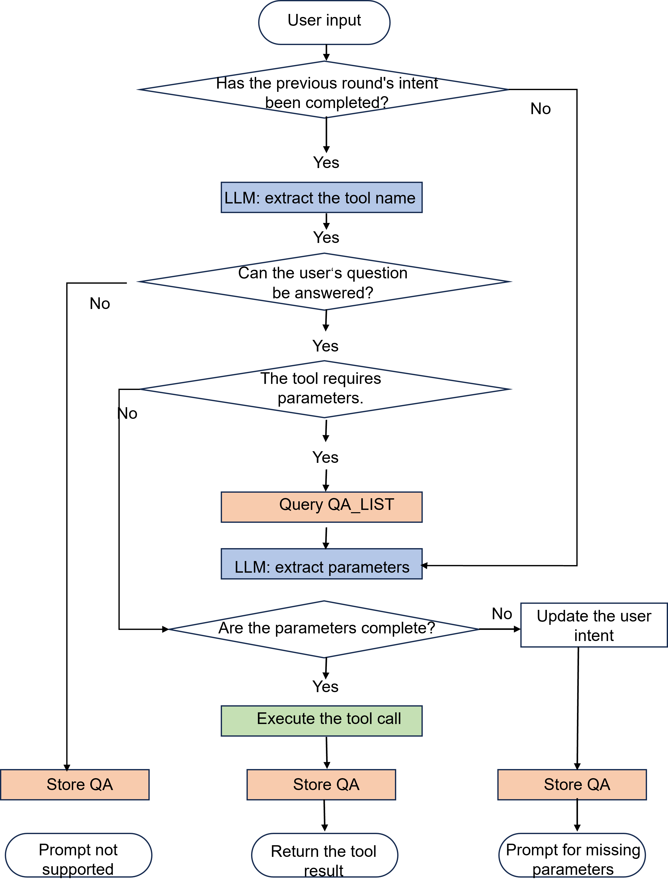

# Intelligent O&M<a name="ZH-CN_TOPIC_0000002293119517"></a>

<!-- md-trans-meta sourceCommit=unknown translatedAt=2026-09-07T01:49:06.718Z -->

## Prerequisites<a id="0000002258589378"></a>

Before using intelligent O&M, register a cluster first, and then bind the cluster that the user needs to diagnose. In addition, bind the large language model that the user needs to use.

The following example uses user ID test\_user, session ID test\_session, and cluster instance address 10.x.x.x:1.

### Registering and Binding a Cluster<a name="section414219541089"></a>

1. Register a cluster.

    ```
    curl -X 'POST' 'https://x.x.x.x:x/v1/api/clusters/register' -H 'accept: application/json' -H 'Content-Type: application/json' --cacert /path/xxx.crt --key /path/xxx.key --cert /path/xxx.crt -d '{ "cluster_name": "cluster1", "host": "10.x.x.x", "port": "1", "username": "user", "password": "db_password"}' --pass "***"
    ```

2. Bind a cluster.

    ```
    curl -X 'PUT' 'https://x.x.x.x:x/v1/api/clusters?instance=10.x.x.x:1&user_id=test_user&session_id=test_session' -H 'accept: application/json' -H 'Content-Type: application/json' --cacert /path/xxx.crt --key /path/xxx.key --cert /path/xxx.crt --pass "***"
    ```

    If the value of data in the returned result is `True`, the binding is successful. To bind another cluster, modify only the value of the instance parameter and call the API again. If a user creates a new session without rebinding a cluster, the cluster bound last time is used by default.

### Binding a Large Language Model<a name="section6312161011917"></a>

1. Query available large language models.

    ```
    curl -X 'GET' 'https://x.x.x.x:x/v1/api/llms' -H 'accept: application/json' -H 'Content-Type: application/json' --cacert /path/xxx.crt --key /path/xxx.key --cert /path/xxx.crt --pass "***"
    ```

2. Bind a large language model.

    ```
    curl -X 'PUT' 'https://x.x.x.x:x/v1/api/llms?name=xxx&user_id=xxx&session_id=xxx' -H 'accept: application/json' -H 'Content-Type: application/json' --cacert /path/xxx.crt --key /path/xxx.key --cert /path/xxx.crt --pass "***"
    ```

    If the value of data in the returned result is `True`, the binding is successful. To bind another large language model, modify the value of the name parameter and call the API again.  

    If no large language model is bound, calling the app/intelligent-interaction API directly uses the large language model configured by default in the configuration file.

## Tool Interaction<a name="ZH-CN_TOPIC_0000002258589366"></a>

Before performing tool interaction, users must first complete the [prerequisites](#0000002258589378). After that, they can ask questions to the GaussMaster service in a Q&A manner. The backend API is /v1/api/app/intelligent-interaction. The value of the `mode` parameter of this API must be `tool_interaction`, which means the current mode is tool interaction. For API details, see [API: /v1/api/app/intelligent-interaction](#section95391566019). Tool interaction supports multi-turn conversations by default, and the conversation history length is 1 turn. Users can specify the conversation history length through the `history_len` parameter. The supported conversation history length is \[1-3\], which means the large language model can remember up to 3 turns of conversation history.

The tool interaction flowchart is shown in [Figure 1](#fig518531224414).

**Figure 1**  Tool interaction flowchart<a name="fig518531224414"></a>  


### Tool Interaction Constraints<a name="section199011054151511"></a>

1. Users can use the pangu-38b open-source model tool provided by Huawei Cloud, whose recognition accuracy is 90%. Other open-source models can also be specified and invoked through APIs. When other open-source models are used for tool interaction, the recognition accuracy cannot be guaranteed.
2. Tool interaction in intelligent O&M supports parameter follow-up questions. When parameters are incomplete, they can be completed based on the historical content.
3. In scenarios such as the unavailability or upgrade of DBMind/openGauss components, the GaussMaster service is affected.
4. GaussMaster intelligent O&M does not provide a front-end page and currently supports only Chinese Q&A.

Currently, 22 DBMind tools (APIs) are supported internally (alarm query requires two DBMind APIs), as shown in the following table.

**Table 1**  API list

<a name="table1133317381846"></a>

<table><thead align="left"><tr id="row103342386416"><th class="cellrowborder" valign="top" width="7.200000000000001%" id="mcps1.2.6.1.1"><p id="p154771952398"><a name="p154771952398"></a><a name="p154771952398"></a>ID</p></th>
<th class="cellrowborder" valign="top" width="30.250000000000004%" id="mcps1.2.6.1.2"><p id="p1147745215911"><a name="p1147745215911"></a><a name="p1147745215911"></a>API</p></th>
<th class="cellrowborder" valign="top" width="16.310000000000002%" id="mcps1.2.6.1.3"><p id="p194601714174"><a name="p194601714174"></a><a name="p194601714174"></a>Parameter</p></th>
<th class="cellrowborder" valign="top" width="23.12%" id="mcps1.2.6.1.4"><p id="p347755216914"><a name="p347755216914"></a><a name="p347755216914"></a>Key Information</p></th>
<th class="cellrowborder" valign="top" width="23.12%" id="mcps1.2.6.1.5"><p id="p1247711521090"><a name="p1247711521090"></a><a name="p1247711521090"></a>Dialogue Example</p></th>
</tr>
</thead>
<tbody><tr id="row63341138644"><td class="cellrowborder" valign="top" width="7.200000000000001%" headers="mcps1.2.6.1.1 "><p id="p20477452497"><a name="p20477452497"></a><a name="p20477452497"></a>1</p></td>
<td class="cellrowborder" valign="top" width="30.250000000000004%" headers="mcps1.2.6.1.2 "><p id="p1147716521097"><a name="p1147716521097"></a><a name="p1147716521097"></a>/v1/api/status/data-directory</p></td>
<td class="cellrowborder" valign="top" width="16.310000000000002%" headers="mcps1.2.6.1.3 "><p id="p04601414872"><a name="p04601414872"></a><a name="p04601414872"></a>- instance: str type, required parameter, the IP and port of the data node of the database to be queried.</p></td>
<td class="cellrowborder" valign="top" width="23.12%" headers="mcps1.2.6.1.4 "><p id="p94775521298"><a name="p94775521298"></a><a name="p94775521298"></a>Database instance, database data directory status.</p></td>
<td class="cellrowborder" valign="top" width="23.12%" headers="mcps1.2.6.1.5 "><p id="p7477145211911"><a name="p7477145211911"></a><a name="p7477145211911"></a>Query the data directory status of 10.90.56.xxx:xxx.</p></td>
</tr>
<tr id="row73343387418"><td class="cellrowborder" valign="top" width="7.200000000000001%" headers="mcps1.2.6.1.1 "><p id="p4477852792"><a name="p4477852792"></a><a name="p4477852792"></a>2</p></td>
<td class="cellrowborder" valign="top" width="30.250000000000004%" headers="mcps1.2.6.1.2 "><p id="p847719521495"><a name="p847719521495"></a><a name="p847719521495"></a>/v1/api/app/workload-collection?data_source=dbe_perf.statement_history</p></td>
<td class="cellrowborder" valign="top" width="16.310000000000002%" headers="mcps1.2.6.1.3 "><p id="p1646011141076"><a name="p1646011141076"></a><a name="p1646011141076"></a>- start_time: str type, required parameter, filters SQL statements by their start time, format is %Y-%m-%d %H:%M:%S</p>
<p id="p6696291899"><a name="p6696291899"></a><a name="p6696291899"></a>- end_time: str type, required parameter, filters SQL statements by their end time, format is %Y-%m-%d %H:%M:%S</p>
<p id="p1483165716913"><a name="p1483165716913"></a><a name="p1483165716913"></a>- database: str type, optional parameter, filters SQL statements by the database name where the SQL statement runs, defaults to None when not specified</p>
<p id="p148314578919"><a name="p148314578919"></a><a name="p148314578919"></a>- schema:  str type, optional parameter, filters SQL statements by the database schema where the SQL statement runs, defaults to None when not specified</p></td>
<td class="cellrowborder" valign="top" width="23.12%" headers="mcps1.2.6.1.4 "><p id="p6477752494"><a name="p6477752494"></a><a name="p6477752494"></a>Start time, end time, database name (optional), and schema (optional).</p></td>
<td class="cellrowborder" valign="top" width="23.12%" headers="mcps1.2.6.1.5 "><p id="p194771752492"><a name="p194771752492"></a><a name="p194771752492"></a>Query SQL list in the test_db database from 10:00 to 11:00 in the morning.</p></td>
</tr>
<tr id="row173344386416"><td class="cellrowborder" valign="top" width="7.200000000000001%" headers="mcps1.2.6.1.1 "><p id="p184772525912"><a name="p184772525912"></a><a name="p184772525912"></a>3</p></td>
<td class="cellrowborder" valign="top" width="30.250000000000004%" headers="mcps1.2.6.1.2 "><p id="p124779525912"><a name="p124779525912"></a><a name="p124779525912"></a>/v1/api/app/workload-collection?data_source=pg_stat_activity</p></td>
<td class="cellrowborder" valign="top" width="16.310000000000002%" headers="mcps1.2.6.1.3 "><p id="p15460214274"><a name="p15460214274"></a><a name="p15460214274"></a>- database: str type, optional parameter, filters SQL statements by the database name where the SQL statement runs, defaults to None when not specified</p>
<p id="p557644315812"><a name="p557644315812"></a><a name="p557644315812"></a>- schema:  str type, optional parameter, filters SQL statements by the database schema where the SQL statement runs, defaults to None when not specified</p></td>
<td class="cellrowborder" valign="top" width="23.12%" headers="mcps1.2.6.1.4 "><p id="p164771352992"><a name="p164771352992"></a><a name="p164771352992"></a>Database name, currently executing SQL.</p></td>
<td class="cellrowborder" valign="top" width="23.12%" headers="mcps1.2.6.1.5 "><p id="p13477152397"><a name="p13477152397"></a><a name="p13477152397"></a>Query currently executing SQL in the test_db database.</p></td>
</tr>
<tr id="row19334133815420"><td class="cellrowborder" valign="top" width="7.200000000000001%" headers="mcps1.2.6.1.1 "><p id="p1247712521598"><a name="p1247712521598"></a><a name="p1247712521598"></a>4</p></td>
<td class="cellrowborder" valign="top" width="30.250000000000004%" headers="mcps1.2.6.1.2 "><p id="p11477195217912"><a name="p11477195217912"></a><a name="p11477195217912"></a>/v1/api/summary/sql/top</p></td>
<td class="cellrowborder" valign="top" width="16.310000000000002%" headers="mcps1.2.6.1.3 "><p id="p1346017143715"><a name="p1346017143715"></a><a name="p1346017143715"></a>None</p></td>
<td class="cellrowborder" valign="top" width="23.12%" headers="mcps1.2.6.1.4 "><p id="p2477952198"><a name="p2477952198"></a><a name="p2477952198"></a>Executes frequent SQL.</p></td>
<td class="cellrowborder" valign="top" width="23.12%" headers="mcps1.2.6.1.5 "><p id="p144778524912"><a name="p144778524912"></a><a name="p144778524912"></a>Query top SQL.</p></td>
</tr>
<tr id="row2033418381345"><td class="cellrowborder" valign="top" width="7.200000000000001%" headers="mcps1.2.6.1.1 "><p id="p174779522097"><a name="p174779522097"></a><a name="p174779522097"></a>5</p></td>
<td class="cellrowborder" valign="top" width="30.250000000000004%" headers="mcps1.2.6.1.2 "><p id="p1747795212911"><a name="p1747795212911"></a><a name="p1747795212911"></a>/v1/api/summary/sql/locking</p></td>
<td class="cellrowborder" valign="top" width="16.310000000000002%" headers="mcps1.2.6.1.3 "><p id="p74604142718"><a name="p74604142718"></a><a name="p74604142718"></a>None</p></td>
<td class="cellrowborder" valign="top" width="23.12%" headers="mcps1.2.6.1.4 "><p id="p547705215915"><a name="p547705215915"></a><a name="p547705215915"></a>Lock wait, blocking, SQL.</p></td>
<td class="cellrowborder" valign="top" width="23.12%" headers="mcps1.2.6.1.5 "><p id="p164771052492"><a name="p164771052492"></a><a name="p164771052492"></a>Query the currently blocked SQL.</p></td>
</tr>
<tr id="row1233512389417"><td class="cellrowborder" valign="top" width="7.200000000000001%" headers="mcps1.2.6.1.1 "><p id="p174771952691"><a name="p174771952691"></a><a name="p174771952691"></a>6</p></td>
<td class="cellrowborder" valign="top" width="30.250000000000004%" headers="mcps1.2.6.1.2 "><p id="p154771752596"><a name="p154771752596"></a><a name="p154771752596"></a>/v1/api/summary/alarms and /v1/api/summary/cluster-diagnosis</p></td>
<td class="cellrowborder" valign="top" width="16.310000000000002%" headers="mcps1.2.6.1.3 "><p id="p12460191416710"><a name="p12460191416710"></a><a name="p12460191416710"></a>- start_time: str type, required parameter, used to filter the start time of the alarm time range, format is %Y-%m-%d %H:%M:%S</p>
<p id="p101875509109"><a name="p101875509109"></a><a name="p101875509109"></a>- end_time: str type, required parameter, used to filter the end time of the alarm time range, format is %Y-%m-%d %H:%M:%S</p></td>
<td class="cellrowborder" valign="top" width="23.12%" headers="mcps1.2.6.1.4 "><p id="p1847817524919"><a name="p1847817524919"></a><a name="p1847817524919"></a>Start time, end time, query alarm.</p></td>
<td class="cellrowborder" valign="top" width="23.12%" headers="mcps1.2.6.1.5 "><p id="p747813527918"><a name="p747813527918"></a><a name="p747813527918"></a>Query alarms from 10:00 to 12:00 today.</p></td>
</tr>
<tr id="row17335838743"><td class="cellrowborder" valign="top" width="7.200000000000001%" headers="mcps1.2.6.1.1 "><p id="p2478145218910"><a name="p2478145218910"></a><a name="p2478145218910"></a>7</p></td>
<td class="cellrowborder" valign="top" width="30.250000000000004%" headers="mcps1.2.6.1.2 "><p id="p194781252392"><a name="p194781252392"></a><a name="p194781252392"></a>/v1/api/agents</p></td>
<td class="cellrowborder" valign="top" width="16.310000000000002%" headers="mcps1.2.6.1.3 "><p id="p1846011141079"><a name="p1846011141079"></a><a name="p1846011141079"></a>None</p></td>
<td class="cellrowborder" valign="top" width="23.12%" headers="mcps1.2.6.1.4 "><p id="p947885213912"><a name="p947885213912"></a><a name="p947885213912"></a>Query managed cluster information.</p></td>
<td class="cellrowborder" valign="top" width="23.12%" headers="mcps1.2.6.1.5 "><p id="p15478115218915"><a name="p15478115218915"></a><a name="p15478115218915"></a>Query information about all currently managed clusters.</p></td>
</tr>
<tr id="row533514380410"><td class="cellrowborder" valign="top" width="7.200000000000001%" headers="mcps1.2.6.1.1 "><p id="p1478165220913"><a name="p1478165220913"></a><a name="p1478165220913"></a>8</p></td>
<td class="cellrowborder" valign="top" width="30.250000000000004%" headers="mcps1.2.6.1.2 "><p id="p1478452297"><a name="p1478452297"></a><a name="p1478452297"></a>/v1/api/status/instances</p></td>
<td class="cellrowborder" valign="top" width="16.310000000000002%" headers="mcps1.2.6.1.3 "><p id="p174607141076"><a name="p174607141076"></a><a name="p174607141076"></a>None</p></td>
<td class="cellrowborder" valign="top" width="23.12%" headers="mcps1.2.6.1.4 "><p id="p94781652190"><a name="p94781652190"></a><a name="p94781652190"></a>Database instance status.</p></td>
<td class="cellrowborder" valign="top" width="23.12%" headers="mcps1.2.6.1.5 "><p id="p2047805212913"><a name="p2047805212913"></a><a name="p2047805212913"></a>Query current database instance status.</p></td>
</tr>
<tr id="row0335133815410"><td class="cellrowborder" valign="top" width="7.200000000000001%" headers="mcps1.2.6.1.1 "><p id="p847812521694"><a name="p847812521694"></a><a name="p847812521694"></a>9</p></td>
<td class="cellrowborder" valign="top" width="30.250000000000004%" headers="mcps1.2.6.1.2 "><p id="p1647855218919"><a name="p1647855218919"></a><a name="p1647855218919"></a>/v1/api/summary/database-list</p></td>
<td class="cellrowborder" valign="top" width="16.310000000000002%" headers="mcps1.2.6.1.3 "><p id="p1746018141277"><a name="p1746018141277"></a><a name="p1746018141277"></a>None</p></td>
<td class="cellrowborder" valign="top" width="23.12%" headers="mcps1.2.6.1.4 "><p id="p54783521096"><a name="p54783521096"></a><a name="p54783521096"></a>Query the database list.</p></td>
<td class="cellrowborder" valign="top" width="23.12%" headers="mcps1.2.6.1.5 "><p id="p74785522919"><a name="p74785522919"></a><a name="p74785522919"></a>Query all databases under the current instance.</p></td>
</tr>
<tr id="row173353389417"><td class="cellrowborder" valign="top" width="7.200000000000001%" headers="mcps1.2.6.1.1 "><p id="p7478145218914"><a name="p7478145218914"></a><a name="p7478145218914"></a>10</p></td>
<td class="cellrowborder" valign="top" width="30.250000000000004%" headers="mcps1.2.6.1.2 "><p id="p747818528919"><a name="p747818528919"></a><a name="p747818528919"></a>/v1/api/summary/knob-recommendation/snapshots</p></td>
<td class="cellrowborder" valign="top" width="16.310000000000002%" headers="mcps1.2.6.1.3 "><p id="p1546071414720"><a name="p1546071414720"></a><a name="p1546071414720"></a>None</p></td>
<td class="cellrowborder" valign="top" width="23.12%" headers="mcps1.2.6.1.4 "><p id="p134783521915"><a name="p134783521915"></a><a name="p134783521915"></a>Metric snapshot.</p></td>
<td class="cellrowborder" valign="top" width="23.12%" headers="mcps1.2.6.1.5 "><p id="p154787522919"><a name="p154787522919"></a><a name="p154787522919"></a>Query current metric snapshot.</p></td>
</tr>
<tr id="row17335938246"><td class="cellrowborder" valign="top" width="7.200000000000001%" headers="mcps1.2.6.1.1 "><p id="p1847811527918"><a name="p1847811527918"></a><a name="p1847811527918"></a>11</p></td>
<td class="cellrowborder" valign="top" width="30.250000000000004%" headers="mcps1.2.6.1.2 "><p id="p147875219918"><a name="p147875219918"></a><a name="p147875219918"></a>/v1/api/summary/knob-recommendation/details</p></td>
<td class="cellrowborder" valign="top" width="16.310000000000002%" headers="mcps1.2.6.1.3 "><p id="p846081412712"><a name="p846081412712"></a><a name="p846081412712"></a>None</p></td>
<td class="cellrowborder" valign="top" width="23.12%" headers="mcps1.2.6.1.4 "><p id="p16478165218918"><a name="p16478165218918"></a><a name="p16478165218918"></a>Parameter recommendation details.</p></td>
<td class="cellrowborder" valign="top" width="23.12%" headers="mcps1.2.6.1.5 "><p id="p44787521193"><a name="p44787521193"></a><a name="p44787521193"></a>Query parameter recommendation details.</p></td>
</tr>
<tr id="row143351838341"><td class="cellrowborder" valign="top" width="7.200000000000001%" headers="mcps1.2.6.1.1 "><p id="p1747817521591"><a name="p1747817521591"></a><a name="p1747817521591"></a>12</p></td>
<td class="cellrowborder" valign="top" width="30.250000000000004%" headers="mcps1.2.6.1.2 "><p id="p144787525918"><a name="p144787525918"></a><a name="p144787525918"></a>/v1/api/summary/knob-recommendation/warnings</p></td>
<td class="cellrowborder" valign="top" width="16.310000000000002%" headers="mcps1.2.6.1.3 "><p id="p174604141272"><a name="p174604141272"></a><a name="p174604141272"></a>None</p></td>
<td class="cellrowborder" valign="top" width="23.12%" headers="mcps1.2.6.1.4 "><p id="p247865217913"><a name="p247865217913"></a><a name="p247865217913"></a>Unreasonable or alarm metric configurations.</p></td>
<td class="cellrowborder" valign="top" width="23.12%" headers="mcps1.2.6.1.5 "><p id="p1847855212918"><a name="p1847855212918"></a><a name="p1847855212918"></a>Query current unreasonable metric configurations.</p></td>
</tr>
<tr id="row33369389418"><td class="cellrowborder" valign="top" width="7.200000000000001%" headers="mcps1.2.6.1.1 "><p id="p54781052297"><a name="p54781052297"></a><a name="p54781052297"></a>13</p></td>
<td class="cellrowborder" valign="top" width="30.250000000000004%" headers="mcps1.2.6.1.2 "><p id="p1147818521595"><a name="p1147818521595"></a><a name="p1147818521595"></a>/v1/api/status/overview</p></td>
<td class="cellrowborder" valign="top" width="16.310000000000002%" headers="mcps1.2.6.1.3 "><p id="p346019141771"><a name="p346019141771"></a><a name="p346019141771"></a>None</p></td>
<td class="cellrowborder" valign="top" width="23.12%" headers="mcps1.2.6.1.4 "><p id="p647811525913"><a name="p647811525913"></a><a name="p647811525913"></a>Database overview information.</p></td>
<td class="cellrowborder" valign="top" width="23.12%" headers="mcps1.2.6.1.5 "><p id="p1478145211910"><a name="p1478145211910"></a><a name="p1478145211910"></a>Query database overview.</p></td>
</tr>
<tr id="row173365388416"><td class="cellrowborder" valign="top" width="7.200000000000001%" headers="mcps1.2.6.1.1 "><p id="p13478852095"><a name="p13478852095"></a><a name="p13478852095"></a>14</p></td>
<td class="cellrowborder" valign="top" width="30.250000000000004%" headers="mcps1.2.6.1.2 "><p id="p347819521597"><a name="p347819521597"></a><a name="p347819521597"></a>/v1/api/summary/metrics/pg_settings_setting</p></td>
<td class="cellrowborder" valign="top" width="16.310000000000002%" headers="mcps1.2.6.1.3 "><p id="p13215162004317"><a name="p13215162004317"></a><a name="p13215162004317"></a>- name: str type, required parameter, name of the GUC parameter to query</p></td>
<td class="cellrowborder" valign="top" width="23.12%" headers="mcps1.2.6.1.4 "><p id="p144781352591"><a name="p144781352591"></a><a name="p144781352591"></a>GUC parameter name.</p></td>
<td class="cellrowborder" valign="top" width="23.12%" headers="mcps1.2.6.1.5 "><p id="p84784521293"><a name="p84784521293"></a><a name="p84784521293"></a>Query the value of the GUC parameter wdr_snapshot_retention_days.</p></td>
</tr>
<tr id="row123362381743"><td class="cellrowborder" valign="top" width="7.200000000000001%" headers="mcps1.2.6.1.1 "><p id="p447935217913"><a name="p447935217913"></a><a name="p447935217913"></a>15</p></td>
<td class="cellrowborder" valign="top" width="30.250000000000004%" headers="mcps1.2.6.1.2 "><p id="p1847918522917"><a name="p1847918522917"></a><a name="p1847918522917"></a>/v1/api/summary/metrics/{name}</p></td>
<td class="cellrowborder" valign="top" width="16.310000000000002%" headers="mcps1.2.6.1.3 "><p id="p3456194175515"><a name="p3456194175515"></a><a name="p3456194175515"></a>- name: str type, required parameter, name of the GUC parameter to query</p></td>
<td class="cellrowborder" valign="top" width="23.12%" headers="mcps1.2.6.1.4 "><p id="p134797522919"><a name="p134797522919"></a><a name="p134797522919"></a>Metric name, start time, and end time.</p></td>
<td class="cellrowborder" valign="top" width="23.12%" headers="mcps1.2.6.1.5 "><p id="p94798521691"><a name="p94798521691"></a><a name="p94798521691"></a>Query the data of the metric os_mem_usage from 8:00 to 9:00 this morning.</p></td>
</tr>
<tr id="row1733613382420"><td class="cellrowborder" valign="top" width="7.200000000000001%" headers="mcps1.2.6.1.1 "><p id="p18479105211913"><a name="p18479105211913"></a><a name="p18479105211913"></a>16</p></td>
<td class="cellrowborder" valign="top" width="30.250000000000004%" headers="mcps1.2.6.1.2 "><p id="p164798521916"><a name="p164798521916"></a><a name="p164798521916"></a>/v1/api/app/slow-sql-rca</p>
<div class="note" id="note181257275363"><a name="note181257275363"></a><a name="note181257275363"></a><span class="notetitle">Note: </span><div class="notebody"><p id="p21251427113617"><a name="p21251427113617"></a><a name="p21251427113617"></a>To improve the usability of tool interaction, the input parameters of the original DBMind slow SQL diagnosis API are simplified. Root causes related to lock events and wait events, and the disk overflow root cause, are not supported yet.</p>
</div></div></td>
<td class="cellrowborder" valign="top" width="16.310000000000002%" headers="mcps1.2.6.1.3 "><p id="p63161833171319"><a name="p63161833171319"></a><a name="p63161833171319"></a>- query: str type, required parameter, the SQL query statement that requires SQL root cause analysis</p>
<p id="p2316733101320"><a name="p2316733101320"></a><a name="p2316733101320"></a>- db_name: str type, required parameter, the database name where the SQL query statement that requires SQL root cause analysis is located</p></td>
<td class="cellrowborder" valign="top" width="23.12%" headers="mcps1.2.6.1.4 "><p id="p144797521692"><a name="p144797521692"></a><a name="p144797521692"></a>SQL statement, database name, and slow SQL root cause analysis.</p></td>
<td class="cellrowborder" valign="top" width="23.12%" headers="mcps1.2.6.1.5 "><p id="p1347915217919"><a name="p1347915217919"></a><a name="p1347915217919"></a>There is a slow SQL in database test_db: select * from t1 where id = 10000; please help me perform root cause analysis.</p></td>
</tr>
<tr id="row23368381944"><td class="cellrowborder" valign="top" width="7.200000000000001%" headers="mcps1.2.6.1.1 "><p id="p647918521196"><a name="p647918521196"></a><a name="p647918521196"></a>17</p></td>
<td class="cellrowborder" valign="top" width="30.250000000000004%" headers="mcps1.2.6.1.2 "><p id="p44793521991"><a name="p44793521991"></a><a name="p44793521991"></a>/v1/api/app/cluster-diagnosis</p></td>
<td class="cellrowborder" valign="top" width="16.310000000000002%" headers="mcps1.2.6.1.3 "><p id="p12215132024320"><a name="p12215132024320"></a><a name="p12215132024320"></a>- start_time: str type, required parameter, the time point for cluster diagnosis, format is %Y-%m-%d %H:%M:%S</p></td>
<td class="cellrowborder" valign="top" width="23.12%" headers="mcps1.2.6.1.4 "><p id="p1847919522919"><a name="p1847919522919"></a><a name="p1847919522919"></a>Cluster diagnosis, time, and instance IP address</p></td>
<td class="cellrowborder" valign="top" width="23.12%" headers="mcps1.2.6.1.5 "><p id="p1847945213918"><a name="p1847945213918"></a><a name="p1847945213918"></a>Please help diagnose the status of cluster 10.90.56.xxx at 12:00 today.</p></td>
</tr>
<tr id="row3336338242"><td class="cellrowborder" valign="top" width="7.200000000000001%" headers="mcps1.2.6.1.1 "><p id="p15479152597"><a name="p15479152597"></a><a name="p15479152597"></a>18</p></td>
<td class="cellrowborder" valign="top" width="30.250000000000004%" headers="mcps1.2.6.1.2 "><p id="p124793521596"><a name="p124793521596"></a><a name="p124793521596"></a>/v1/api/app/metric-diagnosis-detail</p></td>
<td class="cellrowborder" valign="top" width="16.310000000000002%" headers="mcps1.2.6.1.3 "><p id="p14605141873"><a name="p14605141873"></a><a name="p14605141873"></a>- metric_name: str type, required parameter, metric name</p>
<p id="p173531617133616"><a name="p173531617133616"></a><a name="p173531617133616"></a>- alarm_cause: str type, required parameter, alarm cause</p>
<p id="p1415221843619"><a name="p1415221843619"></a><a name="p1415221843619"></a>- start_time: str type, required parameter, start time, format is %Y-%m-%d %H:%M:%S</p>
<p id="p37661418183615"><a name="p37661418183615"></a><a name="p37661418183615"></a>- end_time: str type, required parameter, end time, format is %Y-%m-%d %H:%M:%S</p>
<p id="p8282191983614"><a name="p8282191983614"></a><a name="p8282191983614"></a>- metric_filter: str type, optional parameter, metric filter condition, required format is: key1=value1,key2=value2</p></td>
<td class="cellrowborder" valign="top" width="23.12%" headers="mcps1.2.6.1.4 "><p id="p154796520910"><a name="p154796520910"></a><a name="p154796520910"></a>Metric diagnosis, metric name, alarm cause, start time, end time, metric filter condition (optional).</p></td>
<td class="cellrowborder" valign="top" width="23.12%" headers="mcps1.2.6.1.5 "><p id="p154797521498"><a name="p154797521498"></a><a name="p154797521498"></a>Please help diagnose the cause of the high_xlog_count alarm for the xlog_margin metric between 8:00 and 10:00 in the morning.</p></td>
</tr>
<tr id="row43365389417"><td class="cellrowborder" valign="top" width="7.200000000000001%" headers="mcps1.2.6.1.1 "><p id="p154791352893"><a name="p154791352893"></a><a name="p154791352893"></a>19</p></td>
<td class="cellrowborder" valign="top" width="30.250000000000004%" headers="mcps1.2.6.1.2 "><p id="p1847912521297"><a name="p1847912521297"></a><a name="p1847912521297"></a>/v1/api/app/memory-check</p></td>
<td class="cellrowborder" valign="top" width="16.310000000000002%" headers="mcps1.2.6.1.3 "><p id="p1446014148719"><a name="p1446014148719"></a><a name="p1446014148719"></a>- latest_hours: int type, optional parameter, prediction duration for memory trend prediction, default value is 4 hours</p></td>
<td class="cellrowborder" valign="top" width="23.12%" headers="mcps1.2.6.1.4 "><p id="p2479125215910"><a name="p2479125215910"></a><a name="p2479125215910"></a>Memory status, diagnosis duration.</p></td>
<td class="cellrowborder" valign="top" width="23.12%" headers="mcps1.2.6.1.5 "><p id="p14794521915"><a name="p14794521915"></a><a name="p14794521915"></a>Please analyze the memory status of the last 1 hour.</p></td>
</tr>
<tr id="row63371438843"><td class="cellrowborder" valign="top" width="7.200000000000001%" headers="mcps1.2.6.1.1 "><p id="p18479175211918"><a name="p18479175211918"></a><a name="p18479175211918"></a>20</p></td>
<td class="cellrowborder" valign="top" width="30.250000000000004%" headers="mcps1.2.6.1.2 "><p id="p847918527918"><a name="p847918527918"></a><a name="p847918527918"></a>/v1/api/app/index-recommendation</p></td>
<td class="cellrowborder" valign="top" width="16.310000000000002%" headers="mcps1.2.6.1.3 "><p id="p7216202011434"><a name="p7216202011434"></a><a name="p7216202011434"></a>- sql: str type, required parameter, the query statement SQL for which index recommendation is needed</p>
<p id="p11894218771"><a name="p11894218771"></a><a name="p11894218771"></a>- db_name: str type, required parameter, the database name where the query statement SQL for which index recommendation is needed resides</p></td>
<td class="cellrowborder" valign="top" width="23.12%" headers="mcps1.2.6.1.4 "><p id="p747911521393"><a name="p747911521393"></a><a name="p747911521393"></a>SQL statement and database name.</p></td>
<td class="cellrowborder" valign="top" width="23.12%" headers="mcps1.2.6.1.5 "><p id="p1479852294"><a name="p1479852294"></a><a name="p1479852294"></a>Perform index recommendation for the SQL statement select * from t1 where id = 1000; in the test_db database.</p></td>
</tr>
<tr id="row33375381049"><td class="cellrowborder" valign="top" width="7.200000000000001%" headers="mcps1.2.6.1.1 "><p id="p84797527916"><a name="p84797527916"></a><a name="p84797527916"></a>21</p></td>
<td class="cellrowborder" valign="top" width="30.250000000000004%" headers="mcps1.2.6.1.2 "><p id="p19479752395"><a name="p19479752395"></a><a name="p19479752395"></a>/v1/api/app/risk-analysis/{metric}</p></td>
<td class="cellrowborder" valign="top" width="16.310000000000002%" headers="mcps1.2.6.1.3 "><p id="p178534454815"><a name="p178534454815"></a><a name="p178534454815"></a>- metric: str type, required parameter, specifies the metric name to be forecast</p>
<p id="p08532451189"><a name="p08532451189"></a><a name="p08532451189"></a>- warning_hours: int type, required parameter, the future length for which trend forecasting is needed, in hours</p></td>
<td class="cellrowborder" valign="top" width="23.12%" headers="mcps1.2.6.1.4 "><p id="p647913525916"><a name="p647913525916"></a><a name="p647913525916"></a>Risk analysis or metric forecasting, metric name, and forecasting duration.</p></td>
<td class="cellrowborder" valign="top" width="23.12%" headers="mcps1.2.6.1.5 "><p id="p194791952596"><a name="p194791952596"></a><a name="p194791952596"></a>Forecast the status of the os_mem_usage metric for the next 2 hours.</p></td>
</tr>
</tbody>
</table>

### Tool Interaction Reference Example<a name="section77501521189"></a>

The details of the API for tool interaction are as follows:

```
curl -X 'POST' 'https://x.x.x.x:x/v1/api/app/intelligent-interaction' -H 'accept: application/json' -H 'Content-Type: application/json' -d '{
"query":"There is an SQL statement in database test_db: select* from t1 where id = 10000; please recommend an index for me",
     "mode":"tool_interaction",
     "user_id":"user123",
     "session_id":"session123",
     "history_len ":1
}' --cacert /path/xxx.crt --key /path/xxx.key --cert /path/xxx.crt --pass "***"
```

The result of tool interaction is returned in a streaming manner. The result contains multiple lines, each starting with "data:" and ending with "\\n\\n":

```
data:{"data":[{"content":"Matching tools...","type":"progress"}],"success":true}\n\n
data:{"data":[{"content":"Extracting parameters...","type":"progress"}],"success":true}\n\n
data:{"data":[{"content":"Invoking the tool...","type":"progress"}],"success":true}\n\n
data:{"data":[{"color":"black","content":"The recommended indexes are shown in the following table:","type":"str"},{"content":{"headers":["Index Description","Estimated Space","Estimated Improvement"],"rows":[["CREATEINDEX idx_t1_id ON public.t1(id);","2.49MB","99.91%"]]},"type":"table"}],"success":true}\n\n
data:{"data":[{"content":"DONE","type":"progress"}],"success":true}\n\n
```

>[!NOTE]Note
>During tool interaction, the time consumed in each stage is recorded in the log, including the following four stages:
>
>1. Inferring the tool.
>2. Inferring the parameters.
>3. Invoking the tool.
>4. Invoking the large language model.
>The log level is INFO. You can view the time consumed in each stage as required.

## API Description<a name="ZH-CN_TOPIC_0000002293119509"></a>

This section describes the RESTful APIs provided by the intelligent O&M module.

### API: /v1/api/app/intelligent-interaction<a id="section95391566019"></a>

Function description: Uses O&M tools through interaction.

Request method: POST

Parameters and their descriptions are as shown in the following table:

**Table 1**  API parameter description

<a name="table27279341968"></a>

<table><thead align="left"><tr id="row3727163414616"><th class="cellrowborder" valign="top" width="25%" id="mcps1.2.5.1.1"><p id="p1211735110248"><a name="p1211735110248"></a><a name="p1211735110248"></a>Parameter Name</p></th>
<th class="cellrowborder" valign="top" width="25%" id="mcps1.2.5.1.2"><p id="p21179514243"><a name="p21179514243"></a><a name="p21179514243"></a>Type</p></th>
<th class="cellrowborder" valign="top" width="25%" id="mcps1.2.5.1.3"><p id="p7117451132414"><a name="p7117451132414"></a><a name="p7117451132414"></a>Required or Not</p></th>
<th class="cellrowborder" valign="top" width="25%" id="mcps1.2.5.1.4"><p id="p0117105192415"><a name="p0117105192415"></a><a name="p0117105192415"></a>Description</p></th>
</tr>
</thead>
<tbody><tr id="row1972718342062"><td class="cellrowborder" valign="top" width="25%" headers="mcps1.2.5.1.1 "><p id="p1811765116248"><a name="p1811765116248"></a><a name="p1811765116248"></a>query</p></td>
<td class="cellrowborder" valign="top" width="25%" headers="mcps1.2.5.1.2 "><p id="p1117165192410"><a name="p1117165192410"></a><a name="p1117165192410"></a>str</p></td>
<td class="cellrowborder" valign="top" width="25%" headers="mcps1.2.5.1.3 "><p id="p91171951142414"><a name="p91171951142414"></a><a name="p91171951142414"></a>Yes</p></td>
<td class="cellrowborder" valign="top" width="25%" headers="mcps1.2.5.1.4 "><p id="p3117145142418"><a name="p3117145142418"></a><a name="p3117145142418"></a>User's question.</p></td>
</tr>
<tr id="row07271534366"><td class="cellrowborder" valign="top" width="25%" headers="mcps1.2.5.1.1 "><p id="p181171751182419"><a name="p181171751182419"></a><a name="p181171751182419"></a>user_id</p></td>
<td class="cellrowborder" valign="top" width="25%" headers="mcps1.2.5.1.2 "><p id="p181177516247"><a name="p181177516247"></a><a name="p181177516247"></a>str</p></td>
<td class="cellrowborder" valign="top" width="25%" headers="mcps1.2.5.1.3 "><p id="p1311714511249"><a name="p1311714511249"></a><a name="p1311714511249"></a>Yes</p></td>
<td class="cellrowborder" valign="top" width="25%" headers="mcps1.2.5.1.4 "><p id="p121171551182419"><a name="p121171551182419"></a><a name="p121171551182419"></a>User ID. The required length is greater than or equal to 2, and it can only consist of characters, digits, and underscores.</p></td>
</tr>
<tr id="row19727163414610"><td class="cellrowborder" valign="top" width="25%" headers="mcps1.2.5.1.1 "><p id="p6118185116245"><a name="p6118185116245"></a><a name="p6118185116245"></a>session_id</p></td>
<td class="cellrowborder" valign="top" width="25%" headers="mcps1.2.5.1.2 "><p id="p181181951122415"><a name="p181181951122415"></a><a name="p181181951122415"></a>str</p></td>
<td class="cellrowborder" valign="top" width="25%" headers="mcps1.2.5.1.3 "><p id="p3118951192410"><a name="p3118951192410"></a><a name="p3118951192410"></a>Yes</p></td>
<td class="cellrowborder" valign="top" width="25%" headers="mcps1.2.5.1.4 "><p id="p21182051122416"><a name="p21182051122416"></a><a name="p21182051122416"></a>Session ID. The required length is greater than or equal to 2, and it can only consist of characters, digits, and underscores.</p></td>
</tr>
<tr id="row972719344610"><td class="cellrowborder" valign="top" width="25%" headers="mcps1.2.5.1.1 "><p id="p911835122419"><a name="p911835122419"></a><a name="p911835122419"></a>mode</p></td>
<td class="cellrowborder" valign="top" width="25%" headers="mcps1.2.5.1.2 "><p id="p14118195113243"><a name="p14118195113243"></a><a name="p14118195113243"></a>str</p></td>
<td class="cellrowborder" valign="top" width="25%" headers="mcps1.2.5.1.3 "><p id="p411845162410"><a name="p411845162410"></a><a name="p411845162410"></a>Yes</p></td>
<td class="cellrowborder" valign="top" width="25%" headers="mcps1.2.5.1.4 "><p id="p4118165116247"><a name="p4118165116247"></a><a name="p4118165116247"></a>Interaction type. The optional values are ['tool_interaction', 'fault_diagnostic'].</p>
<a name="ul9638293714"></a><a name="ul9638293714"></a><ul id="ul9638293714"><li>'tool_interaction': tool interaction mode.</li><li>'fault_diagnostic': fault diagnosis mode.</li></ul></td>
</tr>
<tr id="row12727334764"><td class="cellrowborder" valign="top" width="25%" headers="mcps1.2.5.1.1 "><p id="p14118751142413"><a name="p14118751142413"></a><a name="p14118751142413"></a>history_len</p></td>
<td class="cellrowborder" valign="top" width="25%" headers="mcps1.2.5.1.2 "><p id="p1611819517245"><a name="p1611819517245"></a><a name="p1611819517245"></a>int</p></td>
<td class="cellrowborder" valign="top" width="25%" headers="mcps1.2.5.1.3 "><p id="p1511825115244"><a name="p1511825115244"></a><a name="p1511825115244"></a>No</p></td>
<td class="cellrowborder" valign="top" width="25%" headers="mcps1.2.5.1.4 "><p id="p141181051192413"><a name="p141181051192413"></a><a name="p141181051192413"></a>Number of historical dialogue turns. The default value is 1, and the optional values are [1, 2, 3].</p></td>
</tr>
</tbody>
</table>

Return result type: streaming event

Test API sample 1:

```
curl -X 'POST' 'https://x.x.x.x:x/v1/api/app/intelligent-interaction' -H 'accept: application/json' -H 'Content-Type: application/json' -d '{
"query":"There is an SQL statement in database test_db: select* from t1 where id = 10000; please recommend an index for me",
     "mode":"tool_interaction",
     "user_id":"user123",
     "session_id":"session123",
     "history_len":1
}' --cacert /path/xxx.crt --key /path/xxx.key --cert /path/xxx.crt --pass "***"
```

Reference response format:

```
data:{"data":[{"content":"Matching tools...","type":"progress"}],"success":true}\n\n
data:{"data":[{"content":"Extracting parameters...","type":"progress"}],"success":true}\n\n
data:{"data":[{"content":"Invoking the tool...","type":"progress"}],"success":true}\n\n
data:{"data":[{"color":"black","content":"The recommended indexes are shown in the following table:","type":"str"},{"content":{"headers":["Index Description","Estimated Space","Estimated Improvement"],"rows":[["CREATEINDEX idx_t1_id ON public.t1(id);","2.49MB","99.91%"]]},"type":"table"}],"success":true}\n\n
data:{"data":[{"content":"DONE","type":"progress"}],"success":true}\n\n
```

Test API sample 2 (the query parameter value can be obtained from the alarm query result of tool interaction):

```
curl -X 'POST' 'https://x.x.x.x:x/v1/api/app/intelligent-interaction' -H 'accept: application/json' -H 'Content-Type: application/json' -d '{
     "query":"{\"history_alarm_id\": \"c_190471\", \"metric_name\": \"gaussdb_cluster_state\", \"instance\": \"10.90.56.xx\", \"alarm_type\": \"ALARM\", \"alarm_level\": 20, \"start_time\": \"2024-09-05 15:28:56\", \"alarm_content\": \"10.90.56.xx(dn   ): {\\\"ping\\\": 0, \\\"dn_status\\\": 1, \\\"bind_ip_failed\\\": 0, \\\"dn_ping_standby\\\": 0, \\\"ffic_updated\\\": 0, \\\"cms_phonydead_restart\\\": 0, \\\"cms_restart_pending\\\": 0, \\\"dn_read_only\\\": 0, \\\"dn_manual_stop\\\": 0, \\\"dn_disk_damage\\\": 0, \\\"dn_nic_down\\\": 0, \\\"dn_port_conflict\\\": 0, \\\"dn_writable\\\": 0} Unknown\", \"source\": \"dbmind\", \"status\": 0}",
     "mode":"fault_diagnostic",
     "model_name":"pangu",
     "user_id":"user123",
     "session_id":"session123"
}' --cacert /path/xxx.crt --key /path/xxx.key --cert /path/xxx.crt --pass "***"
```

Reference response format:

```
    data:{"data":[{"content":"Querying the fault tree...","type":"progress"}],"success":true}
    data:{"data":[{"content":"Identifying abnormal alarm information...","type":"progress"}],"success":true}
    data:{"data":[{"content":"Identifying parameters...","type":"progress"}],"success":true}
    data:{"data":[{"color":"black","content":"'cluster_feature'","type":"str"}],"success":true}
    data:{"data":[{"content":"DONE","type":"progress"}], "success": true}
```

Exceptions:

```
    data:{"data":[{"content":"Tool execution exception","type":"str"}],"success":true}\n\n
    data:{"data":[{"content":"LLM service exception","type":"str"}],"success":true}\n\n
    data:{"data":[{"content":"O&M knowledge base exception","type":"str"}],"success":true}\n\n
```

### API: /v1/api/llms<a name="section148895305817"></a>

Function description: Obtains the list of all available large language models.

Request method: GET

Parameters and their descriptions: None

Test API sample:

```
curl -X 'GET' 'https://x.x.x.x:x/v1/api/llms' -H 'accept: application/json' -H 'Content-Type: application/json' --cacert /path/xxx.crt --key /path/xxx.key --cert /path/xxx.crt --pass "***"
```

Reference response format:

Successful retrieval 1:

```
{"data":{"local":[],"online":["pangu_cloud_sigma_unify_plugin_38b","Llama3-8B-Chinese-Chat"]},"success":true}
```

Successful retrieval 2:

```
{"data":true,"success":true}
```

### API: /v1/api/llms<a name="section14812403135"></a>

Function description: Switches the LLM.

Request method: PUT

Parameters and their descriptions are as shown in the following table:

**Table 2**  API parameter description

<a name="table4550125315134"></a>

<table><thead align="left"><tr id="row755119536133"><th class="cellrowborder" valign="top" width="25%" id="mcps1.2.5.1.1"><p id="p028313221413"><a name="p028313221413"></a><a name="p028313221413"></a>Parameter Name</p></th>
<th class="cellrowborder" valign="top" width="25%" id="mcps1.2.5.1.2"><p id="p1928312101410"><a name="p1928312101410"></a><a name="p1928312101410"></a>Type</p></th>
<th class="cellrowborder" valign="top" width="25%" id="mcps1.2.5.1.3"><p id="p728312141415"><a name="p728312141415"></a><a name="p728312141415"></a>Required or Not</p></th>
<th class="cellrowborder" valign="top" width="25%" id="mcps1.2.5.1.4"><p id="p1128311211142"><a name="p1128311211142"></a><a name="p1128311211142"></a>Description</p></th>
</tr>
</thead>
<tbody><tr id="row7551145331319"><td class="cellrowborder" valign="top" width="25%" headers="mcps1.2.5.1.1 "><p id="p82831323142"><a name="p82831323142"></a><a name="p82831323142"></a>name</p></td>
<td class="cellrowborder" valign="top" width="25%" headers="mcps1.2.5.1.2 "><p id="p0283152111416"><a name="p0283152111416"></a><a name="p0283152111416"></a>str</p></td>
<td class="cellrowborder" valign="top" width="25%" headers="mcps1.2.5.1.3 "><p id="p2283112141411"><a name="p2283112141411"></a><a name="p2283112141411"></a>Yes</p></td>
<td class="cellrowborder" valign="top" width="25%" headers="mcps1.2.5.1.4 "><p id="p028314261410"><a name="p028314261410"></a><a name="p028314261410"></a>Name of the LLM.</p></td>
</tr>
<tr id="row12551453191315"><td class="cellrowborder" valign="top" width="25%" headers="mcps1.2.5.1.1 "><p id="p128311215147"><a name="p128311215147"></a><a name="p128311215147"></a>user_id</p></td>
<td class="cellrowborder" valign="top" width="25%" headers="mcps1.2.5.1.2 "><p id="p128342171415"><a name="p128342171415"></a><a name="p128342171415"></a>str</p></td>
<td class="cellrowborder" valign="top" width="25%" headers="mcps1.2.5.1.3 "><p id="p182834231416"><a name="p182834231416"></a><a name="p182834231416"></a>Yes</p></td>
<td class="cellrowborder" valign="top" width="25%" headers="mcps1.2.5.1.4 "><p id="p172832027146"><a name="p172832027146"></a><a name="p172832027146"></a>User ID. The required length is greater than or equal to 2, and it can only consist of characters, digits, and underscores.</p></td>
</tr>
<tr id="row11551135301314"><td class="cellrowborder" valign="top" width="25%" headers="mcps1.2.5.1.1 "><p id="p1028342131410"><a name="p1028342131410"></a><a name="p1028342131410"></a>session_id</p></td>
<td class="cellrowborder" valign="top" width="25%" headers="mcps1.2.5.1.2 "><p id="p13283112161418"><a name="p13283112161418"></a><a name="p13283112161418"></a>str</p></td>
<td class="cellrowborder" valign="top" width="25%" headers="mcps1.2.5.1.3 "><p id="p22838251419"><a name="p22838251419"></a><a name="p22838251419"></a>Yes</p></td>
<td class="cellrowborder" valign="top" width="25%" headers="mcps1.2.5.1.4 "><p id="p2283172161414"><a name="p2283172161414"></a><a name="p2283172161414"></a>Session ID. The required length is greater than or equal to 2, and it can only consist of characters, digits, and underscores.</p></td>
</tr>
</tbody>
</table>

Test API sample:

```
curl -X 'PUT' 'https://x.x.x.x:x/v1/api/llms?name=pangu&user_id=xxx&session_id=xxx' -H 'accept: application/json' -H 'Content-Type: application/json' --cacert /path/xxx.crt --key /path/xxx.key --cert /path/xxx.crt --pass "***"
```

Reference response format:

Successful switch:

```
{"data":true,"success":true}
```

Switch failure 1 (the detailed cause of the model switch failure is recorded in the log):

```
{"data":false,"success":true}
```

Switch failure 2:

```
{"msg":"Internal server error.","success":false}
```

### API: /v1/api/clusters<a name="section192711489183"></a>

Description: Obtains the cluster information of all clusters managed by DBMind.

Request method: GET

Parameters and their descriptions: None

Test API sample:

```
curl -X 'GET' 'https://x.x.x.x:x/v1/api/clusters' -H 'accept: application/json' -H 'Content-Type: application/json' --cacert /path/xxx.crt --key /path/xxx.key --cert /path/xxx.crt --pass "***"
```

Reference response format:

Successful retrieval 1:

```
{"data":{"x.x.x.x:x":{"cluster_name":"cluster1","intances":["x.x.x.x:x","x.x.x.x:x"],"managed":true},"x.x.x.x:x":{"cluster_name":"cluster2","intances":["x.x.x.x:x","x.x.x.x:x"],"managed":false}},"success":true}
```

Successful retrieval 2:

```
{"data":{},"success":true}
```

Retrieval failure:

```
{"msg":"Internal server error.","success":false}
```

### API: /v1/api/clusters<a name="section1767886491"></a>

Function description: Switches the currently monitored database cluster.

Request method: PUT

Parameters and their descriptions are as shown in the following table:

**Table 3**  API parameter description

<a name="table1799374474916"></a>

<table><thead align="left"><tr id="row1399334418493"><th class="cellrowborder" valign="top" width="25%" id="mcps1.2.5.1.1"><p id="p19993124411496"><a name="p19993124411496"></a><a name="p19993124411496"></a>Parameter Name</p></th>
<th class="cellrowborder" valign="top" width="25%" id="mcps1.2.5.1.2"><p id="p499319440499"><a name="p499319440499"></a><a name="p499319440499"></a>Type</p></th>
<th class="cellrowborder" valign="top" width="25%" id="mcps1.2.5.1.3"><p id="p11994164494910"><a name="p11994164494910"></a><a name="p11994164494910"></a>Required or Not</p></th>
<th class="cellrowborder" valign="top" width="25%" id="mcps1.2.5.1.4"><p id="p4994184494918"><a name="p4994184494918"></a><a name="p4994184494918"></a>Description</p></th>
</tr>
</thead>
<tbody><tr id="row7994544164917"><td class="cellrowborder" valign="top" width="25%" headers="mcps1.2.5.1.1 "><p id="p253420511498"><a name="p253420511498"></a><a name="p253420511498"></a>instance</p></td>
<td class="cellrowborder" valign="top" width="25%" headers="mcps1.2.5.1.2 "><p id="p1853417514497"><a name="p1853417514497"></a><a name="p1853417514497"></a>str</p></td>
<td class="cellrowborder" valign="top" width="25%" headers="mcps1.2.5.1.3 "><p id="p85359514494"><a name="p85359514494"></a><a name="p85359514494"></a>Yes</p></td>
<td class="cellrowborder" valign="top" width="25%" headers="mcps1.2.5.1.4 "><p id="p75351951154918"><a name="p75351951154918"></a><a name="p75351951154918"></a>IP address of the database instance, including the port number, for example: 192.168.100.100:8080</p></td>
</tr>
<tr id="row2099454494915"><td class="cellrowborder" valign="top" width="25%" headers="mcps1.2.5.1.1 "><p id="p25351351124910"><a name="p25351351124910"></a><a name="p25351351124910"></a>user_id</p></td>
<td class="cellrowborder" valign="top" width="25%" headers="mcps1.2.5.1.2 "><p id="p453515111498"><a name="p453515111498"></a><a name="p453515111498"></a>str</p></td>
<td class="cellrowborder" valign="top" width="25%" headers="mcps1.2.5.1.3 "><p id="p11535125164914"><a name="p11535125164914"></a><a name="p11535125164914"></a>Yes</p></td>
<td class="cellrowborder" valign="top" width="25%" headers="mcps1.2.5.1.4 "><p id="p1153535114911"><a name="p1153535114911"></a><a name="p1153535114911"></a>User ID. The required length is greater than or equal to 2, and it can only consist of characters, digits, and underscores.</p></td>
</tr>
<tr id="row17994144184918"><td class="cellrowborder" valign="top" width="25%" headers="mcps1.2.5.1.1 "><p id="p85354519493"><a name="p85354519493"></a><a name="p85354519493"></a>session_id</p></td>
<td class="cellrowborder" valign="top" width="25%" headers="mcps1.2.5.1.2 "><p id="p0535195118492"><a name="p0535195118492"></a><a name="p0535195118492"></a>str</p></td>
<td class="cellrowborder" valign="top" width="25%" headers="mcps1.2.5.1.3 "><p id="p1253575114498"><a name="p1253575114498"></a><a name="p1253575114498"></a>Yes</p></td>
<td class="cellrowborder" valign="top" width="25%" headers="mcps1.2.5.1.4 "><p id="p1753545114916"><a name="p1753545114916"></a><a name="p1753545114916"></a>Session ID. The required length is greater than or equal to 2, and it can only consist of characters, digits, and underscores.</p></td>
</tr>
</tbody>
</table>

Test API sample:

```
curl -X 'PUT' 'https://x.x.x.x:x/v1/api/clusters?instance=x.x.x.x:x&user_id=xxx&session_id=xxx' -H 'accept: application/json' -H 'Content-Type: application/json' --cacert /path/xxx.crt --key /path/xxx.key --cert /path/xxx.crt --pass "***"
```

Reference response format:

Successful switch:

```
{"data":true,"success":true}
```

Switch failure 1:

```
{"data":false,"success":true}
```

Switch failure 2:

```
{"msg":"Internal server error.","success":false}
```

### API: /v1/api/clusters/register<a name="section11816193111408"></a>

Function description: Registers a database cluster within the DBMind management scope.

Request method: POST

Parameters and their descriptions are as shown in the following table:

**Table 4**  API parameter description

<a name="table941991617422"></a>

<table><thead align="left"><tr id="row3420101624211"><th class="cellrowborder" valign="top" width="25%" id="mcps1.2.5.1.1"><p id="p14420161615425"><a name="p14420161615425"></a><a name="p14420161615425"></a>Parameter Name</p></th>
<th class="cellrowborder" valign="top" width="25%" id="mcps1.2.5.1.2"><p id="p8420716124212"><a name="p8420716124212"></a><a name="p8420716124212"></a>Type</p></th>
<th class="cellrowborder" valign="top" width="25%" id="mcps1.2.5.1.3"><p id="p842051604212"><a name="p842051604212"></a><a name="p842051604212"></a>Required or Not</p></th>
<th class="cellrowborder" valign="top" width="25%" id="mcps1.2.5.1.4"><p id="p1842091664211"><a name="p1842091664211"></a><a name="p1842091664211"></a>Description</p></th>
</tr>
</thead>
<tbody><tr id="row5545528124214"><td class="cellrowborder" valign="top" width="25%" headers="mcps1.2.5.1.1 "><p id="p2765143514422"><a name="p2765143514422"></a><a name="p2765143514422"></a>cluster_name</p></td>
<td class="cellrowborder" valign="top" width="25%" headers="mcps1.2.5.1.2 "><p id="p17651235104219"><a name="p17651235104219"></a><a name="p17651235104219"></a>str</p></td>
<td class="cellrowborder" valign="top" width="25%" headers="mcps1.2.5.1.3 "><p id="p177651935194214"><a name="p177651935194214"></a><a name="p177651935194214"></a>Yes</p></td>
<td class="cellrowborder" valign="top" width="25%" headers="mcps1.2.5.1.4 "><p id="p8765103514428"><a name="p8765103514428"></a><a name="p8765103514428"></a>Cluster name.</p></td>
</tr>
<tr id="row16864531124211"><td class="cellrowborder" valign="top" width="25%" headers="mcps1.2.5.1.1 "><p id="p976523554216"><a name="p976523554216"></a><a name="p976523554216"></a>host</p></td>
<td class="cellrowborder" valign="top" width="25%" headers="mcps1.2.5.1.2 "><p id="p17651235154219"><a name="p17651235154219"></a><a name="p17651235154219"></a>str</p></td>
<td class="cellrowborder" valign="top" width="25%" headers="mcps1.2.5.1.3 "><p id="p2076563574219"><a name="p2076563574219"></a><a name="p2076563574219"></a>Yes</p></td>
<td class="cellrowborder" valign="top" width="25%" headers="mcps1.2.5.1.4 "><p id="p16765143519427"><a name="p16765143519427"></a><a name="p16765143519427"></a>Database IP (any IP in the cluster).</p></td>
</tr>
<tr id="row04871830144211"><td class="cellrowborder" valign="top" width="25%" headers="mcps1.2.5.1.1 "><p id="p16765193513424"><a name="p16765193513424"></a><a name="p16765193513424"></a>port</p></td>
<td class="cellrowborder" valign="top" width="25%" headers="mcps1.2.5.1.2 "><p id="p1676683516425"><a name="p1676683516425"></a><a name="p1676683516425"></a>int</p></td>
<td class="cellrowborder" valign="top" width="25%" headers="mcps1.2.5.1.3 "><p id="p576617350426"><a name="p576617350426"></a><a name="p576617350426"></a>Yes</p></td>
<td class="cellrowborder" valign="top" width="25%" headers="mcps1.2.5.1.4 "><p id="p1676673518427"><a name="p1676673518427"></a><a name="p1676673518427"></a>Port.</p></td>
</tr>
<tr id="row242072517420"><td class="cellrowborder" valign="top" width="25%" headers="mcps1.2.5.1.1 "><p id="p776673518426"><a name="p776673518426"></a><a name="p776673518426"></a>username</p></td>
<td class="cellrowborder" valign="top" width="25%" headers="mcps1.2.5.1.2 "><p id="p6766113510421"><a name="p6766113510421"></a><a name="p6766113510421"></a>str</p></td>
<td class="cellrowborder" valign="top" width="25%" headers="mcps1.2.5.1.3 "><p id="p1176615359426"><a name="p1176615359426"></a><a name="p1176615359426"></a>Yes</p></td>
<td class="cellrowborder" valign="top" width="25%" headers="mcps1.2.5.1.4 "><p id="p676613554218"><a name="p676613554218"></a><a name="p676613554218"></a>Database user name.</p></td>
</tr>
<tr id="row842017167426"><td class="cellrowborder" valign="top" width="25%" headers="mcps1.2.5.1.1 "><p id="p19766103520420"><a name="p19766103520420"></a><a name="p19766103520420"></a>password</p></td>
<td class="cellrowborder" valign="top" width="25%" headers="mcps1.2.5.1.2 "><p id="p87665355428"><a name="p87665355428"></a><a name="p87665355428"></a>str</p></td>
<td class="cellrowborder" valign="top" width="25%" headers="mcps1.2.5.1.3 "><p id="p17665351422"><a name="p17665351422"></a><a name="p17665351422"></a>Yes</p></td>
<td class="cellrowborder" valign="top" width="25%" headers="mcps1.2.5.1.4 "><p id="p4766113514421"><a name="p4766113514421"></a><a name="p4766113514421"></a>Database password.</p></td>
</tr>
</tbody>
</table>

Test API sample:

```
curl -X 'POST' 'https://x.x.x.x:x/v1/api/clusters/register' -H 'accept: application/json' -H 'Content-Type: application/json' -d '{ "cluster_name": "cluster1", "host": "db_host_ip", "port": "5432", "username": "db_user", "password": "db_password"}' --cacert /path/xxx.crt --key /path/xxx.key --cert /path/xxx.crt --pass "***"
```

Reference response format

Successful registration:

```
{"data":{"msg":"Registration successful.","status":0},"success":true}
```

Incorrect account or password of the registered cluster:

```
{"data":{"msg":"Unable to connect to this cluster.","status":503},"success":true}
```

The registered cluster is not managed by DBMind:

```
{"data":{"msg":"DBMind does not manage this cluster, so it cannot be registered.","status":1001},"success":true}
```

Duplicate name of the registered cluster:

```
{"data":{"msg":"This cluster name is already in use.","status":1002},"success":true}
```

>[!NOTE]Note
>After successful registration, the cluster information is stored in the cluster management table. For the table APIs, see [Table 6](appendix_gaussmaster.md#table56641357133711) in the appendix.
