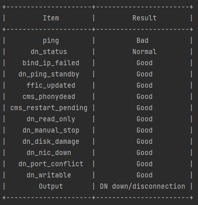

# Cluster Diagnosis<a name="ZH-CN_TOPIC_0000002294471393"></a>

<!-- md-trans-meta sourceCommit=unknown translatedAt=2026-09-07T01:50:03.977Z -->

## Overview<a name="ZH-CN_TOPIC_0000002259861282"></a>

In live-network services, faults must be quickly located and bounded. This feature collects information about each component (such as CMS and DN) in a database instance and its real-time status (such as network connectivity) to determine whether the instance environment has faults and identify the fault root cause. It can be used to implement instance-level fault root cause diagnosis.

DBMind has enhanced cmd-exporter. This version supports log collection for DN, CMS, CMA, ffic, OM\_Monitor, and also supports status collection based on inter-node network connectivity (such as ping). In addition, DBMind sorts out live-network fault scenarios, enumerates and expands the dataset, and ultimately achieves rapid DN fault locating.

>[!NOTE]Note
>Because this feature performs diagnosis based on logs, the time in the diagnosis result may be later than the time when the fault occurred due to log delay or delayed log processing.

**Table 1**  Supported DN fault root cause list

<a name="zh-cn_topic_0000001714829137_table1342813795619"></a>
<table><thead align="left"><tr id="zh-cn_topic_0000001714829137_row045719711563"><th class="cellrowborder" valign="top" width="100%" id="mcps1.2.2.1.1"><p id="zh-cn_topic_0000001714829137_p17861151513"><a name="zh-cn_topic_0000001714829137_p17861151513"></a><a name="zh-cn_topic_0000001714829137_p17861151513"></a>DN Fault Root Cause</p></th>
</tr>
</thead>
<tbody><tr id="zh-cn_topic_0000001714829137_row845747175610"><td class="cellrowborder" valign="top" width="100%" headers="mcps1.2.2.1.1 "><p id="zh-cn_topic_0000001714829137_p58621565113"><a name="zh-cn_topic_0000001714829137_p58621565113"></a><a name="zh-cn_topic_0000001714829137_p58621565113"></a>Unknown.</p></td>
</tr>
<tr id="zh-cn_topic_0000001714829137_row12457167155617"><td class="cellrowborder" valign="top" width="100%" headers="mcps1.2.2.1.1 "><p id="zh-cn_topic_0000001714829137_p178625545119"><a name="zh-cn_topic_0000001714829137_p178625545119"></a><a name="zh-cn_topic_0000001714829137_p178625545119"></a>DN manual stop.</p></td>
</tr>
<tr id="zh-cn_topic_0000001714829137_row1145717795616"><td class="cellrowborder" valign="top" width="100%" headers="mcps1.2.2.1.1 "><p id="zh-cn_topic_0000001714829137_p8862954519"><a name="zh-cn_topic_0000001714829137_p8862954519"></a><a name="zh-cn_topic_0000001714829137_p8862954519"></a>DN disk damage.</p></td>
</tr>
<tr id="zh-cn_topic_0000001714829137_row6457127115618"><td class="cellrowborder" valign="top" width="100%" headers="mcps1.2.2.1.1 "><p id="zh-cn_topic_0000001714829137_p7862115205118"><a name="zh-cn_topic_0000001714829137_p7862115205118"></a><a name="zh-cn_topic_0000001714829137_p7862115205118"></a>DN NIC down.</p></td>
</tr>
<tr id="zh-cn_topic_0000001714829137_row124571720564"><td class="cellrowborder" valign="top" width="100%" headers="mcps1.2.2.1.1 "><p id="zh-cn_topic_0000001714829137_p19862151512"><a name="zh-cn_topic_0000001714829137_p19862151512"></a><a name="zh-cn_topic_0000001714829137_p19862151512"></a>DN port conflict.</p></td>
</tr>
<tr id="zh-cn_topic_0000001714829137_row1645819735616"><td class="cellrowborder" valign="top" width="100%" headers="mcps1.2.2.1.1 "><p id="zh-cn_topic_0000001714829137_p158636519518"><a name="zh-cn_topic_0000001714829137_p158636519518"></a><a name="zh-cn_topic_0000001714829137_p158636519518"></a>DN restarted by cms.</p></td>
</tr>
<tr id="zh-cn_topic_0000001714829137_row19458157125616"><td class="cellrowborder" valign="top" width="100%" headers="mcps1.2.2.1.1 "><p id="zh-cn_topic_0000001714829137_p986311595110"><a name="zh-cn_topic_0000001714829137_p986311595110"></a><a name="zh-cn_topic_0000001714829137_p986311595110"></a>DN phony dead.</p></td>
</tr>
<tr id="zh-cn_topic_0000001714829137_row14581773565"><td class="cellrowborder" valign="top" width="100%" headers="mcps1.2.2.1.1 "><p id="zh-cn_topic_0000001714829137_p188631525110"><a name="zh-cn_topic_0000001714829137_p188631525110"></a><a name="zh-cn_topic_0000001714829137_p188631525110"></a>Core.</p></td>
</tr>
<tr id="zh-cn_topic_0000001714829137_row44179591061"><td class="cellrowborder" valign="top" width="100%" headers="mcps1.2.2.1.1 "><p id="zh-cn_topic_0000001714829137_p3863145205116"><a name="zh-cn_topic_0000001714829137_p3863145205116"></a><a name="zh-cn_topic_0000001714829137_p3863145205116"></a>DN read only.</p></td>
</tr>
<tr id="zh-cn_topic_0000001714829137_row15831114270"><td class="cellrowborder" valign="top" width="100%" headers="mcps1.2.2.1.1 "><p id="zh-cn_topic_0000001714829137_p791432204218"><a name="zh-cn_topic_0000001714829137_p791432204218"></a><a name="zh-cn_topic_0000001714829137_p791432204218"></a>DN down/disconnection.</p></td>
</tr>
<tr id="zh-cn_topic_0000001714829137_row38311543718"><td class="cellrowborder" valign="top" width="100%" headers="mcps1.2.2.1.1 "><p id="zh-cn_topic_0000001714829137_p3863195145119"><a name="zh-cn_topic_0000001714829137_p3863195145119"></a><a name="zh-cn_topic_0000001714829137_p3863195145119"></a>DN Primary disconnected with Standby.</p></td>
</tr>
<tr id="zh-cn_topic_0000001714829137_row14831104276"><td class="cellrowborder" valign="top" width="100%" headers="mcps1.2.2.1.1 "><p id="zh-cn_topic_0000001714829137_p88631595119"><a name="zh-cn_topic_0000001714829137_p88631595119"></a><a name="zh-cn_topic_0000001714829137_p88631595119"></a>DN IP lost.</p></td>
</tr>
</tbody>
</table>

>[!NOTE]Note
>When the cluster status output of the cm\_ctl query is abnormal, a call stack output generally occurs. In this case, it is difficult to obtain the cluster status and the cluster diagnosis result. The related status is marked as "abnormal\_output\_from\_cm\_ctl\_query", and the diagnosis result is Unknown.
>When a DN node is in the Offline state, database instance fault diagnosis is not performed on it. The returned status is Normal, and the status code is -1.

## Usage Guide<a name="ZH-CN_TOPIC_0000002259758184"></a>

When an alarm is generated on a DN instance, a complete command for starting the instance fault analysis function is as follows:

```
gs_dbmind component cluster_diagnosis --conf {confpath} --host {ip_address} --role dn --time "2023-04-20 16:00:00" --method tree
```

After this command is entered, the system reads the log records of the three minutes before the specified time and analyzes the selected DN instance by using the selected method. An example of the analysis result is shown in [Figure 1](#zh-cn_topic_0000001714948973_fig0615168103510).

**Figure 1**  DN instance diagnosis using the selected method<a name="zh-cn_topic_0000001714948973_fig0615168103510"></a>  


The dictionary in the first half of the returned result provides the parsing result of the logs, where Good indicates that the item is normal and Bad indicates that the item is abnormal. The final Output indicates the output result.

>[!NOTE]Note
>
>- A single diagnosis reads the logs and node status of the three minutes before the diagnosis time point. Due to factors such as network latency and model computation time, the actual time is slightly shorter than three minutes. Considering all factors, it is more accurate to use the diagnosis result within 150 seconds as a reference.
>- The network connectivity diagnosis of the cluster fault diagnosis function is determined based on the connectivity between database nodes. For a single-node cluster, there is no connectivity between database nodes, so cluster diagnosis does not support fault diagnosis of single-node clusters.
>- In the database instance diagnosis function, the timeout for determining network connectivity is 1 second. When the network latency reaches 1 second or more, the node is determined to be disconnected.
>- When cluster diagnosis is attempted on a newly managed cluster, a brief network anomaly may occur due to the delay in data collection.

## Getting Help<a name="ZH-CN_TOPIC_0000002294398329"></a>

Module command-line description:

```
gs_dbmind component cluster_diagnosis --help
```

The following help information is displayed:

```
usage: [-h] --conf CONF --host HOST --role {cn,dn} [--time TIME] [--method {logical,tree}]
Cluster diagnosis.
optional arguments:
  -h, --help            show this help message and exit
  --conf CONF           set the directory of configuration files
  --host HOST           set the host of the cluster node, ip only.
  --role {cn,dn}        set the role of instance for diagnosis. roles: [cn]
                        are not supported for centralized DB.
  --time TIME           set time for diagnosis in timestamp(ms) or datetime format
  --method {logical,tree}
                        set method for the model: logical: if-else, tree: xgboost.
```

## Command Reference<a name="ZH-CN_TOPIC_0000002294471397"></a>

**Table 1**  Command-line parameter description

<a name="zh-cn_topic_0000001714949065_table1342813795619"></a>
<table><thead align="left"><tr id="zh-cn_topic_0000001714949065_row045719711563"><th class="cellrowborder" valign="top" width="21.535353535353536%" id="mcps1.2.4.1.1"><p id="zh-cn_topic_0000001714949065_p1245710711563"><a name="zh-cn_topic_0000001714949065_p1245710711563"></a><a name="zh-cn_topic_0000001714949065_p1245710711563"></a>Parameter</p></th>
<th class="cellrowborder" valign="top" width="45.13131313131313%" id="mcps1.2.4.1.2"><p id="zh-cn_topic_0000001714949065_p184571871566"><a name="zh-cn_topic_0000001714949065_p184571871566"></a><a name="zh-cn_topic_0000001714949065_p184571871566"></a>Parameter Description</p></th>
<th class="cellrowborder" valign="top" width="33.333333333333336%" id="mcps1.2.4.1.3"><p id="zh-cn_topic_0000001714949065_p9457678569"><a name="zh-cn_topic_0000001714949065_p9457678569"></a><a name="zh-cn_topic_0000001714949065_p9457678569"></a>Value Range</p></th>
</tr>
</thead>
<tbody><tr id="zh-cn_topic_0000001714949065_row845747175610"><td class="cellrowborder" valign="top" width="21.535353535353536%" headers="mcps1.2.4.1.1 "><p id="zh-cn_topic_0000001714949065_p945713712568"><a name="zh-cn_topic_0000001714949065_p945713712568"></a><a name="zh-cn_topic_0000001714949065_p945713712568"></a>-h, --help</p></td>
<td class="cellrowborder" valign="top" width="45.13131313131313%" headers="mcps1.2.4.1.2 "><p id="zh-cn_topic_0000001714949065_p174574715614"><a name="zh-cn_topic_0000001714949065_p174574715614"></a><a name="zh-cn_topic_0000001714949065_p174574715614"></a>Help command.</p></td>
<td class="cellrowborder" valign="top" width="33.333333333333336%" headers="mcps1.2.4.1.3 "><p id="zh-cn_topic_0000001714949065_p18457187195615"><a name="zh-cn_topic_0000001714949065_p18457187195615"></a><a name="zh-cn_topic_0000001714949065_p18457187195615"></a>-</p></td>
</tr>
<tr id="zh-cn_topic_0000001714949065_row187351049193418"><td class="cellrowborder" valign="top" width="21.535353535353536%" headers="mcps1.2.4.1.1 "><p id="zh-cn_topic_0000001714949065_p173574963416"><a name="zh-cn_topic_0000001714949065_p173574963416"></a><a name="zh-cn_topic_0000001714949065_p173574963416"></a>--conf</p></td>
<td class="cellrowborder" valign="top" width="45.13131313131313%" headers="mcps1.2.4.1.2 "><p id="zh-cn_topic_0000001714949065_p2674747103519"><a name="zh-cn_topic_0000001714949065_p2674747103519"></a><a name="zh-cn_topic_0000001714949065_p2674747103519"></a>Path of the configuration file required for connecting to the time-series database.</p></td>
<td class="cellrowborder" valign="top" width="33.333333333333336%" headers="mcps1.2.4.1.3 "><p id="zh-cn_topic_0000001714949065_p157352049203419"><a name="zh-cn_topic_0000001714949065_p157352049203419"></a><a name="zh-cn_topic_0000001714949065_p157352049203419"></a>-</p></td>
</tr>
<tr id="zh-cn_topic_0000001714949065_row12457167155617"><td class="cellrowborder" valign="top" width="21.535353535353536%" headers="mcps1.2.4.1.1 "><p id="zh-cn_topic_0000001714949065_p205118433215"><a name="zh-cn_topic_0000001714949065_p205118433215"></a><a name="zh-cn_topic_0000001714949065_p205118433215"></a>--host</p></td>
<td class="cellrowborder" valign="top" width="45.13131313131313%" headers="mcps1.2.4.1.2 "><p id="zh-cn_topic_0000001714949065_p126961052143518"><a name="zh-cn_topic_0000001714949065_p126961052143518"></a><a name="zh-cn_topic_0000001714949065_p126961052143518"></a>IP address of the target node to be analyzed.</p></td>
<td class="cellrowborder" valign="top" width="33.333333333333336%" headers="mcps1.2.4.1.3 "><p id="zh-cn_topic_0000001714949065_p1398855873115"><a name="zh-cn_topic_0000001714949065_p1398855873115"></a><a name="zh-cn_topic_0000001714949065_p1398855873115"></a>-</p></td>
</tr>
<tr id="zh-cn_topic_0000001714949065_row1145717795616"><td class="cellrowborder" valign="top" width="21.535353535353536%" headers="mcps1.2.4.1.1 "><p id="zh-cn_topic_0000001714949065_p125010403211"><a name="zh-cn_topic_0000001714949065_p125010403211"></a><a name="zh-cn_topic_0000001714949065_p125010403211"></a>--role</p></td>
<td class="cellrowborder" valign="top" width="45.13131313131313%" headers="mcps1.2.4.1.2 "><p id="zh-cn_topic_0000001714949065_p183154183620"><a name="zh-cn_topic_0000001714949065_p183154183620"></a><a name="zh-cn_topic_0000001714949065_p183154183620"></a>Role of the target node to be analyzed (only DN is supported; using CN triggers an exception prompt).</p></td>
<td class="cellrowborder" valign="top" width="33.333333333333336%" headers="mcps1.2.4.1.3 "><p id="zh-cn_topic_0000001714949065_p11987758123118"><a name="zh-cn_topic_0000001714949065_p11987758123118"></a><a name="zh-cn_topic_0000001714949065_p11987758123118"></a>Currently only {dn} is supported. (Entering cn prompts an exception: cn is not in the instance status.)</p></td>
</tr>
<tr id="zh-cn_topic_0000001714949065_row6457127115618"><td class="cellrowborder" valign="top" width="21.535353535353536%" headers="mcps1.2.4.1.1 "><p id="zh-cn_topic_0000001714949065_p1150749325"><a name="zh-cn_topic_0000001714949065_p1150749325"></a><a name="zh-cn_topic_0000001714949065_p1150749325"></a>--time</p></td>
<td class="cellrowborder" valign="top" width="45.13131313131313%" headers="mcps1.2.4.1.2 "><p id="zh-cn_topic_0000001714949065_p189041222123616"><a name="zh-cn_topic_0000001714949065_p189041222123616"></a><a name="zh-cn_topic_0000001714949065_p189041222123616"></a>Time point when the analyzed exception occurred. The default value is the current time, and the date-time format is %Y-%m-%d %H:%M:%S.</p></td>
<td class="cellrowborder" valign="top" width="33.333333333333336%" headers="mcps1.2.4.1.3 "><p id="zh-cn_topic_0000001714949065_p1095712011916"><a name="zh-cn_topic_0000001714949065_p1095712011916"></a><a name="zh-cn_topic_0000001714949065_p1095712011916"></a>Date and time format or a timestamp in milliseconds.</p></td>
</tr>
<tr id="zh-cn_topic_0000001714949065_row124571720564"><td class="cellrowborder" valign="top" width="21.535353535353536%" headers="mcps1.2.4.1.1 "><p id="zh-cn_topic_0000001714949065_p134912463220"><a name="zh-cn_topic_0000001714949065_p134912463220"></a><a name="zh-cn_topic_0000001714949065_p134912463220"></a>--method</p></td>
<td class="cellrowborder" valign="top" width="45.13131313131313%" headers="mcps1.2.4.1.2 "><p id="zh-cn_topic_0000001714949065_p4331330173617"><a name="zh-cn_topic_0000001714949065_p4331330173617"></a><a name="zh-cn_topic_0000001714949065_p4331330173617"></a>Analysis method. Currently, two methods are provided: the fault location logic model and the decision tree model.</p></td>
<td class="cellrowborder" valign="top" width="33.333333333333336%" headers="mcps1.2.4.1.3 "><p id="zh-cn_topic_0000001714949065_p15986958123113"><a name="zh-cn_topic_0000001714949065_p15986958123113"></a><a name="zh-cn_topic_0000001714949065_p15986958123113"></a>{logical, tree}.</p></td>
</tr>
</tbody>
</table>

## FAQ<a name="ZH-CN_TOPIC_0000002259861290"></a>

If the system fails to return the expected diagnosis result when you attempt to start instance diagnosis, troubleshoot the issue in the following order:

- Check whether the configuration file address required for connecting to the time-series database is entered correctly, whether it contains the log files that instance diagnosis needs to read, whether the account used has the permission to read and write logs, and whether the log files are damaged and can be read and written normally.
- Check whether the IP address of the target node is correct.
- Check whether diagnosis is supported for the selected instance. Instance diagnosis currently supports only DN diagnosis. Also check whether the parameters are entered correctly.
- Check whether the entered time point when the exception occurred conforms to the date and time format. In addition, instance diagnosis supports only diagnosis of the current and past moments, that is, it can target only past events or events related to the current time point.
- Check whether the selected diagnosis method is entered correctly and whether it exceeds the supported range.
- For NIC fault monitoring, it is recommended that cmd-exporter be connected to multiple NICs simultaneously when the time-series database collects data, so that when one NIC fails, the other NICs can still send messages normally.
