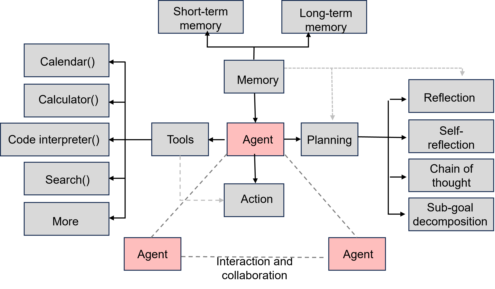

# LLM Agent Technology

<!-- md-trans-meta sourceCommit=unknown translatedAt=2026-09-07T02:00:15.511Z -->

An LLM agent is an intelligent entity that can perceive its environment, make decisions, and execute actions. Unlike traditional artificial intelligence, an LLM agent can think independently and call tools to gradually complete a given goal. An LLM agent usually uses a Q&A robot as the interaction entry, triggering a fully automatic workflow through natural language without human intervention.

An LLM agent mainly has four capabilities: perception, analysis, decision-making, and execution. These capabilities work together to form its basic working principle.

1. Perception: Obtains information about the external environment through sensors, enabling the agent to understand its surroundings.
2. Analysis: Analyzes and processes the perceived information to extract useful features and patterns.
3. Decision-making: The LLM agent makes decisions based on the analysis results and formulates corresponding action plans.
4. Execution: Converts decisions into concrete actions to complete tasks.

Working together, these four capabilities enable the agent to run and execute tasks efficiently in complex environments.

In an LLM-based agent, the LLM acts as the brain of the agent, and there are three key components: **planning**, **memory**, and **tool usage**, as shown in [Figure 1](#fig8331451230).

**Figure 1**  LLM agent architecture  

## Planning

Based on prompting techniques, the agent decomposes large tasks into subtasks and plans the execution flow. It also reflects on the task execution process to decide whether to continue executing the task or to determine that the task is complete and terminate the execution. Common prompting techniques include Chain of Thoughts, Tree of Thoughts, and ReAct (Reasoning And Acting).

## Memory

The memory module stores information, including past interactions, learned knowledge, and even temporary task information. For an agent, an effective memory mechanism ensures that it can draw on past experience and knowledge when facing new or complex situations. Memory is divided into two parts: short-term memory and long-term memory.

- Short-term memory refers to the context during task execution. It is generated and temporarily stored during the execution of subtasks, and is cleared after the task is completed.
- Long-term memory refers to information retained for a long time, generally an external knowledge base, which is usually stored and retrieved using a vector database.

GaussMaster implements multi-turn conversations and parameter follow-up based on short-term memory. Short-term memory is stored in the openGauss metadata database. For its structure definition, see [Table 5](appendix.md#zh-cn_topic_0000002207300310_table15200116175319) in the appendix in Chapter 5.

## Tool Usage

A significant difference between an agent and an LLM is that the former can use external tools to extend its capabilities. By integrating various tool APIs into the agent, such as slow SQL diagnosis, index recommendation, cluster diagnosis, and database query tools, the agent can interact with the physical world and solve actual database problems.
