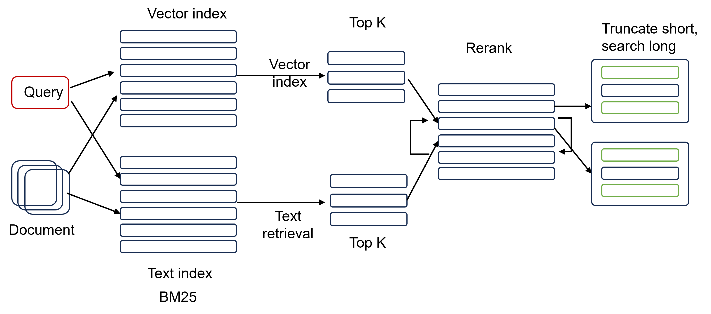
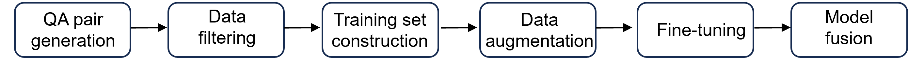
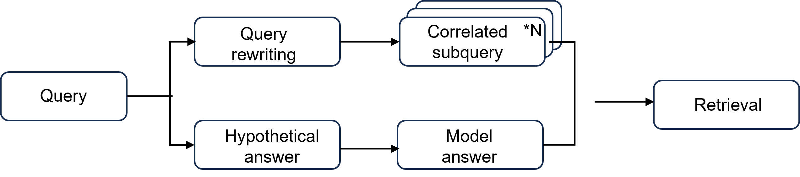
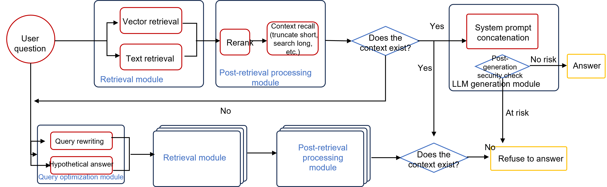

# LLM RAG Technology

<!-- md-trans-meta sourceCommit=unknown translatedAt=2026-09-07T02:01:06.203Z -->

Retrieval-augmented generation (RAG) optimizes the output of a large language model so that it can reference an authoritative knowledge base outside its training data sources before generating a response. LLMs are trained on massive amounts of data and use billions of parameters to generate original output for tasks such as answering questions, translating languages, and completing sentences. Building on the already powerful capabilities of LLMs, RAG extends them to access domain-specific or organizational internal knowledge bases, all without retraining the model. This is a cost-effective way to improve LLM output, keeping it relevant, accurate, and useful in various contexts.

GaussMaster builds the openGauss knowledge base and uses RAG technology to obtain knowledge chunks related to a query from the knowledge base to construct context, providing the LLM with additional relevant background knowledge. This improves the quality of LLM-generated answers, reduces hallucinations, and enhances user experience. The RAG technology involves optimization of queries, retrieval, and models. The specific implementation design of each module is described below.

## Retrieval Module

The main function of the retrieval module is to retrieve the most relevant knowledge chunks from the knowledge base based on the user query. Currently, the industry mainly adopts the vector retrieval solution, which calculates the similarity between the query vector and the knowledge chunk vectors and selects the top K most relevant documents as the context information. However, the similarity between vectors does not necessarily reflect the true semantic similarity, and it is difficult to guarantee the retrieval recall rate by relying solely on vectorization. Therefore, GaussMaster proposes a solution that combines retrieval and reranking. On the basis of vector retrieval, it introduces text retrieval and reranks all retrieval results to obtain the final retrieval results. The introduction of text retrieval addresses the shortcomings of vector retrieval in searching for person names and phrases. It retrieves the corresponding results through keyword matching. After multi-path retrieval, the reranking model determines the similarity between the query and the documents, ranks the most relevant information first, and improves the recall rate of the retrieval module. The overall process of the retrieval module is shown in [Figure 1](#fig060842511242):

**Figure 1**  Overall process flowchart of the retrieval module  

The parts are described as follows:

1. Index construction: For the segmented knowledge chunks, perform vectorization and text tokenization respectively, and then build the vector and text indexes.
2. Vector retrieval: For the user query, perform vectorization and then similarity matching to obtain the knowledge chunks with the highest similarity as the vector retrieval topK.
3. Text retrieval: For the user query, use the BM25 algorithm for text similarity matching to obtain the knowledge chunks with the highest similarity as the text retrieval topK.
4. Rerank: For the topK results of multi-path retrieval, construct QA pairs with the user query, pass them to the reranking model, calculate the relevance between the query and the knowledge chunks, use a threshold to filter out the results with low relevance, and rerank the most relevant topK results.
5. Truncate short, search long: For the reranked knowledge chunks, obtain and integrate the adjacent knowledge chunks respectively to enrich the context information and improve the quality of the answers generated by the LLM.

## Model Fine-Tuning

In the fused retrieval scheme, an embedding model is used to vectorize knowledge for subsequent vector similarity calculation, and a reranking model is used to rank the relevance between the query and knowledge chunks across multiple retrieval results, so as to extract the most relevant knowledge chunks. However, general-purpose embedding models are trained on open-source corpora and have no knowledge of Gauss databases. As a result, semantics are lost after vectorization, preventing similarity calculation from achieving optimal results. Similarly, because the reranking model is also trained on open-source corpora, it cannot understand Gauss knowledge when judging the relevance between a query and knowledge chunks, leading to disordered ranking and thus reducing the recall rate of the retrieval module. Therefore, Gauss database knowledge must be used to fine-tune the models so that their performance improves when processing relevant data. The main process of model fine-tuning is shown in [Figure 1](#fig1419564143512).

**Figure 1**  Model fine-tuning flowchart  

The parts are described as follows:

1. QA pair generation: Based on Gauss database documentation and O&M documentation, a point-question-answer chain of thought is constructed, and an LLM is used to generate basic question-answer pairs step by step.
2. Data filtering: Vector retrieval is performed using the questions in the question-answer pairs. If the answer is not in the top 5 results, the question-answer pair is discarded.
3. Training set construction: The question-answer pairs are randomly shuffled and split into a training set and a test set at a ratio of 1:9.
4. Data augmentation: Vector retrieval is performed using the questions in the question-answer pairs, and the top 200 results are obtained. The top 5 results and the answer are discarded, and then a certain proportion is sampled as hard negatives.

    >[!NOTE]Note 
    >A hard negative, in the fields of machine learning and information retrieval, refers to a negative sample that is difficult for a model to classify correctly. These samples are very close to certain positive samples in the feature space, or the model has high confidence in predicting them but they are actually negative samples. Hard negatives are particularly important for model training because they provide more information and help the model better learn and distinguish samples with blurred or easily confused boundaries.

5. Fine-tuning: In each training round, hard negatives are randomly sampled to ensure the diversity of negative samples, and parameters such as the learning rate and batch\_size are adjusted for model tuning.
6. Model fusion: To avoid model overfitting, the base model and the fine-tuned model can be fused by weight.

## Query Optimization Module

When a user enters a query, colloquial or unclear expression may prevent relevant knowledge chunks from being retrieved. Therefore, a query optimization module is introduced to rewrite the user query. GaussMaster introduces two schemes, query rewriting and hypothetical answer, to transform the query separately, generate appropriate query content for retrieval, expand the retrieved knowledge chunks, and improve the recall rate of the retrieval module. The main process of query optimization is shown in [Figure 1](#fig7240516184920).

**Figure 1**  Query optimization flowchart  

The parts are described as follows:

1. Query rewriting: For the original query, first construct a query rewriting prompt and pass it to the LLM to generate multiple related subqueries;
2. Hypothetical answer: For the original query, construct a hypothetical answer prompt, and the LLM provides an answer based on its knowledge;
3. Retrieval: Retrieve the query rewriting result and the hypothetical answer result separately to obtain relevant contexts, re-rank them, and select the most relevant result as the context for subsequent answer generation.

## End-to-End Q&A Process

Based on the preceding three modules, GaussMaster provides an end-to-end Q&A process, as shown in [Figure 1](#fig1172673785210).

**Figure 1**  End-to-end Q&A process flowchart  

The process is as follows:

1. When a user asks a question, the corresponding query first passes through the retrieval module for vector retrieval and text retrieval to obtain relevant information from the vector knowledge base;
2. The retrieval processing module re-ranks the retrieval results and obtains the context through methods such as chunk-shortening and context-lengthening;
3. Check whether the context exists;
    1. If the retrieved context exists, the query and context are concatenated into a prompt, which is then passed to the LLM. After a security check, if no risk is detected, the answer is generated; if risky information exists, the answer is refused;
    2. If the retrieved context does not exist, query optimization is performed on the user's question. Multiple subqueries are generated through query rewriting and hypothetical answer methods, and then the relevant context is obtained through the retrieval and retrieval post-processing modules. If the relevant context does not exist, the answer is refused; if it exists, the query and context are concatenated into a prompt, and the LLM performs a security check. If a risk exists, the answer is refused; otherwise, the generated answer is returned.

In addition, because LLM generation involves a certain degree of randomness, the effectiveness and completeness of answers may vary. Therefore, GaussMaster provides a feedback channel. Users can like correct and complete answers and report unfriendly answers, and the corresponding feedback is passed to GaussMaster to help it iterate and improve in the future, enhancing the accuracy and completeness of Q&A.
