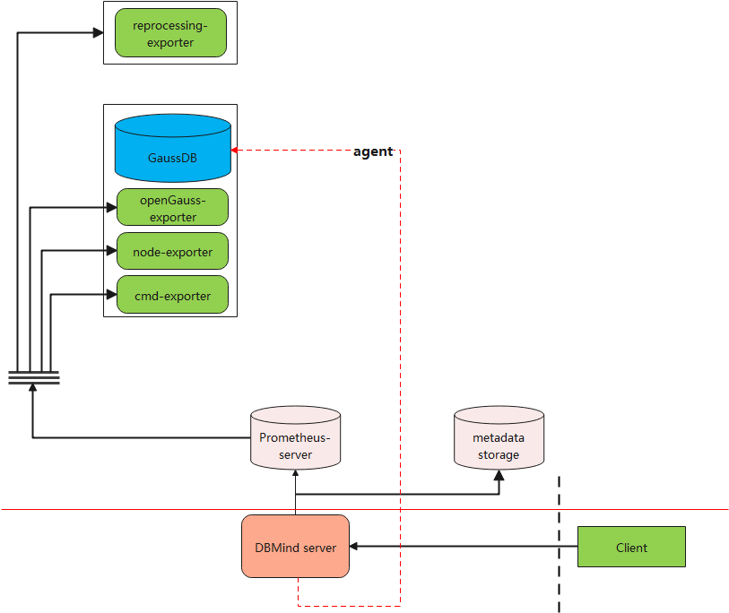

# Product Design

<!-- md-trans-meta sourceCommit=unknown translatedAt=2026-09-07T02:10:21.083Z -->

## Architecture Design<a name="ZH-CN_TOPIC_0000002293420737"></a>

The DBMind monitoring platform is based on the open-source Prometheus and provides data producer exporters that can be integrated with the Prometheus platform. The DBMind service architecture is shown in [Figure 1 DBMind service architecture](#fig3224154930):

**Figure 1**  DBMind service architecture<a name="fig3224154930"></a>  


The key components in the figure are described as follows:

- DBMind server: the DBMind backend service, which can be used for periodic offline computing, including slow SQL root cause analysis and time-series forecasting.
- Prometheus-server: the server that stores Prometheus monitoring metrics.
- Metadata storage: the database where DBMind stores the computing results after offline computing is complete. It supports the openGauss database.
- Client: the client through which users read the DBMind offline computing results. Currently, this client supports command-line and Web API operations.
- openGauss-exporter: collects monitoring metrics from openGauss database nodes for DBMind service computing, and acts as an agent to execute SQL statements on managed instances.
- node-exporter: an exporter officially provided by Prometheus, which can be used to monitor system metrics of the corresponding node, such as CPU and memory usage.
- reprocessing-exporter: used to reprocess the metrics collected by Prometheus, for example, to calculate the CPU usage.
- cmd-exporter: used to collect command line and log metrics.

## Security Design<a name="ZH-CN_TOPIC_0000002293307681"></a>

DBMind is an autonomous component of the openGauss database and must be deployed independently of the database. During deployment, communication interactions occur. For the interactive parts, the SSL protocol can be used for security hardening.

### Security Hardening of the Data Collection Component exporter<a name="section45844591147"></a>

An exporter is a component used to collect metrics such as database information. The exporter components developed by DBMind include openGauss-exporter and reprocessing-exporter.

The preceding exporter components are designed and implemented based on the Prometheus protocol, which is the de facto standard in the time-series monitoring field. The interaction interface of Prometheus uses the HTTP protocol by default and can be hardened to the HTTPS protocol through the SSL protocol. The DBMind exporters support the HTTPS protocol by default, and users need to manually specify the SSL certificate file, key file, CA file, and so on.

To use the SSL protocol, configure the corresponding certificate files for the following command-line parameters:

**Table 1**  Command-line parameters that need to be configured for the exporter to use the SSL protocol

<a name="table1842112341618"></a>
<table><thead align="left"><tr id="row88431233167"><th class="cellrowborder" valign="top" width="50%" id="mcps1.2.3.1.1"><p id="p1884312316164"><a name="p1884312316164"></a><a name="p1884312316164"></a>Command-Line Parameter</p></th>
<th class="cellrowborder" valign="top" width="50%" id="mcps1.2.3.1.2"><p id="p9843192318162"><a name="p9843192318162"></a><a name="p9843192318162"></a>Description</p></th>
</tr>
</thead>
<tbody><tr id="row58431423121610"><td class="cellrowborder" valign="top" width="50%" headers="mcps1.2.3.1.1 "><p id="p11843112315164"><a name="p11843112315164"></a><a name="p11843112315164"></a>--ssl-certfile</p></td>
<td class="cellrowborder" valign="top" width="50%" headers="mcps1.2.3.1.2 "><p id="p6843122371611"><a name="p6843122371611"></a><a name="p6843122371611"></a>SSL certificate file.</p></td>
</tr>
<tr id="row1984314239167"><td class="cellrowborder" valign="top" width="50%" headers="mcps1.2.3.1.1 "><p id="p98431523111616"><a name="p98431523111616"></a><a name="p98431523111616"></a>--ssl-keyfile</p></td>
<td class="cellrowborder" valign="top" width="50%" headers="mcps1.2.3.1.2 "><p id="p18843023181616"><a name="p18843023181616"></a><a name="p18843023181616"></a>SSL key file.</p></td>
</tr>
<tr id="row9843182320164"><td class="cellrowborder" valign="top" width="50%" headers="mcps1.2.3.1.1 "><p id="p2843123121616"><a name="p2843123121616"></a><a name="p2843123121616"></a>--ssl-ca-file</p></td>
<td class="cellrowborder" valign="top" width="50%" headers="mcps1.2.3.1.2 "><p id="p7843102314168"><a name="p7843102314168"></a><a name="p7843102314168"></a>CA certificate file.</p></td>
</tr>
</tbody>
</table>

For example, users can configure reprocessing-exporter by running the following command:

```
gs_dbmind component reprocessing_exporter 127.0.0.1 9090 --web.listen-address 127.0.0.1 --web.listen-port 8181 --ssl-certfile /path/to/cert --ssl-keyfile /path/to/keyfile --ssl-ca-file /path/to/ca
```

If the user configures a CA certificate for the SSL protocol, two-way authentication is used, and the corresponding certificate file must also be configured on the Prometheus collection side. For details, see the [Prometheus official website](https://prometheus.io/docs/prometheus/latest/configuration/configuration/#tls_config).

### Security Hardening of the Time-Series Data Retrieval Process<a name="section13702193818172"></a>

DBMind Service can also retrieve time-series data from Prometheus, and this channel can also be hardened by using the SSL protocol. Prometheus supports the HTTPS protocol by default. For details about how to configure the HTTPS protocol for Prometheus, see the [official Prometheus website](https://prometheus.io/docs/prometheus/latest/configuration/https/).

In the configuration file directory generated on the DBMind side, manually modify the dbmind.conf file, configure the part related to Prometheus data collection, and set this process to use a secure protocol. For example:

```
[TSDB]
name = prometheus # The type of time-series database. Options: prometheus, influxdb.
host =  # Address of time-series database.
port =  # Port to connect to time-series database.
username = (null) # User name to connect to time-series database.
password = (null) # Password to connect to time-series database.
ssl_certfile = (null) # The certificate file for ssl connections.
ssl_keyfile = (null) # Certificate private key file.
ssl_keyfile_password = (null) # Password for ssl keyfile.
ssl_ca_file = (null)  # CA certificate to validate requests.
```

You can modify the values of the ssl\_certfile, ssl\_keyfile, ssl\_keyfile\_password, and ssl\_ca\_file options in the preceding configuration file to configure the SSL certificate file, SSL key file, SSL key file password, and CA certificate file, respectively.

### DBMind Service Security Hardening<a name="section1840683017186"></a>

DBMind Service provides services through RESTful API interfaces and supports HTTPS by default. Users manually modify the dbmind.conf file in the configuration file directory, configure the WEB-SERVICE section, and set the process to use a secure protocol. When SSL is set to true, users must configure the SSL certificate path. When SSL is set to false and no SSL certificate path is configured, HTTP is used and a risk warning is displayed. When SSL is set to false but a certificate path is configured, HTTPS is used preferentially. For example:

```
[WEB-SERVICE]
ssl = true # Using secure protocol by default, users must provide a certificate path. Otherwise, the DBMind process cannot start.
host = 127.0.0.1  # Which host to bind for web service. '0.0.0.0' means to bind all.
port = 8080  # Port to listen for web serivce.
ssl_certfile = (null) # The certificate file for ssl connections.
ssl_keyfile = (null) # Certificate private key file.
ssl_keyfile_password = (null) # Password for ssl keyfile.
ssl_ca_file = (null)  # CA certificate to validate requests.
```
