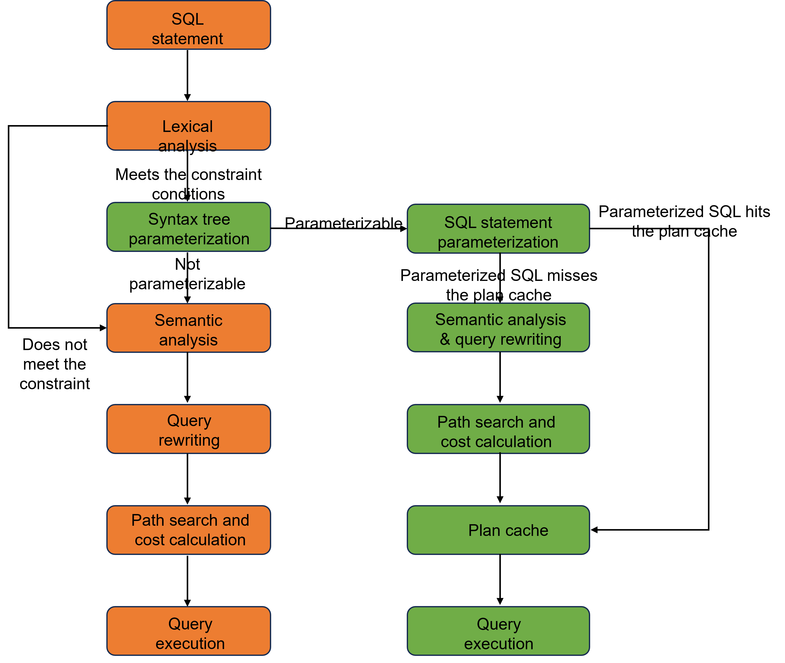

# Automatic Parameterization

<!-- md-trans-meta sourceCommit=unknown translatedAt=2026-09-06T11:05:42.861Z pushedAt=2026-09-22T11:12:32.606Z -->

## Availability<a name="section3480125215592"></a>

This feature has been available since openGauss 7.0.0-RC1.

## Feature Overview<a name="section5814522588"></a>

The automatic parameterization feature of openGauss reduces the execution time of SQL statements by reusing the execution plan cache in scenarios where similar or identical simple SQL statements need to be executed repeatedly.



## Customer Benefits<a name="section148987345722"></a>

Improves performance when a large number of similar simple SQL statements are executed repeatedly.

## Feature Description<a name="section117041846599"></a>

In scenarios where a large number of similar/repeated simple SQL statements exist, the SQL statements are parameterized and used as keys, and the corresponding execution plans are cached. Subsequently, the corresponding execution plan cache can be directly located through the same parameterized SQL statement, thereby reducing the time consumed in the query rewrite and plan generation steps during SQL statement execution.


## Feature Enhancements<a name="section23349265924"></a>

- In 7.0.0-RC2, view support was added. When automatic parameterization is enabled, parameterized statements can be queried through the view function `query_parameterization_views()`.
- In 7.0.0-RC3, GPC (Global Plan Cache) support was added. When GPC is enabled and the parameterization feature is used, parameterized statements are also cached in GPC (when the execution plan uses a Generic Plan). They can be queried through the view `DBE_PERF.GLOBAL_PLANCACHE_STATUS`.

## Feature Constraints<a name="section51513617598"></a>

- Supports only INSERT, UPDATE, DELETE (DML) and SELECT statements that contain WHERE (DQL).
- Supports only the Simple Query Protocol, and does not support the Extended Query Protocol.
- The length of an SQL statement must be less than or equal to 512.
- Does not support the RETURNING keyword.
- Does not support the WITH clause.
- Does not support the UPSERT clause.
- Does not support hints.
- Does not support subqueries.
- Does not support the ORDER BY keyword.
- Does not support the LIMIT keyword.
- Does not support functions.
- Does not support the COLLATE keyword.
- Does not support type conversion of values.
- Does not support the NULL keyword.
- Does not support the IGNORE keyword.
- Does not support the DEFAULT VALUES and DEFAULT keywords.
- Does not support the USING keyword.
- Does not support the ON DUPLICATE KEY UPDATE syntax.
- Does not support the PARTITION keyword.
- The JOIN keyword is not supported.
- Statements containing arrays are not supported.
- Statements containing implicit type conversion are not supported.
- Only single-table queries, inserts, and updates are supported.
- When enable_ignore_case_in_quotes = on, parameterization does not take effect.
- When td_compatible_truncation = on, parameterization does not take effect.
- Statements operating on partitioned tables, temporary tables, system tables, compressed tables, views, or unlogged tables are not parameterized.

## Dependencies<a name="section20491151513600"></a>

None.

## Usage Guide<a name="section20491151514123"></a>

The automatic parameterization feature is controlled by session-level GUC parameters. After the related parameters are enabled, SQL statements that meet the conditions are processed through automatic parameterization. For information about setting the following parameters, see [here](../database_reference/other_optimizer_options.md).

- **Enable automatic parameterization**

```
SET ENABLE_QUERY_PARAMETERIZATION=ON;
```
