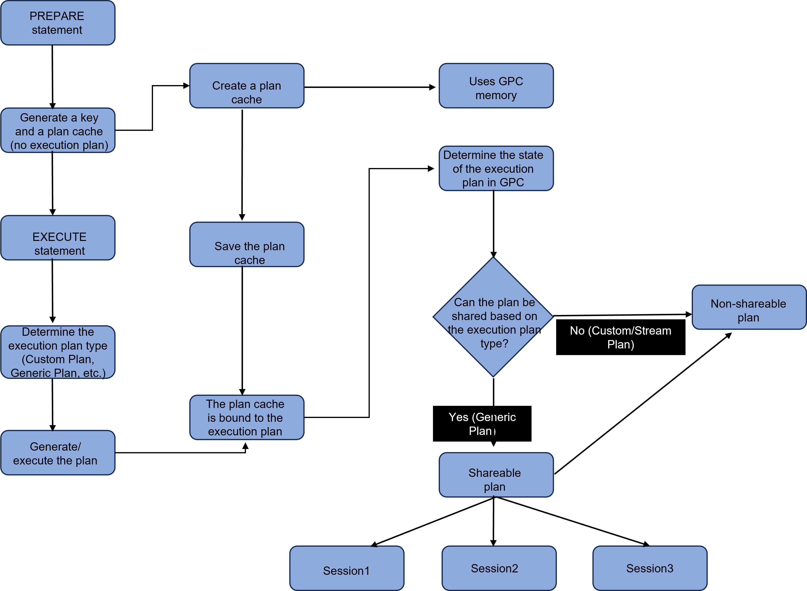
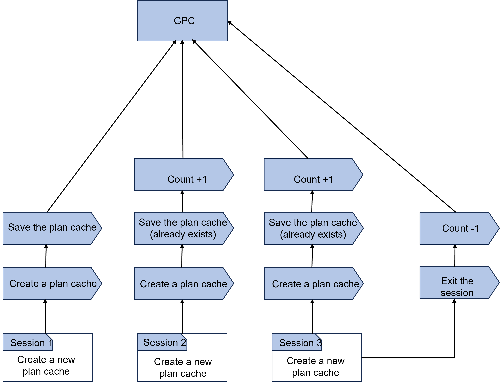

# Global Plan Cache

<!-- md-trans-meta sourceCommit=unknown translatedAt=2026-09-06T11:11:24.262Z pushedAt=2026-09-22T11:12:32.628Z -->

## Availability<a name="section3480125215594"></a>

This feature has been available since openGauss 1.0.0.

## Feature Overview<a name="section3480125215595"></a>

Global Plan Cache (GPC) is an optimization feature for execution plan caching. It allows execution plan caches to be shared across sessions, thereby saving memory space, avoiding repeated plan generation, and improving performance.
When this feature is enabled, execution plan caches that meet specific conditions can be shared across different sessions. After an execution plan is generated in one session, other sessions can also use it, avoiding repeated generation and the storage of multiple copies of the execution plan. You can query `DBE_PERF.GLOBAL_PLANCACHE_STATUS` to view which execution plan caches are currently being shared. Different sessions connected to the same openGauss Server obtain the same result.

## Customer Benefits<a name="section3480125215596"></a>

In scenarios with multiple connections that require the execution plan cache, this feature reduces memory usage and improves performance.

## Feature Description<a name="section3480125215597"></a>

After this feature is enabled, new execution plan caches are saved to GPC-related memory for management. Whenever a new execution plan cache is saved, the database first determines whether the execution plan can be shared. If it can, in addition to the original saving process, the related information of the execution plan is also saved in a GPC hash table, and the information of the execution plan can be found through a unique key. If it cannot, the execution plan is saved in basically the same way as the original process.



When an execution plan that has already been cached in one session is cached again by another session, the database first checks the GPC hash table to see whether the same execution plan exists. If it exists, the execution plan is not cached again.



## Feature Enhancements<a name="section3480125215598"></a>

None.

## Feature Constraints<a name="section3480125215599"></a>

- The thread pool must be enabled.
- An execution plan is globally cached only when the execution plan cache uses a Generic Plan. Other plan types (such as Custom Plan and Stream Plan) are not globally cached and remain visible only to the current session.

## Dependencies<a name="section3480125215600"></a>

None.

## Usage Guide<a name="section3480125215601"></a>

Before use, see [GLOBAL_PLANCACHE_STATUS](../sql_reference/global_plancache_status.md) and [GLOBAL_PLANCACHE_CLEAN](../sql_reference/global_plancache_clean.md).

Prerequisites

- Enable `enable_thread_pool` and `enable_global_plancache`.
- Set `enable_pbe_optimization = on`.

```sql
openGauss=# show enable_thread_pool;
 enable_thread_pool 
--------------------
 on
(1 row)

openGauss=# show enable_global_plancache;
 enable_global_plancache 
-------------------------
 on
(1 row)

openGauss=# set enable_pbe_optimization = on;
SET
openGauss=# show enable_pbe_optimization;
 enable_pbe_optimization 
-------------------------
 on
(1 row)

openGauss=# drop table if exists t1;
DROP TABLE
openGauss=# create table t1(id int,v1 int,v2 int,v3 varchar(255));
CREATE TABLE
openGauss=# PREPARE st1 AS INSERT INTO t1 VALUES($1, $2, $3, $4);
PREPARE
openGauss=# EXECUTE st1(1, 2, 3, 'abcd');
INSERT 0 1
openGauss=# select * from dbe_perf.global_plancache_status;
 nodename |                         query                         | refcount | valid | databaseid |  schema_name   | params_num | func_id 
----------+-------------------------------------------------------+----------+-------+------------+----------------+------------+---------
 node3    | PREPARE st1 AS INSERT INTO t1 VALUES($1, $2, $3, $4); |        1 | t     |      16337 | "$user",public |          4 |       0
(1 row)

-- Open session 2.

openGauss=# set enable_pbe_optimization = on;
SET
-- No attempt to save the plan cache; refcount is 1 at this point.
openGauss=# select * from dbe_perf.global_plancache_status;
 nodename |                         query                         | refcount | valid | databaseid |  schema_name   | params_num | func_id 
----------+-------------------------------------------------------+----------+-------+------------+----------------+------------+---------
 node3    | PREPARE st1 AS INSERT INTO t1 VALUES($1, $2, $3, $4); |        1 | t     |      16337 | "$user",public |          4 |       0
(1 row)

-- Save the plan cache.
openGauss=# PREPARE st1 AS INSERT INTO t1 VALUES($1, $2, $3, $4);
PREPARE
openGauss=# EXECUTE st1(1, 2, 3, 'abcd');
INSERT 0 1
-- The count is 2 at this point.
openGauss=# select * from dbe_perf.global_plancache_status;
 nodename |                         query                         | refcount | valid | databaseid |  schema_name   | params_num | func_id 
----------+-------------------------------------------------------+----------+-------+------------+----------------+------------+---------
 node3    | PREPARE st1 AS INSERT INTO t1 VALUES($1, $2, $3, $4); |        2 | t     |      16337 | "$user",public |          4 |       0
(1 row)

-- Return to session 1 to query.
-- At this point, the count in session 1 is 2.
openGauss=# select * from dbe_perf.global_plancache_status;
 nodename |                         query                         | refcount | valid | databaseid |  schema_name   | params_num | func_id 
----------+-------------------------------------------------------+----------+-------+------------+----------------+------------+---------
 node3    | PREPARE st1 AS INSERT INTO t1 VALUES($1, $2, $3, $4); |        2 | t     |      16337 | "$user",public |          4 |       0
(1 row)

-- Exit session 2.
-- At this point, the count is decremented by 1.
openGauss=# \q

-- View in session 1.
-- At this point, the count is 1.
openGauss=# select * from dbe_perf.global_plancache_status;
 nodename |                         query                         | refcount | valid | databaseid |  schema_name   | params_num | func_id 
----------+-------------------------------------------------------+----------+-------+------------+----------------+------------+---------
 node3    | PREPARE st1 AS INSERT INTO t1 VALUES($1, $2, $3, $4); |        1 | t     |      16337 | "$user",public |          4 |       0
(1 row)

-- Exit session 1.
openGauss=# \q
-- Reopen the session and query the view.
-- The count is 0.
openGauss=# select * from dbe_perf.global_plancache_status;
 nodename |                         query                         | refcount | valid | databaseid |  schema_name   | params_num | func_id 
----------+-------------------------------------------------------+----------+-------+------------+----------------+------------+---------
 node3    | PREPARE st1 AS INSERT INTO t1 VALUES($1, $2, $3, $4); |        0 | t     |      16337 | "$user",public |          4 |       0
(1 row)

-- Drop the table.
openGauss=# drop table t1;
DROP TABLE

-- Query the view again; the record disappears.
openGauss=# select * from dbe_perf.global_plancache_status;
 nodename | query | refcount | valid | databaseid | schema_name | params_num | func_id 
----------+-------+----------+-------+------------+-------------+------------+---------
(0 rows)
```
