# Resource Pooling Multi-Node Parallelism

<!-- md-trans-meta sourceCommit=unknown translatedAt=2026-09-06T11:24:31.963Z pushedAt=2026-09-22T11:12:32.693Z -->

## Availability

This feature has been available since openGauss 6.0.0-RC1.

## Feature Overview

SPQ (SharedEverything Parallel Query) is a multi-node parallel query framework built on the openGauss open-source database. This framework is deployed in a resource pooling scenario, where the cluster uses a one-write-multiple-read architecture with one write/read node and multiple read nodes. In the existing openGauss cluster, only one read node can perform queries at a time, which severely limits the cluster's query performance. SPQ is based on the SharedEverything distributed architecture, in which all nodes share the resources within the cluster. The optimizer first generates a multi-node execution plan, which is then distributed to each node for execution. The query node then aggregates the data from each node to enable parallel queries across all read nodes, fully leveraging the cluster's OLAP capabilities. This gives resource pooling strong TP and AP capabilities at the same time.

**Figure 1**  Resource pooling multi-node parallelism solution  

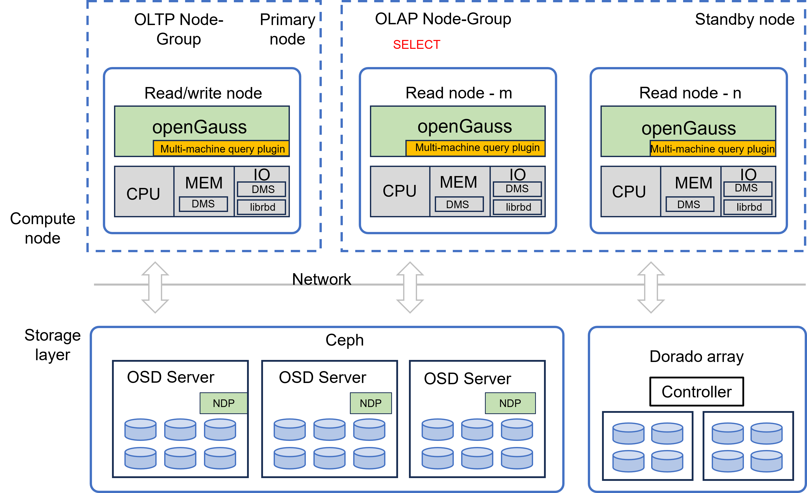

## Customer Benefits

When customers execute large-scale data queries on a read node, only the computing power of the current query node is actually used, while the computing power of the remaining nodes is not effectively utilized. Multi-machine parallelism can fully utilize the computing power of all compute nodes, thereby greatly improving query efficiency.

## Feature Description

The openGauss resource pooling one-write-multi-read architecture isolates OLTP and OLAP workloads by building a virtual Node-Group. Any node can initiate SQL query requests. Based on cost and rules, the system decides whether to use a multi-node query or a native single-node query, which is transparent to upper-layer applications and imperceptible to users. To meet the preceding requirements, SPQ develops the following new features on top of the original openGauss design:

- Connects to the open-source ORCA optimizer to generate SPQ multi-node parallel execution plans. The adapted components are loaded into the openGauss kernel as dynamic libraries.

- Adds basic scan operators and compute operators to adapt to multi-node plans, implementing inter-node data exchange and data distribution.

- Adds an adaptive scan mechanism to eliminate data skew.

- Supports DML and DDL enhancements.

### 1. Connecting to the Distributed Optimizer

The GPORCA optimizer, an open-source component developed by the GreenPlum community, is used and adapted to openGauss to generate multi-node execution plans. The adapted component is invoked by openGauss multi-node queries in the form of a dynamic library. Because ORCA itself is already modularized with interface-based input and output, during adaptation we only apply the corresponding adaptation logic to the blue-boxed part in the following figure. The core changes include:

- For the resource pooling storage feature, extend the scan node generation scheme and adjust the table data scan range.

- Based on shared storage, match the corresponding cost model and generate a distributed scan plan.

**Figure 2**  openGauss integration with ORCA
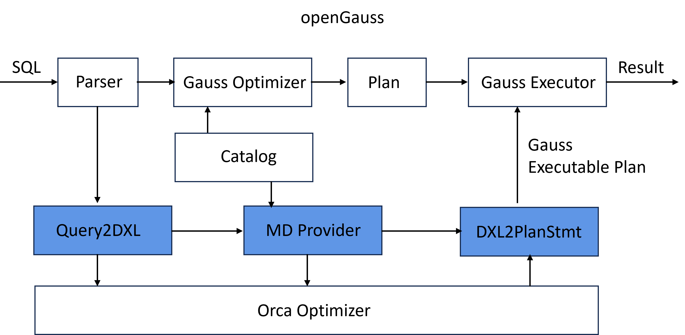

### 2. Multi-Node Parallel Execution Framework

1) Node logic adaptation: By adapting the existing openGauss distributed execution process, the logical concepts of QC (Query Coordinator) and QE (Query Executor) are introduced into the resource-pooled cluster, matching the CN/DN roles. Any node in the cluster that initiates a query request can become a QC, and QEs can also be dynamically configured through GUC parameters.

    **Figure 3**  SPQ working cluster
    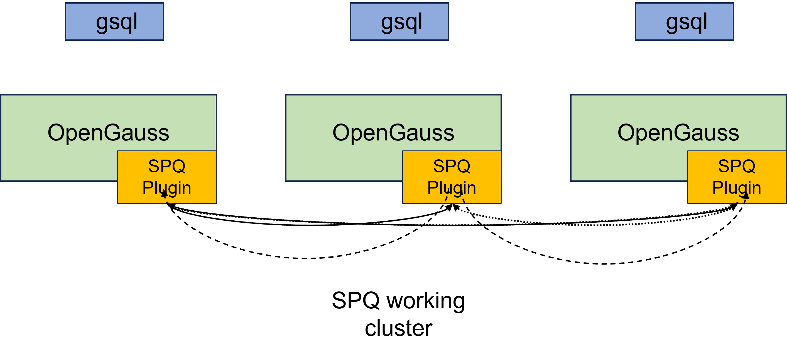

2) Adaptive scan: SPQ is designed with an adaptive scan mechanism that no longer restricts each Worker to scanning specific IDs. It adopts a request-response mode and, through the specific RPC communication mechanism between the QC process and QE Worker processes, the QC process is responsible for informing each Worker process of the scannable tasks, thereby eliminating the problem of computational data skew.

    **Figure 4**  Adaptive scan
    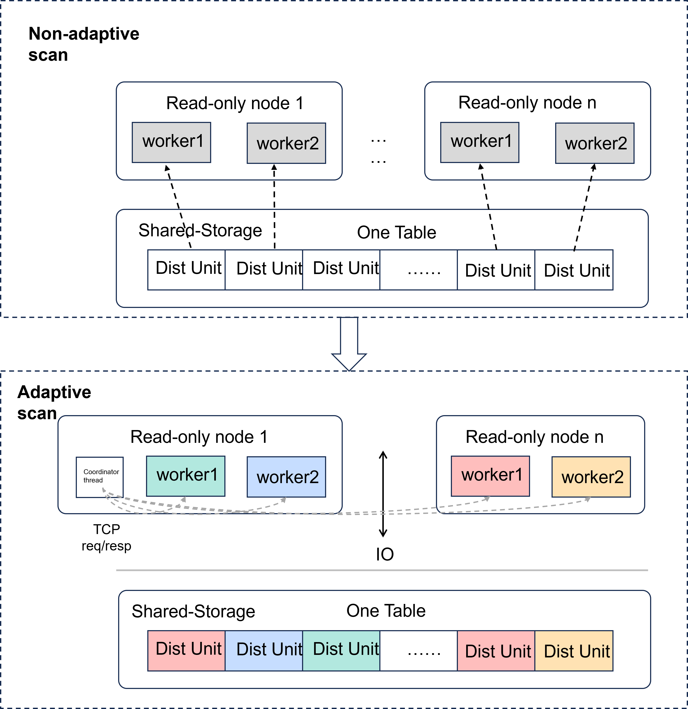

3) Basic operator support: The SPQ multi-node parallel executor provides support for parallelizing the original basic operators (Scan, Join, Aggregate, Sort, etc.) and Stream operators (Gather/Broadcast/Redistribute). Based on the implementation of the original operators, to ensure that the split reading of data between nodes and the execution process fully adapt to the distributed execution plan generated by ORCA, the following operators are added/modified:

- Scan operators: Four operators, SpqSeqScan, SpqIndexScan, SpqIndexOnlyScan, and SpqBitmapHeapScan, are added to adapt to the distributed scan range.

- Computation operators: Distributed FinalAgg and PartialAgg computation logic for Aggregate is added. The HashJoin operator supports the LASJ_NOTIN semi-join branch generated by Orca.

- Shuffle operators: SpqRemoteQuery and Redistribute operators are added to adapt to the distributed plan.

**Figure 5**  TPC-H performance comparison

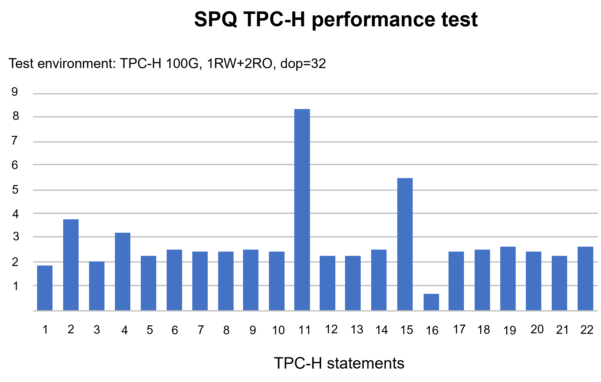

This test used the 22 standard TPC-H statements with a test data volume of 100 GB. In the resource pooling (one primary and two standby) scenario, SPQ and openGauss native statements were executed, achieving an overall performance improvement of about 2.58 times.

### 3. Multi-Node Parallel DDL Enhancement

The basic principle of creating an index in openGauss is to scan and sort the original table data, generate index pages in memory, and write the page data to disk. SPQ uses multi-node parallelism to accelerate the scanning and sorting of the original data during index creation, thereby improving the performance of index creation. Currently, SPQ multi-node parallel btree index creation and btree online (concurrently) index creation are supported.

**Figure 6**  SPQ create index design solution

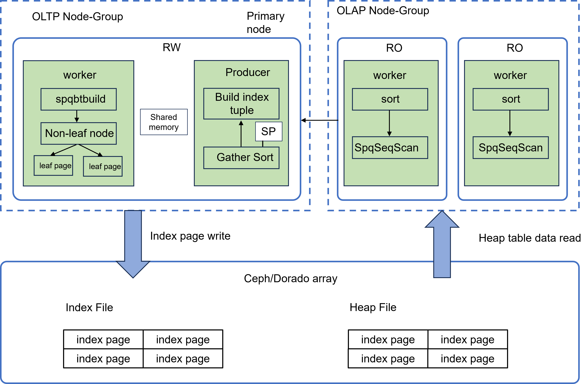

**Figure 7**  Create index performance comparison

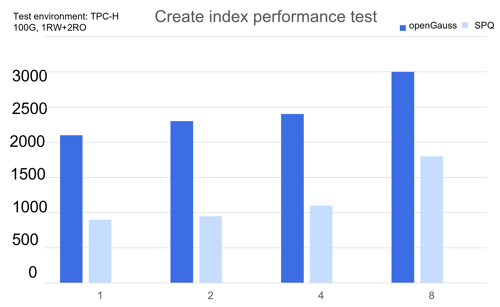

For the create index test on 100 GB of data, executing the SPQ and openGauss create index statements in the resource pooling (one primary and two standby) scenario improves the overall performance by about 2 times.

### 4. Multi-Node Parallel DML Enhancement

In openGauss, DML mainly consists of two parts: Finding data and writing data that meets the requirements. SPQ uses multi-node parallelism to accelerate data reads and writes, improving query performance through multiple read-only nodes and thereby improving DML performance. Currently, multi-node parallel DML supports single-thread writes (insert, delete, and update).

**Figure 8**  SPQ DML design solution

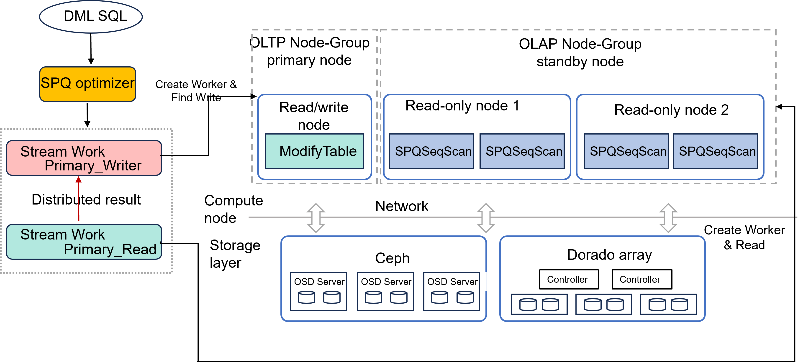

- Insert

**Figure 9**  SPQ Insert performance test

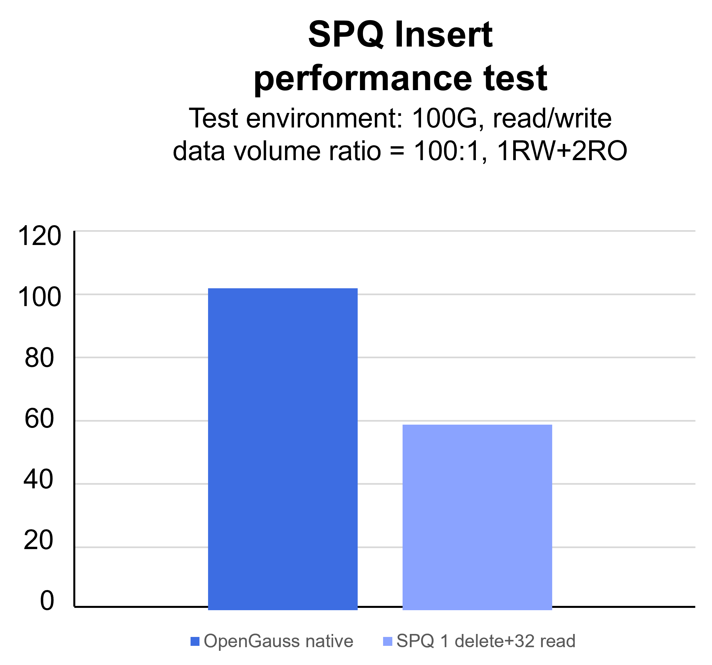

In this test, the data volume is 100 GB, the number of write threads is 1, and the number of read threads per node is 32. SPQ and openGauss native statements are executed in the resource pooling (one primary and two standby) scenario. When the read data volume is far greater than the write data volume, the performance improvement is up to about 2x.

- Update

**Figure 10**  SPQ Update performance test

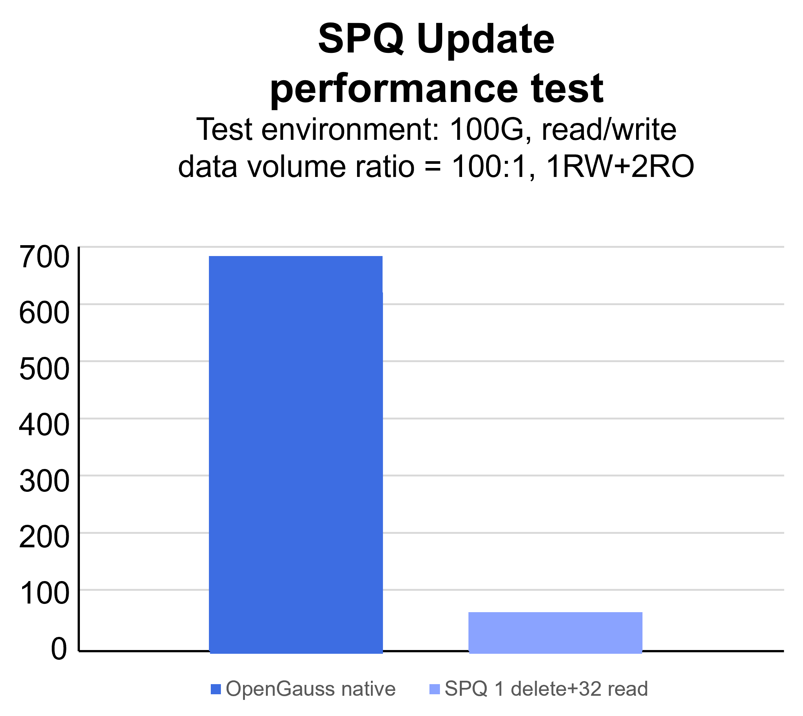

In this test, the data volume is 100 GB, the number of write threads is 1, and the number of read threads per node is 32. SPQ and openGauss native statements are executed in the resource pooling (one primary and two standby) scenario. When the read data volume is far greater than the write data volume, the performance improvement is up to about 10 times.

- Delete

**Figure 11**  SPQ Delete performance test

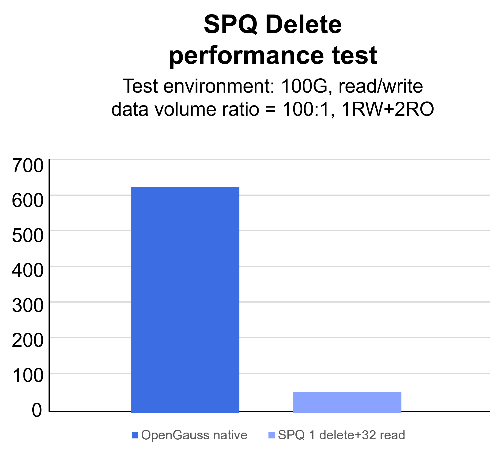

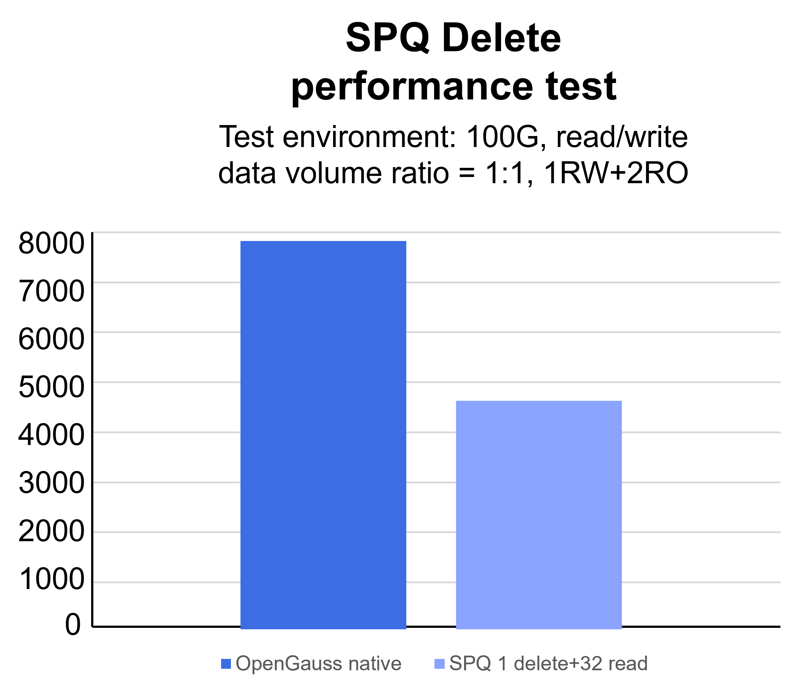

In this test, the data volume is 100 GB, the number of write threads is 1, and the number of read threads per node is 32. SPQ and openGauss native statements are executed in the resource pooling (one primary and two standby) scenario. When the read data volume is far greater than the write data volume, the performance improvement is up to about 10 times; when the read and write data volumes are equal, the performance improvement is about 1.7 times.

## Feature Enhancements

None.

## Feature Constraints

- This feature is supported only in resource pooling deployment.

- Currently, the plug-in can be loaded only through [shared_preload_libraries](../database_reference/kernel_resource_usage.md).

- Queries on partitioned tables, system tables, pseudo columns, user-defined functions, and stored procedures are not supported yet.

- The node names [pgxc_node_name](../database_reference/opengauss_transaction.md) configured on the nodes where SPQ is loaded must be different from each other.

- When the disk reserved space is insufficient, the execution of statements will fail.

## Dependencies

None.

## Usage Guide

For plugin installation and usage, see **[spqplugin-Extension](../extension_reference/spqplugin.md)**.
