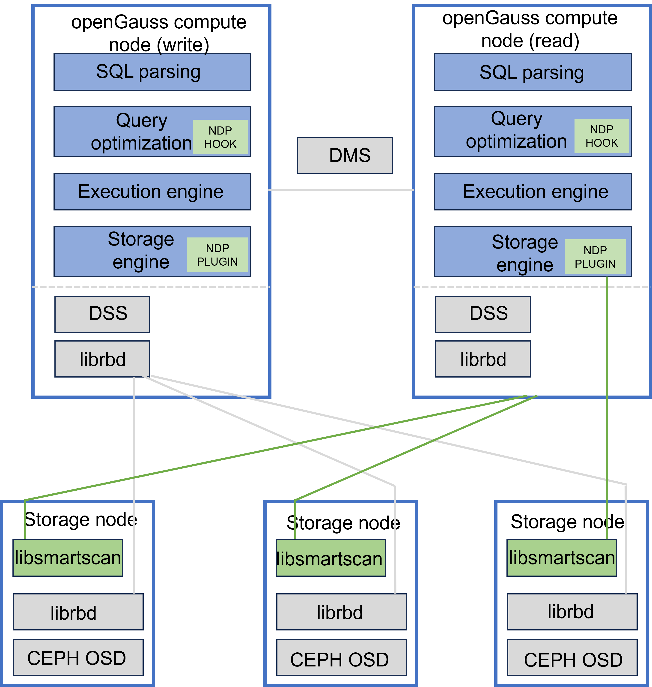

# Resource Pooling Operator Offloading

<!-- md-trans-meta sourceCommit=unknown translatedAt=2026-09-06T11:23:59.700Z pushedAt=2026-09-22T11:12:32.688Z -->

## Availability

This feature has been available since openGauss 5.1.0.

## Feature Overview

Although shared storage brings benefits such as elasticity and reliability, its performance drops considerably compared with a standalone local-disk deployment, mainly due to the latency introduced by network I/O and the distributed storage itself. This is especially true for large-scale queries where the buffer pool cannot cache the data: A large amount of data must be moved from the storage node to the compute node, and after filtering, the effective data content accounts for only a very small proportion in most scenarios, wasting a large amount of network I/O time and resulting in poor performance. Through operator offloading, data filtering is offloaded to the storage side for execution, removing unnecessary data and thereby reducing the amount of network communication data and improving end-to-end performance.

**Figure 1**  Resource pooling operator offloading solution  

## Customer Benefits

In resource pooling scenarios, a large number of queries obtain unnecessary data over the network and then analyze and process it, which affects query performance. For users whose workloads are mostly query-based, data preprocessing can be performed on the storage side to filter out unnecessary data, reducing the amount of data transmitted over the network and improving query performance.

## Feature Description

The openGauss resource pooling operator offloading feature supports running the logic of Agg, SeqScan, Filter, and Projection on storage nodes. The filtered, projected, or aggregated results are then transferred to compute nodes, which continue processing the received NDP results to output upper-layer operators or aggregate the NDP results. The business is unaware of operator offloading. This feature reduces the data I/O transferred over the network and leverages the computing power of storage nodes to improve query performance. The overall solution of this feature consists of two parts:

### Compute-Side Database Kernel

- Provides the database kernel operator offloading capability as a plug-in. Scenarios where operator offloading is not possible are executed following the original kernel process.
- Determines scenarios suitable for operator offloading. Offloading is performed only for scenarios that are beneficial or can be offloaded; scenarios where operator offloading is not possible are executed following the original kernel process.
- Constructs the context information for operator offloading, including snapshot, clog, csnlog, expr, and table schema, and sends it to the libsmartscan process on the storage side.
- Obtains the storage unit (stripe) information corresponding to the file location through DSS, constructs an NDP request, and sends it to the corresponding storage node for processing. NDP processing is performed for PAGE/BLOCK that are not in the Buffer Pool (the current read node and write node); otherwise, the original kernel process is followed.
- Performs special processing on the data returned after NDP processing on the storage node, and outputs it to the upper-layer operator or aggregates the intermediate results.

### Storage-Side libsmartscan Process

- Provides near-storage data computation.
- Reads data through storage interfaces using storage semantics, reading only the local data of the storage node.
- Parses the data and determines its visibility. For PAGE/BLOCK whose visibility cannot be determined or whose corresponding version data cannot be obtained (in the Ustore scenario), the original compute-side process handles them.
- Performs filtering, aggregation, and projection on visible data, and returns the processed data to the compute node.

Operator offloading on the compute side does not change the original execution plan or operator-related information. The NDP data processing logic is implemented through storage engine interface hooks, shielding the execution engine from being aware of the offloading.

For plug-in installation and enabling, see: **[ndpplugin-Extension](../extension_reference/ndpplugin.md)**

## Feature Enhancements

None.

## Feature Constraints

- This feature can be used only in resource pooling deployments.
- The plug-in can currently be loaded only through `shared_preload_libraries`.
- Toast table scenarios are not supported yet.
- Ustore scenarios are not supported yet.
- `synchronize_seqscans` is not supported yet.

## Dependencies

None.
