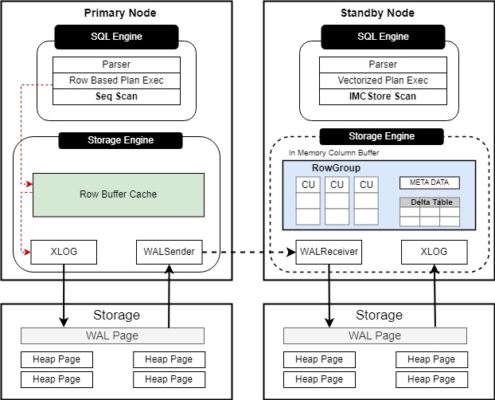

# HTAP Row-Column Fusion

<!-- md-trans-meta sourceCommit=unknown translatedAt=2026-09-06T11:25:59.567Z pushedAt=2026-09-22T11:12:32.698Z -->

## Availability<a name="section15406143204715"></a>

This feature has been available since openGauss 7.0.0-RC1.

## Feature Overview<a name="section740615433477"></a>

The HTAP row-column fusion feature implements the openGauss HTAP integrated database architecture in single-node and primary/standby scenarios through the node's row-column dual-format in-memory mode. Through an efficient row-column conversion technology, the node reads disk row store data, generates column store units (Column Unit), and stores them in the node's column cache. It also supports the node in generating a column cache query plan through cost estimation, greatly improving data analysis efficiency in complex OLAP scenarios through column store queries, so that the database has strong TP and AP capabilities at the same time. In the primary/standby scenario, column cache data is stored on the standby node, and a large number of row data changes made by the primary node in OLTP scenarios are synchronized through log reading and replay to maintain the freshness of the column cache data.

**Figure 1**  Row-column conversion feature design in the primary/standby scenario<a name="fig114741818101675"></a>  



## Customer Benefits<a name="section13406743164715"></a>

As digital transformation deepens, real-time high-concurrency transaction processing and complex hybrid workloads combining data integration and analysis have become the core demands placed on enterprise databases. To respond to these new business scenarios, business systems are progressively upgrading to the HTAP (Hybrid Transactional/Analytical Processing) database model—that is, using the same in-memory database system to support both efficient transaction processing (OLTP) and complex queries (OLAP).

openGauss leverages the available memory space of standby nodes through simple instruction settings to convert row-store data into column caches for storage (In-Memory-Column-Store). Given the query advantages of column storage, in scenarios where data volumes are huge and table structures are complex while users only care about queries on some columns, the column caches produced by row-column conversion can effectively improve the overall query efficiency of enterprises running large and complex OLAP data analysis.

## Feature Description<a name="section16406154310471"></a>

In an openGauss primary/standby cluster, the standby node supports forming a dual-format in-memory model of row and column data. For row-level modifications on the primary node, the standby node synchronizes the modifications from the primary node through logs and writes the corresponding modifications into the incremental table. At the same time, a synchronization thread started in the background on the standby node synchronizes the row-store modifications stored in the incremental table to the column-store cache. For large-scale OLAP data analysis requests initiated by users on the standby node, the system first logically determines whether column cache data for the queried table already exists, and then generates a query plan based on the column cache according to cost calculation.

- Row-column data conversion:

    When a user sends a row-column conversion request for table data on the primary node, the instruction is transmitted to the standby node through a network channel. Based on the instruction information, the standby node initializes the incremental table, reads the row-store data in parallel, forms basic column storage units (Column Unit), and writes them in batches into the requested column-store memory.

- Log-based row-column data synchronization:

    Without affecting the efficiency of row-store data modification on the primary node, and to ensure the real-time performance of column cache data on the standby node, the standby node is designed to read and replay row-store modifications based on logs, and to update the column cache data by means of the incremental table and a background synchronization thread.

- Scan query supporting the column cache:

    A new In-Memory-CStore-Scan (IMCStore scan) column cache query operator is added. Based on the openGauss execution optimizer and cost estimation, a vectorized execution plan containing the column cache query operator is generated.

## Feature Enhancements<a name="section1340684315478"></a>

None.

## Feature Constraints<a name="section06531946143616"></a>

The specification constraints of HTAP row-column fusion are as follows:

- Tables: Row-column conversion is supported only for ordinary tables. Temporary tables, system tables, TOAST tables, unlogged tables, column store tables, and foreign tables are not supported. In a primary/standby scenario, row-column conversion of segment-page tables is not supported.

- Data types: See [Data Types Supported by Column Store Tables](../sql_reference/data_types_supported_by_column_store_tables.md). In particular:
    - Data types with unknown length are not supported, such as text, hll, and cidr.
    - Variable-length database types longer than 8 KB are not supported, such as char(2500) and varchar(2500). Converting columns of long data types is not recommended.
- Others
    - Row-column conversion is currently supported only within a single database.
    - The lightweight edition of openGauss does not support the HTAP row-column fusion feature.
    - In a primary/standby scenario, a row-column conversion request is initiated by the primary node, and all standby nodes perform the row-column conversion. The primary node does not store the column cache.
    - In a primary/standby scenario, data modifications caused by the primary node have a certain delay when queried through the column cache on the standby node.
    - Re-conversion is currently not supported. A table/partition that has already been converted must first cancel the row-column conversion before it can be converted again.
    - When converting a partitioned table, if a specific partition is specified for row-column conversion, only a first-level partition can be specified. If a second-level partition exists under the specified first-level partition, it is automatically converted by default.
    - For a table that has already undergone row-column conversion, the following operations are not supported: Truncating the table, modifying column names/column attributes, adding/deleting columns, modifying table compression parameters, and modifying the table character set in database B. In particular, for a converted partitioned table, the following operations are not supported: Adding, deleting, exchanging, truncating, splitting, merging, moving, and renaming.
    - For an interval partitioned table, newly added partitions are not automatically converted currently.
    - For tables that have already been converted in the current database, the VACUUM FULL operation is not supported.

- In a primary/standby scenario, you need to modify the authentication method in the pg_hba.conf file of the primary and standby nodes to allow row-column conversion requests to be transmitted (the values here depend on the actual network configuration and the user used for connection):

```
host     all     dbuser     primary_ip/32     trust
host     all     dbuser     standby_ip/32     trust
```

## Dependencies<a name="section8406643144716"></a>

[vectorized engine](https://atomgit.com/opengauss/openGauss-server/blob/master/docs/en/performance_tuning_guide/vectorized_engine.md)

## Usage Guide<a name="section20491151513592"></a>

The HTAP row-column fusion feature allows users to perform row-column conversion and clear existing column caches for an entire table, specified columns of a table, or specified partitions.

- **Perform row-column conversion on a specified row-store table**
    - **Conversion method 1: Convert the entire table**

        ```
        ALTER TABLE table_name IMCSTORED;
        ```

    - **Conversion method 2: Convert some columns of the table**

        ```
        ALTER TABLE table_name IMCSTORED(column_name_list);
        ```

    - **Conversion method 3: Convert a specified partition of a partitioned table**

        ```
        ALTER TABLE table_name MODIFY PARTITION partition_name IMCSTORED;
        ```

    - **Conversion method 4: Convert some columns of a specified partition of a partitioned table, supporting conversion of different columns for different partitions**

        ```
        ALTER TABLE table_name MODIFY PARTITION partition_name IMCSTORED(column_name_list);
        ```

- **Clear converted column caches**
    - **Clearing method 1: Clear all column caches of a specified row-store table**

        ```
        ALTER TABLE table_name UNIMCSTORED;
        ```

    - **Clearing method 2: Clear column caches of a specified partition of a partitioned table**

        ```
        ALTER TABLE table_name MODIFY PARTITION partition_name UNIMCSTORED;
        ```

### Parameter Description<a name="section415419560710"></a>

- **table\_name**

    Name of the table to be converted.
- **column\_name\_list**

    List of field names in the specified table for row-to-column conversion, for example (name, age).

- **partition\_name**

    Name of the partition to be converted.

### Example<a name="zh-cn_topic_0283136734_zh-cn_topic_0237120296_zh-cn_topic_0066331191_zh-cn_topic_0059778293_s05b88010070445598ab2a86454e5d88b"></a>

Perform row-column conversion on a created row-store table. For example:

```
--Create a regular table.
openGauss=# CREATE TABLE test
(
  id   INT,
  name VARCHAR2(40),
  dept_id    INT
);

CREATE TABLE

--Perform row-column conversion on the table.
openGauss=# ALTER TABLE test IMCSTORED;
ALTER TABLE

--Query the table and execute the row-store plan.
openGauss=# EXPLAIN SELECT * FROM test;
                       QUERY PLAN                        
---------------------------------------------------------
 Seq Scan on test  (cost=0.00..16.01 rows=601 width=106)
(1 row)
--Enable the column-store scan plan.
openGauss=# SET enable_imcsscan=on;
SET

--Query the table and execute the column-store plan.
openGauss=# EXPLAIN SELECT * FROM test;
                             QUERY PLAN                             
--------------------------------------------------------------------
 Row Adapter  (cost=10.60..10.60 rows=601 width=106)
   ->  IMCStore Scan on test  (cost=0.00..10.60 rows=601 width=106)
(2 rows)

--Clear the column cache of the table.
openGauss=# ALTER TABLE test UNIMCSTORED;
ALTER TABLE

--Perform row-column conversion on some columns of the table.
openGauss=# ALTER TABLE test IMCSTORED(id);
ALTER TABLE
```

```
--Create a partitioned table.
openGauss=# CREATE TABLE test_partition
(
  id   INT,
  name VARCHAR2(40),
  dept_id    INT,
  age  INT
) PARTITION BY RANGE(dept_id) SUBPARTITION BY RANGE (age) 
(
    PARTITION dept_id_p1 VALUES LESS THAN (5) (
        SUBPARTITION age_sub_p1 VALUES LESS THAN (25),
        SUBPARTITION age_sub_p2 VALUES LESS THAN (35),
        SUBPARTITION age_sub_p3 VALUES LESS THAN (maxvalue)
    ),
    PARTITION dept_id_p2 VALUES LESS THAN (maxvalue) (
        SUBPARTITION age_sub_p4 VALUES LESS THAN (25),
        SUBPARTITION age_sub_p5 VALUES LESS THAN (35),
        SUBPARTITION age_sub_p6 VALUES LESS THAN (maxvalue)
    )
);

CREATE TABLE

--Perform full row-column conversion on the table, that is, all partitions and all columns.
openGauss=# ALTER TABLE test_partition IMCSTORED;
ALTER TABLE

--Clear the column cache of the table.
openGauss=# ALTER TABLE test_partition UNIMCSTORED;
ALTER TABLE

--Perform row-column conversion on all columns of the dept_id_p1 partition of the table.
openGauss=# ALTER TABLE test_partition MODIFY PARTITION dept_id_p1 IMCSTORED;
ALTER TABLE

--Clear the column cache of the dept_id_p1 partition of the table.
openGauss=# ALTER TABLE test_partition MODIFY PARTITION dept_id_p1 UNIMCSTORED;
ALTER TABLE

--Perform row-column conversion on the id and name columns of the dept_id_p1 partition of the table.
openGauss=# ALTER TABLE test_partition MODIFY PARTITION dept_id_p1 IMCSTORED(id, name);
ALTER TABLE

--Perform row-column conversion on the name and age columns of the dept_id_p2 partition of the table.
openGauss=# ALTER TABLE test_partition MODIFY PARTITION dept_id_p2 IMCSTORED(name, age);
ALTER TABLE

--Enable the column store scan plan.
openGauss=# SET enable_imcsscan=on;
SET

--Query the id and name columns of the dept_id_p1 partition of the table, and execute the column store plan.
openGauss=# EXPLAIN SELECT id, name FROM test_partition PARTITION(dept_id_p1);
                                          QUERY PLAN                                           
-----------------------------------------------------------------------------------------------
 Row Adapter  (cost=5.58..5.58 rows=583 width=102)
   ->  Vector Partition Iterator  (cost=0.00..5.58 rows=583 width=102)
         Iterations: 1, Sub Iterations: 3
         ->  Partitioned IMCStore Scan on test_partition  (cost=0.00..5.58 rows=583 width=102)
               Selected Partitions:  1
               Selected Subpartitions:  ALL
(6 rows)

--Query the name and age columns of the dept_id_p2 partition of the table, and execute the column store plan.
openGauss=# EXPLAIN SELECT name, age FROM test_partition PARTITION(dept_id_p2);
                                          QUERY PLAN                                           
-----------------------------------------------------------------------------------------------
 Row Adapter  (cost=5.58..5.58 rows=583 width=102)
   ->  Vector Partition Iterator  (cost=0.00..5.58 rows=583 width=102)
         Iterations: 1, Sub Iterations: 3
         ->  Partitioned IMCStore Scan on test_partition  (cost=0.00..5.58 rows=583 width=102)
               Selected Partitions:  2
               Selected Subpartitions:  ALL
(6 rows)

--Query the id and name columns of the entire table. The id column of dept_id_p2 is not converted, so the row store plan is executed.
openGauss=# EXPLAIN SELECT name, age FROM test_partition;
                                     QUERY PLAN                                      
-------------------------------------------------------------------------------------
 Partition Iterator  (cost=0.00..15.83 rows=583 width=102)
   Iterations: 2, Sub Iterations: 6
   ->  Partitioned Seq Scan on test_partition  (cost=0.00..15.83 rows=583 width=102)
         Selected Partitions:  1..2
         Selected Subpartitions:  ALL
(5 rows)

--Query the name column of the entire table. Both dept_id_p1 and dept_id_p2 convert the name column, so a column-store plan is executed.
openGauss=# EXPLAIN SELECT name FROM test_partition;
                                          QUERY PLAN                                           
-----------------------------------------------------------------------------------------------
 Row Adapter  (cost=10.58..10.58 rows=583 width=98)
   ->  Vector Partition Iterator  (cost=0.00..10.58 rows=583 width=98)
         Iterations: 2, Sub Iterations: 6
         ->  Partitioned IMCStore Scan on test_partition  (cost=0.00..10.58 rows=583 width=98)
               Selected Partitions:  1..2
               Selected Subpartitions:  ALL
(6 rows)
```
