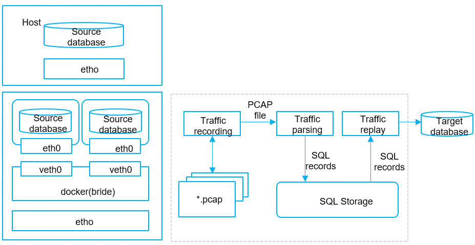
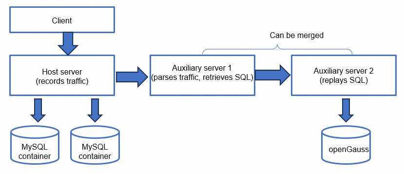

# Recording and Replay Tool

<!-- md-trans-meta sourceCommit=unknown translatedAt=2026-07-16T08:11:21.934Z -->

## Feature Description

The SQL traffic recording and replay tool can record business SQL from the source database (MySQL) client and replay it on the target database (openGauss). After the replay is completed, the collected slow SQL information can be viewed.

This tool supports three recording modes and two replay modes:

<table>
   <tr>
      <th>Feature</th>
      <th>Mode</th>
   </tr>
   <tr>
      <td>Recording</td>
      <td>tcpdump-based recording attach-based application recording MySQL system table-based recording</td>
   </tr>
   <tr>
      <td>Replay</td>
      <td>SQL statement filtering: full replay; replay only query statements
       Replay strategy: serial replay; parallel replay; N-times stress testing
       Replay medium: database-based replay; JSON file-based replay
      </td>
   </tr>
</table>

## Overview

### Recording

1. Traffic recording based on tcpdump and database communication protocol parsing can capture network traffic from the source database, generate network packet files, and parse business SQL statements from the network packet files according to the source database communication protocol.

   Figure 1. Schematic diagram of tcpdump recording and replay

   

2. Recording based on attach app can perform dynamic instrumentation on Java apps, directly collecting dynamic SQL from Java apps. The tool must be deployed on the same machine as the Java app.

3. Recording based on MySQL system tables: by setting the MySQL global parameters general_log=ON and log_output='table', the MySQL system table mysql.general_log can be made to record all SQL statements, and the tool can record business SQL by querying this table.

### Replay

After recording for a cycle in the production environment, the SQL can be taken to the experimental environment for replay. The replay scenarios are as follows:

<table>
    <tr>
        <th>Replay Mode</th>
        <th>Scenario Description</th>
        <th>Advantages</th>
        <th>Operation Process</th>
    </tr>
    <tr>
        <td>Full Replay</td>
        <td>All SQL recorded is replayed in the experimental environment.</td>
        <td>The business flow during the recording period can be fully simulated.</td>
        <td>Full migration (from the production MySQL environment to the test openGauss environment) --> Recording --> Replay all SQL (monitor openGauss to identify issues)</td>
    </tr>
    <tr>
        <td>Replay queries only</td>
        <td>Replay the query statements in the experimental environment or business environment.</td>
        <td>It can be combined with incremental migration to directly perform N-times query stress testing in the business environment, exposing issues before the cutover. However, the queries are not real-time.</td>
        <td>Full migration (business environment MySQL to business environment openGauss) → Recording + incremental migration → Replay query SQL + incremental migration (monitor openGauss to identify issues) → Cutover → Reverse migration</td>
    </tr>
</table>

## Environment Preparation

This tool is supported on Linux. On Windows systems, only the recording mode based on MySQL system tables is supported; therefore, Linux is recommended. The deployment topology of the tool on Linux is as follows:

   

## Constraints

### Prerequisites

1. Before recording, ensure that the base data of the source database and the target database are consistent.

### tcpdump Recording

1. Recording requires operations performed by the root user or a user with sudo privileges.

2. When recording in Docker, the Docker OS shell must be installed in the Docker container.

3. SSL must be disabled on the source database client.

4. libpcap must be installed on the target server or container.

### attach Recording

1. The target process app requires JDK 8+, and the environment requires JDK 11+.

2. The MySQL driver used by the target process is mysql-jdbc-connector 5.x and 8.x.

3. The recorded SQL only supports JSON file storage.

4. SQL execution duration cannot be obtained.

5. Multi-threaded target programs are not supported for collection.

### general_log Recording

1. Set the MySQL global parameters general_log=ON and log_output='table'.

2. SQL execution duration cannot be obtained.

### tcpdump Parsing

1. Only SQL executed on connections established after the recording start time can be fully parsed.

### Replay

1. Only replay to the openGauss database is supported.

2. The replay database must use database B.

3. Only SQL recorded via tcpdump supports parallel replay.

4. Execution plans are printed only when UPDATE and SELECT statements are slow SQL.

## Operation Steps

### transcribe-replay-tool-6.0.0.jar

Core recording and replay tool. It is used to schedule various plugins for recording, and responsible for parsing network packet files as well as SQL replay.

- Compile

~~~
cd transcribe-replay-tool
sh build.sh
~~~

The compiled toolkit already includes the Recording Plugin, and users may also compile the plugin themselves.

### Recording Plugin

#### tcpdump

A network traffic capture tool used to collect network traffic from the source database.

- Download

~~~
wget https://www.tcpdump.org/release/tcpdump-4.9.3.tar.gz
~~~

- Extract &amp; Compile

~~~
tar -zxf tcpdump-4.9.3.tar.gz
cd tcpdump-4.9.3
./configure
make
~~~

#### attach.jar & agent.jar

A dynamic instrumentation tool used to directly collect dynamic SQL from Java apps.

- Source Code Address

~~~
https://gitcode.com/opengauss/compatibility-assessment/tree/master/dynamic_sql_collection
~~~

### Function Scripts

1. check.sh

   Checks the running status of the tcpdump plugin process to prevent abnormal collection caused by the tcpdump process not exiting when the recording side stops abnormally. It can be started synchronously with the recording side, or started after the recording process ends to clean up residual processes.

2. scp.sh

   Used to transfer network packet files from the recording-side server to the local machine in a one-way password-free scenario. This script can be executed after the recording starts, and the following parameters must be passed:

~~~
-u: Recording-side username
-h: Recording-side server IP
-s: Path where recording-side network files are located
-t: Disk write path for network files on the password-free side
-n: Name of the recorded network file
~~~

- Compile

~~~

# Enter dynamic_sql_collection/agent and dynamic_sql_collection/attach for compilation

mvn clean package
~~~

## Tool Usage

- Startup Command

~~~
java -jar transcribe-replay-tool-6.0.0.jar -t [transcribe|parse|replay] -f [transcribe.properties|parse.properties|replay.properties]
~~~

- Parameter Description

~~~
-t: Command type. Options: transcribe/parse/replay. transcribe indicates starting traffic recording, parse indicates starting parsing of network packet files, and replay indicates starting SQL replay.
-f: Configuration file path. Depending on the command type, the configuration file path for the recording side, parsing side, or replay side can be selected respectively. When using the attach method for recording, only absolute paths are supported.
~~~

### Recording Side

#### Startup Command

~~~
java -jar transcribe-replay-tool-6.0.0.jar -t transcribe -f transcribe.properties
~~~

#### Recording-Side Configuration Items

~~~

# Global Configuration Items: Required for All Three Recording Modes

# sql.transcribe.mode: Recording Mode, options: tcpdump/attach/general, representing traffic capture, dynamic instrumentation, and querying system tables respectively. String type, No Default Value

sql.transcribe.mode=tcpdump

# tcpdump configuration. When selecting the tcpdump recording mode, the following additional configuration items are required.

# tcpdump

# tcpdump.plugin.path: Directory location of the tcpdump recording plugin. Type: String. Default value: plugin/ subdirectory under the tool JAR package path.

tcpdump.plugin.path=/***/***/***

# tcpdump.network.interface: Name of the service network interface that the tcpdump tool listens on

tcpdump.network.interface=eth0

# tcpdump.database.port: Database port that the tcpdump tool listens on, int type, No Default Value

tcpdump.database.port=3306

# tcpdump.capture.duration: Recording duration, int type, default value: 1, unit: minute

tcpdump.capture.duration=1

# tcpdump.file.path: Temporary storage location for network packet files. The network files obtained from recording are temporarily stored in this path. If remote host information is configured, the files will be sent to the remote host. String type.

# Default value: the tcpdump-files/ subdirectory under the tool JAR package path

tcpdump.file.path=/***/***/***

# tcpdump.file.name: Network packet file name, String type, default value: tcpdump-file

tcpdump.file.name=tcpdump-file

# Single network file packet size limit, int type, default value: 10, unit: MB

tcpdump.file.size=10

# max.cpu.threshold: System CPU usage threshold, value range 0–1. When the system CPU usage exceeds this value, the tool stops recording. Double type. Default value: 0.85

max.cpu.threshold=0.85

# max.memory.threshold: System Memory Usage Threshold, ranging from 0 to 1. When system memory usage exceeds this value, the tool stops recording. Type: double. Default value: 0.85

max.memory.threshold=0.85

# max.disk.threshold: Disk Usage Threshold, value range 0–1. When the disk occupancy rate of the disk storing files exceeds this value, the tool stops recording. Type: double. Default value: 0.85

max.disk.threshold=0.85

# remote.file.path: Remote Host File Path. The recording result file will eventually be sent to this path. String type. No default value.

remote.file.path=/***/***/***

# remote.receiver.name: Remote Host Username. The recording result file will eventually be sent to this user. Type: String. Default value: root

remote.receiver.name=remote_user

# remote.receiver.password: Remote User Password. Type: String. No default value

remote.receiver.password=******

# remote.node.ip: Remote host IP. The file will be sent to the remote host using this IP. Type: String. Default value: 127.0.0.1

remote.node.ip=127.0.0.1

# remote.node.port: Remote Host Port. Type: int. Default value: 22

remote.node.port=22

# remote.retry.count: Send Failure Retry Count, the allowed send failures for file when sending to remote host. Stop recording when exceeding this count. Type: int. Default value: 1

remote.retry.count=1

# attach Configuration: Additional Configuration Items Required When Selecting the attach Recording Mode

# attach

# attach.plugin.path: Location of the attach.jar & agent.jar recording plugin. Type: String. Default value: Directory where the tool JAR package resides

attach.plugin.path=/***/***/***

# attach.process.pid: PID of the Java app monitored by the attach tool. Type: long. No default value.

attach.process.pid=1

# attach.target.schema: Name of the database to which the Java app monitored by the attach tool connects, Type: String. No default value

attach.target.schema=schema_name

# attach.capture.duration: Duration of SQL collection by the attach tool. Type: int. Default value: 1. Unit: minutes

attach.capture.duration=1

# sql.file.path: Directory for storing SQL files collected by attach. Defaults to the sql-files/ subdirectory under the tool JAR package path.

sql.file.path=/***/***/***

# sql.file.name: SQL file name collected by the attach tool. Type: String. Default value: sql-file.

sql.file.name=sql-file

# sql.file.size: File size limit for a single SQL file collected by the attach tool. Type: int. Default value: 10. Unit: MB

sql.file.size=10

# max.cpu.threshold: System CPU usage threshold, value ranges from 0 to 1. When the system CPU usage exceeds this value, the tool stops recording. Type: Double. Default value: 0.85

max.cpu.threshold=0.85

# max.memory.threshold: System Memory Usage Threshold, ranging from 0 to 1. When system memory usage exceeds this value, the tool stops recording. Type: double. Default value: 0.85

max.memory.threshold=0.85

# max.disk.threshold: Disk Usage Threshold, ranging from 0 to 1. When the disk occupancy rate of the disk storing files exceeds this value, the tool stops recording. Type: double. Default value: 0.85

max.disk.threshold=0.85

# remote.file.path: Remote Host File Path. The recording result file will eventually be sent to this path. Type: String. No default value.

remote.file.path=/***/***/***

# remote.receiver.name: Remote Host Username. The recording result file will eventually be sent to this user. Type: String. Default value: root

remote.receiver.name=remote_user

# remote.receiver.password: Remote User Password. Type: String. No default value.

remote.receiver.password=******

# remote.node.ip: Remote host IP. The file is sent to the remote host using this IP. String type. Default value: 127.0.0.1

remote.node.ip=127.0.0.1

# remote.node.port: Remote host port. Type: int. Default value: 22.

remote.node.port=22

# remote.retry.count: Send Failure Retry Count. Allowed send failures for file when sending to remote host. Stop recording when exceeding this count. Type: int. Default value: 1

remote.retry.count=1

# General log configuration. When selecting the general recording mode, the following additional configuration items are required.

# general.database.ip: Target MySQL IP address. Type: String. No default value

general.database.ip=127.0.0.1

# general.database.port: Target MySQL port. Type: int. Default value: 3306

general.database.port=3306

# general.database.username: Target MySQL database query user. Type: String. No default value

general.database.username=db_user

# general.database.password: Target MySQL database password. Type: String. No default value

general.database.password=******

# general.sql.batch: Number of data rows per query. Type: int. Default value: 10

general.sql.batch=10

# general.start.time: Start time for general log SQL collection. Type: timestamp. Default value: 1970-01-01 00:00:01

general.start.time=1970-01-01 00:00:01

# sql.storage.mode: SQL storage mode, optional values: json or db. Selecting json indicates that the recorded SQL is stored in a JSON file, and selecting db indicates that the recorded SQL is stored in the database. Type: String. Default value: json

sql.storage.mode=json

# If the SQL storage mode is set to json, the following additional configuration items are required

# sql.file.path: SQL file path. Type: String. Default value: sql-files/ subdirectory under the tool JAR package path

sql.file.path=/***/***/***

# sql.file.name: SQL file name. Type: String. Default value: sql-file

sql.file.name=sql-file

# sql.file.size: SQL file size limit. Type: int. Default value: 10. Unit: MB

sql.file.size=10

# If the SQL storage mode is set to db, additional configuration items are required:

# database

# sql.database.ip: IP of the SQL repository. Type: String. No default value

sql.database.ip=127.0.0.1

# sql.database.port: SQL repository port. Type: int. No default value

sql.database.port=5432

# sql.database.username: SQL repository username. Type: String. No default value

sql.database.username=db_user

# sql.database.name: SQL Repository Name. Type: String. No default value

sql.database.name=transcribe

# sql.database.password: SQL repository password. Type: String. No default value.

sql.database.password=******

# sql.table.name: Table name for storing SQL. Type: String. Default value: sql_table

sql.table.name=sql_table

# sql.table.drop: Whether to drop the existing table if the table name used to store SQL matches an existing table name in the database. Type: boolean. Default value: false

sql.table.drop=false
~~~

**NOTE**
If the selected recording mode is tcpdump, you need to enable the parsing side to parse the network packet files to obtain SQL statements.

### Parsing Side

#### Startup Command

~~~
java -jar transcribe-replay-tool-6.0.0.jar -t parse -f parse.properties
~~~

#### Parsing-side Configuration Items

~~~

# Parse

# Directory of network packet files to be parsed

tcpdump.file.path=/***/***/***

# tcpdump.database.ip: Source database IP address that the tcpdump tool listens on during collection. Type: String. No default value

tcpdump.database.ip=127.0.0.1

# tcpdump.database.port: Source database port that the tcpdump tool collection listens on. Type: int. No default value

tcpdump.database.port=3306

# queue.size.limit: Maximum number of packets read per batch during parsing. Type: int. Default value: 10000

queue.size.limit=10000

# packet.batch.size: Number of packets processed per SQL submission during parsing. Type: int. Default value: 10000

packet.batch.size=10000

# sql.storage.mode: SQL storage mode, optional values: json or db. Selecting json means recorded SQL is stored in JSON files, selecting db means recorded SQL is stored in the database. Type: String. Default value: json

sql.storage.mode=json

# If the SQL storage mode is set to json, the following additional configuration items are required

# sql.file.path: SQL file path. Type: String. Default value: parse-files/ subdirectory under the package path

sql.file.path=/***/***/***

# sql.file.name: SQL file name. Type: String. Default value: parse-file

sql.file.name=parse

# sql.file.size: SQL file size limit. Type: int. Default value: 10. Unit: MB

sql.file.size=10

# If the SQL storage mode is set to db, the following additional configuration items are required.

# Database

# sql.database.ip: IP of the SQL repository. Type: String. No default value

sql.database.ip=127.0.0.1

# sql.database.port: SQL repository port. Type: int. No default value

sql.database.port=5432

# sql.database.username: SQL repository username. Type: String. No default value

sql.database.username=db_user

# sql.database.name: SQL repository name. Type: String. No default value

sql.database.name=db_name

# sql.database.password: SQL repository password. Type: String. No default value

sql.database.password=******

# sql.table.name: Table name for storing SQL. Type: String. Default value: sql_table

sql.table.name=sql_table

# sql.table.drop: Table name for storing SQL. Whether to drop the existing table if the table name for storing SQL conflicts with an existing table name in the database. Type: Boolean. Default value: false

sql.table.drop=false
~~~

### Replay Side

#### Startup Command

~~~
java -jar transcribe-replay-tool-6.0.0.jar -t replay -f replay.properties
~~~

#### Replay-side Configuration Items

~~~

# Replay Mode: db or json. Type: String. Default db

sql.storage.mode=json

# Replay strategy: serial, parallel. Type: String. Default: serial

sql.replay.strategy = parallel

# N-fold stress test multiplier. Type: int

sql.replay.multiple=3

# Whether to replay only query statements. Type: Boolean. Default value: false (can only be set to true when selecting N-times stress test)

sql.replay.only.query=false

# Maximum number of threads for parallel replay. Type: int

sql.replay.parallel.max.pool.size=5

# Slow SQL determination rule. 1 or 2. Default value: 2

sql.replay.slow.sql.rule=2

# Slow SQL Determination Rule 1 (Difference from MySQL Time, Unit: Microseconds), int type

sql.replay.slow.time.difference.threshold=1000

# Slow SQL Determination Rule 2: (openGauss execution duration). Type: int

sql.replay.slow.sql.duration.threshold=1000

# CSV file path for storing slow SQL

sql.replay.slow.sql.csv.dir=/***/***/***

# Slow SQL TOP N print. Type: int

sql.replay.slow.top.number=5

# Sampling Interval for MySQL and openGauss Execution Time Comparison Chart

sql.replay.draw.interval=1000

# Replay session whitelist, format: 192.168.0.1, 192.168.0.1:8888, [2407:c080:1200:22a0:a09f:d625:2787:800b] or [2407:c080:1200:22a0:a09f:d625:2787:800b]:54068, sessions are separated by ';'

sql.replay.session.white.list=[]

# Replay session blacklist, format: 192.168.0.1, 192.168.0.1:8888, [2407:c080:1200:22a0:a09f:d625:2787:800b] or [2407:c080:1200:22a0:a09f:d625:2787:800b]:54068, sessions are separated by semicolons (;)

sql.replay.session.black.list=[192.168.0.229:60032]

# Replay-side database IP. Type: String. No default value

sql.replay.database.ip=192.168.0.34

# Replay-side database port. Type: int. No default value

sql.replay.database.port=5432

# Source database and target schema mapping relationship. If no schema is set, it defaults to public. Multiple mappings are separated by semicolons (;)

sql.replay.database.schema.map=mysql1：opengauss1：schema1；mysql2：opengauss2

# Replay-side Database User, Type: String. No default value.

sql.replay.database.username=opengauss_test

# Replay-side database user password. Type: String. No default value

sql.replay.database.password=xxxxxx

# If SQL replay mode is set to db, additional configuration items are required.

# database

# sql.database.ip: SQL repository IP. Type: String. No default value

sql.database.ip=127.0.0.1

# sql.database.port: SQL repository port. Type: int. No default value

sql.database.port=5432

# sql.database.username: SQL repository username. Type: String. No default value

sql.database.username=db_user

# sql.database.name: SQL repository name. Type: String. No default value

sql.database.name=db_name

# sql.database.password: SQL repository password. Type: String. No default value

sql.database.password=******

# sql.table.name: Table name for storing SQL. Type: String. Default value: sql_table

sql.table.name=sql_table

# If the SQL replay mode is json, the following additional items must be configured.

# sql.file.path: SQL file path. Type: String. Consistent with parsing side

sql.file.path=/***/***/***

# sql.file.name: SQL file name. Type: String. Consistent with parsing side

sql.file.name=parse-file
~~~