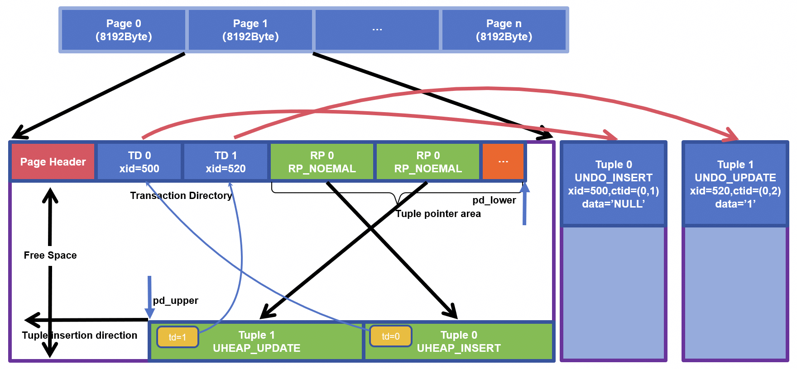
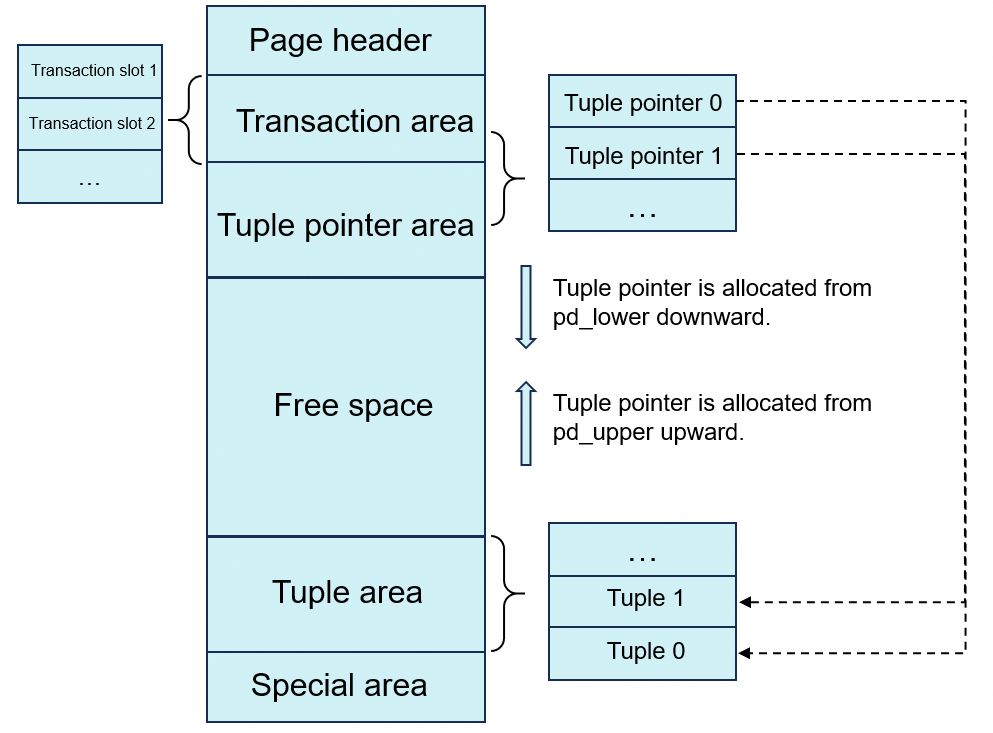
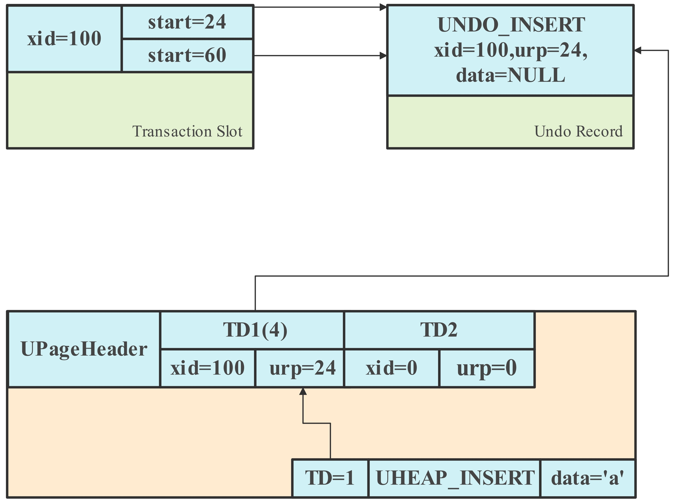
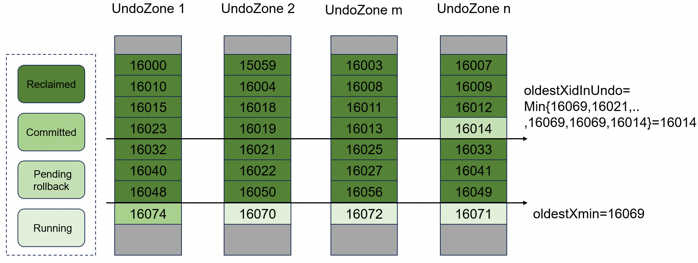
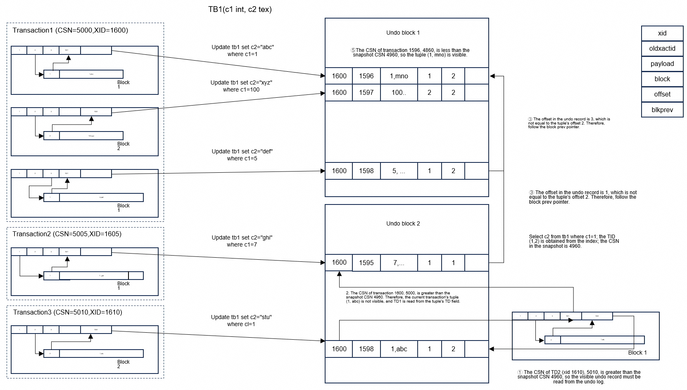
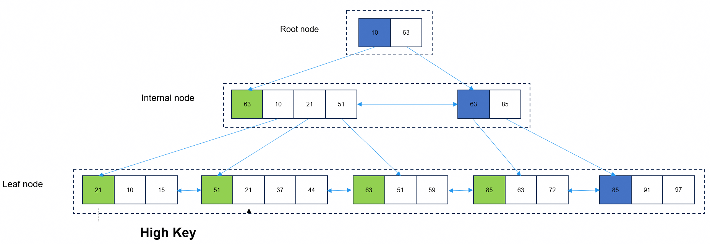
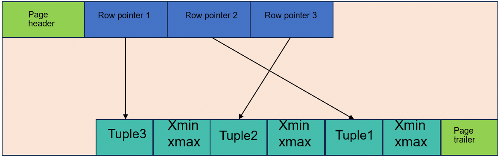
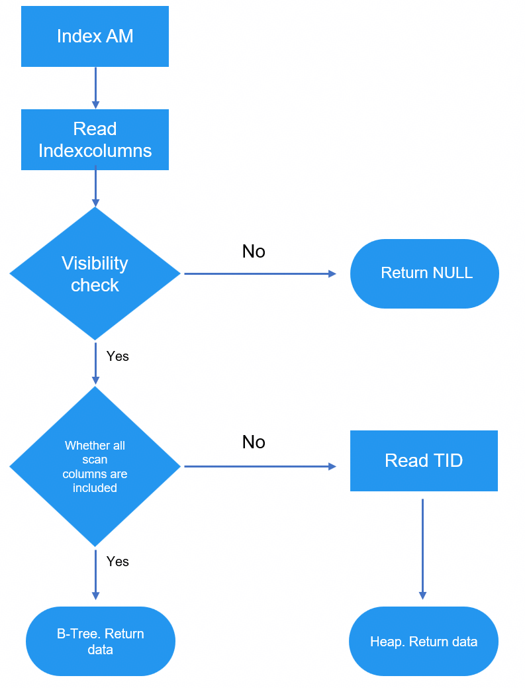
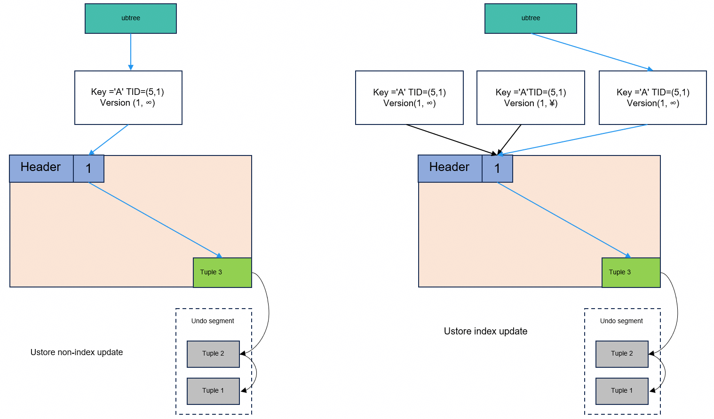

# Ustore Storage Engine

<!-- md-trans-meta sourceCommit=unknown translatedAt=2026-07-29T02:44:51.279Z pushedAt=2026-09-23T11:26:51.994Z -->

## Availability

This feature has been available since openGauss 2.1.0.

## Feature Description

The Ustore storage engine, also known as the in-place update storage engine, is a new storage mode introduced in the openGauss kernel. The row storage engine used in earlier versions operates in append update mode. Append update performs well for insert and delete operations as well as HOT (HeapOnly Tuple) updates (that is, updates within the same page) in business scenarios. However, for non-HOT update scenarios that span multiple data pages, garbage collection is not efficient enough. To address this, the Ustore storage engine was introduced.

## Design Principles 

The Ustore storage engine separates the latest version of "valid data" from the historical versions of "garbage data" for storage. The latest version of "valid data" is stored on data pages, while a dedicated UNDO space is allocated for unified management of historical versions of "garbage data." As a result, the data space does not expand due to frequent updates, and the centralized reclamation of "garbage data" is more efficient.

The Ustore storage engine adopts a NUMA-aware UNDO subsystem design, enabling the UNDO subsystem to scale effectively on multi-core platforms. It also employs multi-version index technology to address index cleanup issues, thereby significantly improving the reuse efficiency of storage space reclamation.

By leveraging the UNDO space, the Ustore storage engine enables more efficient and comprehensive flashback queries and a recycle bin mechanism, allowing rapid rollback of human "misoperations" and providing openGauss with richer enterprise-grade features.

## Core Advantages

- **High performance:** For workloads involving different operations such as insert, update, and delete, performance and resource usage are relatively balanced. The update operation adopts the in-place update mode, which delivers higher and more stable performance in scenarios with frequent updates. It is well-suited for typical OLTP workloads characterized by "short" (short transactions), "frequent" (frequent update operations), and "fast" (high performance requirements).

- **Efficient storage:** It supports maximum in-place update, greatly saving space. Rollback segments and data pages are stored separately, providing more efficient and stable I/O utilization. The UNDO subsystem adopts a NUMA-aware design, offering better multi-core scalability. UNDO space is allocated in a unified manner and reclaimed centrally, resulting in higher reuse efficiency and more efficient and stable storage space usage.

- **Fine-grained resource control:** The Ustore engine provides multi-dimensional transaction "supervision" methods. Transactions can be supervised based on criteria such as transaction execution duration, the amount of UNDO space used by a single transaction, and overall UNDO space limits. This prevents abnormal or unexpected behaviors and facilitates database administrators in regulating and constraining the use of database system resources.

## Feature Description 

Ustore is a new storage mode added to the openGauss kernel. It maximizes the advantages of various designs. Its architecture design for multi-version management is shown in Table 1:

**Table 1** Architecture design of Ustore for multi-version management

<table><thead align="left"><tr id="zh-cn_topic_0243295239_zh-cn_topic_0240782908_row88806271453"><th class="cellrowborder" valign="top" width="7.830783078307831%" id="mcps1.2.8.1.1">
Dimension
</th>
<th class="cellrowborder" valign="top" width="11.561156115611562%" id="mcps1.2.8.1.2">
Architecture Design
</th>
</tr>
</thead>
<tbody><tr id="zh-cn_topic_0243295239_zh-cn_topic_0240782908_row18811277456"><td class="cellrowborder" valign="top" width="7.830783078307831%" headers="mcps1.2.8.1.1 ">
Version storage method
</td>
<td class="cellrowborder" valign="top" width="11.561156115611562%" headers="mcps1.2.8.1.2 ">
Separate storage
</td>
</tr>
<tr id="zh-cn_topic_0243295239_zh-cn_topic_0240782908_row18811277457"><td class="cellrowborder" valign="top" width="7.830783078307831%" headers="mcps1.2.8.1.1 ">
Version chain organization
</td>
<td class="cellrowborder" valign="top" width="11.561156115611562%" headers="mcps1.2.8.1.2 ">
Newest to old
</td>
</tr>
<tr id="zh-cn_topic_0243295239_zh-cn_topic_0240782908_row18811277458"><td class="cellrowborder" valign="top" width="7.830783078307831%" headers="mcps1.2.8.1.1 ">
Old version management method
</td>
<td class="cellrowborder" valign="top" width="11.561156115611562%" headers="mcps1.2.8.1.2 ">
Page-Based RCR, Page-Based Row Consistent Read
</td>
</tr>
</tbody>
</table>

Compared with Astore, Ustore stores the latest version of "valid data" and historical versions of "garbage data" separately. The latest version of "valid data" is stored on data pages, while a dedicated Undo space is allocated for unified storage of historical versions of "garbage data". As a result, the data space does not expand due to frequent updates, and the efficiency of centralized reclamation of "garbage data" is higher. The Ustore storage engine adopts a NUMA-aware Undo subsystem, which can scale effectively on multi-core platforms. It also employs multi-version index technology to address the index cleanup problem, effectively improving the reuse efficiency of storage space.

**Figure 1**  Ustore architecture diagram    

  
    

### Ustore Main Functional Modules

Ustore and Astore share transaction management, concurrency control, buffer management, checkpoint, fault recovery management, and media manager. The main functional modules of Ustore are shown in Table 2:

**Table 2** Architecture design of Ustore in multi-version management

<table><thead align="left"><tr id="zh-cn_topic_0243295239_zh-cn_topic_0240782908_row88806271553"><th class="cellrowborder" valign="top" width="7.830783078307831%" id="mcps1.2.8.1.1">
Module
</th>
<th class="cellrowborder" valign="top" width="11.561156115611562%" id="mcps1.2.8.1.2">
Description
</th>
</tr>
</thead>
<tbody><tr id="zh-cn_topic_0243295239_zh-cn_topic_0240782908_row18811277556"><td class="cellrowborder" valign="top" width="7.830783078307831%" headers="mcps1.2.8.1.1 ">
Ustore table access management
</td>
<td class="cellrowborder" valign="top" width="11.561156115611562%" headers="mcps1.2.8.1.2 ">
It interfaces upward with the SQL engine, providing row-level query, insert, delete, and modify operation interfaces for Ustore tables. Downward, it traverses and performs add, delete, modify, and query operations on Ustore table files based on the inter-page and intra-page structures of Ustore tables, as well as the Ustore table tuple structure.
</td>
</tr>
<tr id="zh-cn_topic_0243295239_zh-cn_topic_0240782908_row18811277557"><td class="cellrowborder" valign="top" width="7.830783078307831%" headers="mcps1.2.8.1.1 ">
Ustore index access management
</td>
<td class="cellrowborder" valign="top" width="11.561156115611562%" headers="mcps1.2.8.1.2 ">
It interfaces upward with the SQL engine, providing row-level query, insert, and delete operation interfaces for index tables. Downward, it performs lookup, add, and delete operations on specified index keys based on the inter-page and intra-page structures of index tables, as well as the index tuple structure.
</td>
</tr>
<tr id="zh-cn_topic_0243295239_zh-cn_topic_0240782908_row18811277558"><td class="cellrowborder" valign="top" width="7.830783078307831%" headers="mcps1.2.8.1.1 ">
Ustore table page structure
</td>
<td class="cellrowborder" valign="top" width="11.561156115611562%" headers="mcps1.2.8.1.2 ">
Includes the specific organization of Ustore table tuples within a page, as well as operations such as tuple insertion into a page, page compaction, and page initialization.
</td>
</tr>
<tr id="zh-cn_topic_0243295239_zh-cn_topic_0240782908_row18811277559"><td class="cellrowborder" valign="top" width="7.830783078307831%" headers="mcps1.2.8.1.1 ">
Ustore table tuple structure
</td>
<td class="cellrowborder" valign="top" width="11.561156115611562%" headers="mcps1.2.8.1.2 ">
Includes operations such as filling, deconstructing, modifying, field querying, and transforming of Ustore table tuples.
</td>
</tr>
<tr id="zh-cn_topic_0243295239_zh-cn_topic_0240782908_row18811277560"><td class="cellrowborder" valign="top" width="7.830783078307831%" headers="mcps1.2.8.1.1 ">
Undo record structure
</td>
<td class="cellrowborder" valign="top" width="11.561156115611562%" headers="mcps1.2.8.1.2 ">
Includes operations such as the structuring, filling, encoding, and decoding of Undo records.
</td>
</tr>
<tr id="zh-cn_topic_0243295239_zh-cn_topic_0240782908_row18811277561"><td class="cellrowborder" valign="top" width="7.830783078307831%" headers="mcps1.2.8.1.1 ">
Multi-version index
</td>
<td class="cellrowborder" valign="top" width="11.561156115611562%" headers="mcps1.2.8.1.2 ">
Includes modules such as the page structure, query, modification, visibility check, and garbage collection of UBtree, a multi-version index dedicated to Ustore.
</td>
</tr>
</tbody>
</table>

### Ustore Page Structure

The page structure of Ustore is identical to that of Astore. openGauss also uses the default 8 KB page, and its page structure is shown in Figure 2:

**Figure 2**  Ustore page structure   

  
    

### Ustore Multi-Version Management

The Ustore multi-version management approach is based on MVCC technology, ensuring data consistency and transaction isolation in high-concurrency environments. Ustore's multi-version management primarily involves the following aspects:

- Rollback segment (Undo segment)

    - Whenever a transaction modifies data, Ustore places the old version of the data in the Undo directory of the rollback segment. The rollback segment is used to restore data upon transaction rollback and also supports multi-version reads. When a transaction needs to access a historical version, it can locate the previous old data through the rollback segment.

- MVCC

    - Ustore implements efficient concurrency control through MVCC, allowing multiple transactions to perform read operations simultaneously without blocking each other, while write operations require additional synchronization mechanisms. Overall, the concurrency control mechanism of Ustore reduces conflicts between transactions and improves system throughput.

- Space management and reclamation

    - Ustore implements an autonomous space management mechanism that does not rely on medium-weight VACUUM and AUTOVACUUM cleanup mechanisms.

    - Over time, Ustore cleans up obsolete versions and rollback records that are no longer needed through a garbage collection mechanism, thereby freeing storage space and optimizing performance.

- Version chain

    - Ustore manages multiple versions of data by maintaining a version chain for data records. Each update to a record creates a new version, which is appended to the end of the existing version chain. The old version is not immediately deleted but remains in the chain for ongoing transactions to read.

- CSN (Commit Sequence Number)

    - CSN is an incrementing sequence number that identifies the commit order of transactions. In Ustore, CSN works in conjunction with the version chain to ensure the visibility and consistency of data versions. A transaction can only see data versions generated by transactions that committed before it started.

#### PBRCR (Page Base Row Consistency Read) Ustore Old Version Management

The core of Ustore old version management is to record historical versions of data through the **Undo Segment**, ensuring the implementation of features such as transaction rollback and snapshot isolation level reads.

**Figure 3** Version Management   

  
    

- Old version data is centrally stored in the Undo directory of the Undo Segment. To reduce read-write conflicts, old version data (Undo Segment records) is written to the Undo directory of the data directory using an append write method. In this way, the reading and writing of old version data do not conflict with each other, and old version data of the same transaction is stored contiguously, facilitating rollback operations.

- To reduce contention during concurrent writes, the Undo directory space is divided into multiple logical areas (UndoZone). Threads perform allocation within their own logical areas, completely isolated from other threads, so that no additional lock overhead is incurred when allocating space for writing old data. UndoZone can also be partitioned based on CPU NUMA cores, with each thread allocating from the UndoZone on the current NUMA core, further improving allocation efficiency.

- When Undo space is allocated, it is recorded at transaction granularity. Once it is confirmed that no transaction is accessing the old version data, the data is reclaimed.

Rollback records in the Undo space must be reclaimed to prevent the Undo space from expanding indefinitely. Once a transaction ID is smaller than the minimum Xmin (oldestXmin) in the current snapshot, the old version data in the rollback records will no longer be accessed, and the rollback records can then be reclaimed.

As described above, rollback records in the Undo space are stored in the UndoZone in ascending order of transaction IDs. The conditions for reclamation are as follows:

1. The Undo space of transactions that have been committed and whose transaction IDs are smaller than oldestXmin can be reclaimed.

2. The Undo space of transactions that have been rolled back and whose rollback has been completed can be reclaimed.

The reclamation process of Undo space is shown in Figure 4:

**Figure 4** Undo reclamation process   

  
    

As shown in the figure above, committed transaction 16068 that is less than oldestXmin is reclaimed in UndoZone1, transaction 16050 is reclaimed in UndoZone2, transaction 16056 is reclaimed in UndoZone m, and transaction 16012 is reclaimed in UndoZone n. Transaction 16014 is pending rollback but has not yet been rolled back, so the upper limit of reclaimable transaction IDs in UndoZone n is only up to 16014. The upper limit of other zones is oldestXmin. oldestXidInUndo takes the minimum value among the upper limits of all UndoZones, so oldestXidInUndo equals 16014.

#### MVCC

MVCC (Multi-Version Concurrency Control) is a concurrency control method used to address data consistency issues that may arise when multiple transactions execute concurrently in a database. MVCC provides efficient concurrency and data consistency by maintaining multiple data versions (recording historical versions) within the database.

The visibility check mechanism of Ustore is similar to that of Astore, comparing the CSN of the snapshot with the CSNs of the tuple deletion and insertion transactions to determine whether a tuple is visible. Ustore and Astore share the same transaction management mechanism and snapshot management mechanism. The key difference between Ustore and Astore is that Astore retains old version data on the page, whereas Ustore stores old version data in a unified undo segment. When old version data is needed, Astore can directly read the transaction IDs of tuple insertion and deletion from the tuple header to determine tuple visibility. Ustore, however, needs to read the transaction information of the old version from the undo segment to determine whether the old version is visible.

When retrieving a tuple, Ustore first checks the corresponding transaction directory. Transaction directories are classified into two types: valid and invalid. When the transaction directory is valid, Ustore directly obtains the latest transaction on the tuple. If the transaction directory is frozen (FROZEN), it means the tuple is already visible to all transactions. If the transaction ID in the transaction directory is less than oldestXidInUndo, it means the tuple is sufficiently old to be visible to all transactions. In this case, the transaction directory is also set to frozen to accelerate subsequent queries.

If a tuple is marked with an invalid transaction directory, it means the transaction that modified the tuple has been committed and is older than the transaction in the current transaction directory. In this case, Ustore uses the transaction in the transaction directory for visibility check. If the tuple is visible, it means the transaction that modified the tuple is already visible, and there is no need to read transaction information from the undo directory again. The following figure shows an example of the tuple query process:

**Figure 5**  Tuple query process   

  
    

#### Multi-Version Index

openGauss implements a multi-version index called UBtree, which is a variant of the Btree index specifically designed for Ustore. It differs from the original Btree index in the following aspects.

1. It supports multi-version management and visibility checks for index data, and can autonomously identify and reclaim old-version tuples. Additionally, the visibility check at the index layer improves the performance of index scans and index-only scans.

2. In addition to index insertion operations, an index deletion operation is introduced to mark the index tuples corresponding to deleted or modified tuples.

3. The index is sorted in the order of key + TID. Tuples with the same index column are sorted by the TID of the corresponding tuple as the secondary key. The xmin and xmax values are appended after the key.

4. A new optional page split strategy, "insertpt", is added.

5. Old version cleanup does not depend on Vacuum. With independent space reclamation capability, the index is decoupled from the heap table and can be cleaned up independently, achieving more stable I/O performance.

**Figure 6** UBtree structure  

  
    

##### Index Page Organization

The hierarchy of the multi-version index is basically the same as that of the Btree index. The non-leaf nodes are consistent with those of the Btree index, and only the Special field at the page trailer differs. The following figure shows the UBtree leaf page structure:

**Figure 7** UBtree leaf page structure  

  
    

Similar to the method of maintaining version information in Astore heap pages, each index tuple in the leaf nodes of UBtree has the corresponding xmin and xmax appended to its tail. An index is merely a structure for accelerating searches and is not inherently tied to the concept of historical versions. The xmin only identifies when this index tuple became valid and when it was deleted, rather than having a pointer to an old version tuple as in the case of heap tuples in Astore.

The space for storing xmin and xmax at the tail of a newly inserted index tuple is reserved during the execution of the index insertion function. The reserved space and xmin are written to the page through the index tuple page insertion function when the index tuple is inserted, while xmax is written to the page through the index tuple page deletion function when the index tuple is deleted.

In the index page cleanup function, the index tuple uses its xmin and xmax information to determine whether the tuple has become invalid, and then performs independent page cleanup. This function attempts to clear all invalid tuples and performs corresponding defragmentation. During an index scan, the corresponding function is called to locate the first index tuple that meets the scan condition, and then retrieves tuples in the current page that satisfy the index scan condition and pass the visibility check. Visibility is determined based on xmin, xmax, and the current snapshot.

##### Index Operations

For the original Btree index, there are four main types of operations: index creation, index scan, index insertion, and index deletion.

- **Create operation**: When creating an index, a scan function is used to scan the corresponding Ustore table and retrieve the latest version of each tuple along with its xmin and xmax. If a tuple has an old version that was updated in place, the original Astore logic is reused to prevent access by old transactions with the repeatable read isolation level. During the creation process, tuples received after scanning are sorted by index column and TID, then inserted into index pages sequentially, and the corresponding original pages and upper-level pages are constructed. The entire creation process requires all pages to be recorded in the XLOG, and the contents in storage management must be forcibly flushed to the permanent storage medium before the process is considered successfully completed.

- **Scan operation**: When reading data, users can accelerate the process by using index scans. Index scans are largely consistent with Btree indexes. UBtree supports multi-version management and visibility checks for index data, and the visibility check at the index layer improves the performance of both index scans (Index Scan) and index-only scans (IndexOnly Scan). For index scans:

    1. If the index columns include all scan columns (IndexOnly Scan), a binary search is performed on the index based on the scan conditions, and data is returned once matching tuples are found.

    2. If the index columns do not include all scan columns (Index Scan), a binary search is performed on the index based on the scan conditions to find the TID of the matching tuple, and then the TID is used to locate the corresponding data tuple in the data table, as shown in Figure 8:

**Figure 8** Scan operation

  
    

- **Insert operation**: The insertion logic of UBtree remains largely unchanged, except that transaction information must be directly obtained during index insertion to fill in the xmin field.

- **Delete operation**: UBtree adds an additional index deletion process. The main steps of index deletion are similar to those of insertion: transaction information is obtained to fill in the xmax field (the btree index does not maintain version information and does not require a delete operation), and the active_tuple_count on the page is updated. If active_tuple_count is reduced to 0, page reclamation is attempted.

- **Update operation**: For Ustore, the handling of UBtree index columns during data updates also differs from that of Astore. Data updates involve two scenarios: updates to index columns and updates to non-index columns. The following figure illustrates the processing flow of UBtree when data is updated:

**Figure 9** Update operation  

  
    

In the case of a non-index column update, the index remains unchanged. The index tuple still points to the data tuple from the initial insertion. Uheap does not insert a new data tuple; instead, it modifies the current data tuple and stores the historical data in Undo.

In the case of an index column update, UBtree also inserts a new index tuple, but it points to the same data linepointer and the same data tuple. Scanning older versions of the data requires reading from Undo.

#### Space Management and Reclamation

Unlike the space management and reclamation mechanism of Astore, Ustore implements an autonomous space management mechanism. In Ustore, space allocation and reclamation for both the heap and indexes proceed smoothly during normal business operations, without relying on the medium-weight VACUUM and AUTOVACUUM cleanup mechanisms.

##### Autonomous Heap Page Space Management

The autonomous space management of heap pages in Ustore is built upon a lightweight heap page cleanup mechanism similar to that of Astore. During the execution of DML and DQL operations, Ustore performs heap data page cleanup to replace the VACUUM cleanup mechanism.

For Astore, the corresponding index tuples must be cleaned up before the row pointers of data tuples can be reused. This is to prevent accessing reused row pointers through index tuples, which would result in retrieving incorrect data. In Astore, such invalid index tuples must be uniformly removed through VACUUM operations before row pointers can be reused, which couples the cleanup logic of heap pages and index pages together and also causes intermittent heavy I/O. In Ustore, data and index pages can be cleaned up efficiently and independently, because UBtree with version information can independently detect and filter out invalid index tuples, preventing access to the corresponding data table through invalid index tuples.

##### Autonomous Index Page Space Management

The space management of index pages does not rely on the FSM data structure, but instead relies on a unique structure called URQ (UBtree Recycle Queue), referred to as the recycle queue.

The recycle queue in the index consists of two parts: the Potential Empty Page Queue and the Available Page Queue. Both queues are cross-page circular queues, where each element stores a blkno and an XID. The blkno indicates the block number of the index page corresponding to that element, and the XID indicates the point in time at which the page can be reclaimed or reused. These elements are sorted by XID within a single page of the circular queue, so that pages with smaller XIDs (most likely to be reclaimed or reused) can be quickly located. The structure is illustrated in the figure.

For the Potential Empty Page Queue, it stores pages whose internal tuples have all been deleted but not yet fully invalidated, and the XID marks the possible timing when the last tuple in the page becomes invalid. For the Available Page Queue, it stores pages that have been deleted and can or will soon be reused, and the XID indicates the timing when the page can be reused.

During business operations, the index continuously attempts to reclaim pages from the Potential Empty Page Queue through a reclamation function. When the index requests a new page, it interacts with the Available Page Queue to search for currently available free pages. When no available pages exist in the Available Page Queue, new pages are generally obtained by extending the index physical file. However, there are cases where the physical file is extended in batches, or where an error occurs and the process exits before the extended pages are used. In such cases, the metadata page of the recycle queue stores the number of correctly tracked pages. If this number is less than the total number of pages in the entire index table, an attempt is made to use these untracked pages, and the tracked page count is updated accordingly.

##### Medium-Weight and Heavyweight Manual Page Cleanup

Similar to Astore, Ustore also provides the VACUUM statement to allow users to proactively perform medium-weight cleanup on a Ustore table and its indexes. Its external behavior is consistent with that of Astore. The heavyweight VACUUM FULL is also consistent with Astore, which cleans up invalid data and reorganizes both the data space and the index space.

### Ustore Transaction Model

#### Transactions and CSN

Ustore supports transactions to ensure the ACID properties of operations. Ustore transactions have the following characteristics:

- Transactions are implicitly started. The first data modification automatically initiates a transaction, and there is no explicit START TRANSACTION statement.

- When a transaction starts, a unique transaction identifier, XID, is assigned.

- By default, auto-commit is disabled, and a transaction is not committed at the end of a statement. Auto-commit can be enabled by setting the session parameter auto commit.

- When a transaction ends, a CSN that represents the unique attribute of the transaction is generated.

CSN (Commit Sequence Number) is a 64-bit integer with a time attribute.

- When the database changes, the global CSN number of the current system is updated.

- CSN serves as the primary identifier for visibility checks. It can mark the following transaction states: transaction in progress, transaction committed, transaction synchronously rolled back, transaction being committed, this transaction is a subtransaction, and transaction frozen.

#### Transaction Table Management

The transaction table of Ustore stores all information related to transactions and rollback segments. Transactions are managed uniformly by the buffer in the form of data pages. Transaction pages are stored in a specific area of the Undo tablespace and are managed by the Undo tablespace.

#### Transaction Types

**Ordinary Transactions**

- A transaction is the basic unit of work in a database management system. It consists of a series of operations that ensure data integrity and consistency. Transactions have four properties: atomicity, consistency, isolation, and durability.

- Queries do not consume transactions, and visibility checks are based on CSN.

**2PC Transactions**

2PC (Two-Phase Commit) is a simple distributed transaction protocol that ensures consistency among all participants in a distributed system during transaction execution.

- Advantage: simple to implement and suitable for distributed database transaction management.

- Disadvantage: a single point of failure exists. If the coordinator crashes, participants will be blocked; if a network partition occurs, consistency issues may arise.

Use case: applicable to systems such as distributed databases and message queues that require transaction consistency.
Ustore supports standard 2PC transactions.

#### Isolation Levels

- When a statement begins execution, it obtains the current system CSN as the query CSN for the current statement.

- The visible result of the entire statement is determined at the moment the statement begins and is not affected by subsequent modifications from other transactions.

- In Ustore, read committed provides consistent reads by default.

## Feature Enhancements 

None.

## Feature Constraints

- Does not support materialized views.

- Does not support GIN indexes.

- Does not support Btree indexes.

- Does not support ledger user tables.

- Does not support hash indexes.

- Does not support gist indexes.

- Does not support the DEFERRABLE and INITIALLY DEFERRED keywords.

- Does not support compression.

- Does not support FOR NO KEY UPDATE and FOR KEY SHARE.

- Does not support compress as.

- Does not support segment-page tables.

- Does not support concurrent indexes.

- Cannot be used together with other storage types in a DELETE statement.

- Does not support column-store tables.

- MOT foreign tables are not supported.

- Cursor for update/share is not supported.

## Dependencies

None.

## Basic Principles 

The Ustore storage engine stores the latest version of "valid data" and historical versions of "garbage data" separately. The latest version of "valid data" is stored on data pages, while a dedicated Undo space is allocated for unified management of historical versions of "garbage data." As a result, the data space does not expand due to frequent updates, and the efficiency of centralized reclamation of "garbage data" is higher.

The Ustore storage engine adopts a NUMA-aware Undo subsystem design, enabling the Undo subsystem to scale effectively on multi-core platforms. It also employs multi-version index technology to address the index cleanup problem, thereby significantly improving the reuse efficiency of storage space reclamation.

By leveraging the Undo space, the Ustore storage engine enables more efficient and comprehensive flashback queries and a recycle bin mechanism, allowing quick rollback of human misoperations and providing openGauss with richer enterprise-grade features.

The Ustore storage engine maintains rock-steady performance even under frequent data update scenarios, ensuring smoother business system operation and adapting to a wider range of business scenarios and workloads, particularly in financial core business scenarios that demand higher performance and stability.

