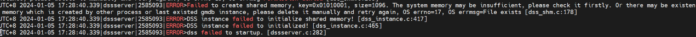

# Insufficient Shared Memory

<!-- md-trans-meta sourceCommit=unknown translatedAt=2026-07-29T02:44:04.127Z pushedAt=2026-09-24T06:23:26.043Z -->

## Symptom

Failed to start dssserver, with the error message "dss failed to startup".

## Cause

Insufficient shared memory. You can check the logs in the /dss/dss0/dssdba/run directory, where you will see an error similar to the following screenshot.

## Solution

Use the ipcrm -m xxxx or ipcrm -a command to clear shared memory.
> [!WARNING]Note
>
>+ Use the ipcrm -a command with caution under the root user, as it may affect other processes.
