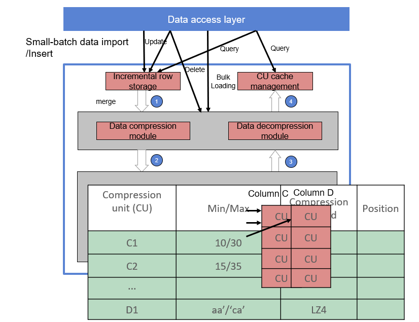
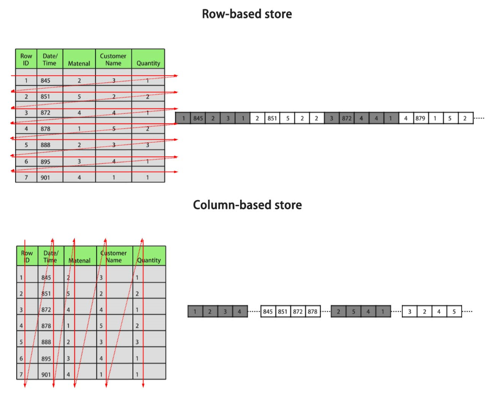

# Planning Storage Models

<!-- md-trans-meta sourceCommit=unknown translatedAt=2026-07-29T02:45:50.618Z pushedAt=2026-09-24T07:02:35.383Z -->

## Availability <a name="section18007590"></a>

openGauss supports hybrid row-column storage. This feature has been available since openGauss 1.0.0.

## Feature Description<a name="section27850590"></a>

openGauss supports two storage models: row storage and columnar storage. Users can choose either row-store or column-store tables when creating tables based on specific usage scenarios.

In general, columnar storage is suitable when a table has many columns (a wide table) and queries involve only a limited number of columns. The columnar storage approach is illustrated in [Figure 1](#fig114741818102620). If a table has few columns and queries involve most of them, row storage is the better choice.

**Figure 1**  Columnar storage diagram<a name="fig114741818102620"></a>  



## Customer Value<a name="section49328722"></a>

In scenarios involving wide tables with large data volumes, queries often focus on specific columns, and the row storage engine delivers relatively poor query performance. For example, in a meteorological bureau scenario, a single table may have 200 to 800 columns, while queries frequently access only 10 columns. In such cases, vectorized execution technology and the columnar storage engine can significantly improve performance and reduce storage space.

## Feature Description<a name="section41305314"></a>

Tables have two storage models: row-store tables and column-store tables. Each storage model has its own advantages and disadvantages, and it is recommended to choose based on actual conditions. Typically, openGauss databases used for OLTP (Online Transaction Processing) scenarios default to row storage, while columnar storage is used only for OLAP (Online Analytical Processing) scenarios that involve complex queries and large data volumes.

- Row-store table

    The default table type upon creation. Data is stored by row, meaning all data in a single row is stored contiguously. Row-store tables support full insert, delete, update, and query operations. They are suitable for scenarios where data requires frequent updates.

- Column-store table

Data is stored by column, meaning all data in a single column is stored contiguously. Single-column queries involve minimal I/O and consume less storage space than row-store tables. This model is suitable for scenarios involving bulk data insertion, infrequent updates, and query-centric statistical analysis. Column-store tables are not suitable for point queries, and inserting a single record performs poorly.

Row storage stores a table by rows on disk partitions, while columnar storage stores a table by columns on disk partitions. By default, a created table uses row storage. For the differences between row storage and columnar storage, see [Figure 1](#zh-cn_topic_0237120296_fig1417354233018).

**Figure 1**  Differences between row storage and columnar storage<a name="zh-cn_topic_0237120296_fig1417354233018"></a>  



In the preceding figure, the upper-left shows a row-store table, and the upper-right shows how the row-store table is stored on disk. The lower-left shows a column-store table, and the lower-right shows how the column-store table is stored on disk.

Row and columnar storage have the following advantages and disadvantages:

<a name="zh-cn_topic_0237120296_table8447131119519"></a>
<table><thead align="left"><tr id="zh-cn_topic_0237120296_row16451411125113"><th class="cellrowborder" valign="top" width="14.14141414141414%" id="mcps1.1.4.1.1"><p id="zh-cn_topic_0237120296_p7453131117518"><a name="zh-cn_topic_0237120296_p7453131117518"></a><a name="zh-cn_topic_0237120296_p7453131117518"></a><strong id="zh-cn_topic_0237120296_b2453151113516"><a name="zh-cn_topic_0237120296_b2453151113516"></a><a name="zh-cn_topic_0237120296_b2453151113516"></a>Storage Model</strong></p></th>
<th class="cellrowborder" valign="top" width="39.39393939393939%" id="mcps1.1.4.1.2"><p id="zh-cn_topic_0237120296_p199221916145119"><a name="zh-cn_topic_0237120296_p199221916145119"></a><a name="zh-cn_topic_0237120296_p199221916145119"></a><strong id="zh-cn_topic_0237120296_b183421054185116"><a name="zh-cn_topic_0237120296_b183421054185116"></a><a name="zh-cn_topic_0237120296_b183421054185116"></a>Advantages</strong></p></th>
<th class="cellrowborder" valign="top" width="46.464646464646464%" id="mcps1.1.4.1.3"><p id="zh-cn_topic_0237120296_p164535117512"><a name="zh-cn_topic_0237120296_p164535117512"></a><a name="zh-cn_topic_0237120296_p164535117512"></a><strong id="zh-cn_topic_0237120296_b1463713025117"><a name="zh-cn_topic_0237120296_b1463713025117"></a><a name="zh-cn_topic_0237120296_b1463713025117"></a>Disadvantages</strong></p></th>
</tr>
</thead>
<tbody><tr id="zh-cn_topic_0237120296_row445671111516"><td class="cellrowborder" valign="top" width="14.14141414141414%" headers="mcps1.1.4.1.1 "><p id="zh-cn_topic_0237120296_p124571811115110"><a name="zh-cn_topic_0237120296_p124571811115110"></a><a name="zh-cn_topic_0237120296_p124571811115110"></a>Row storage</p></td>
<td class="cellrowborder" valign="top" width="39.39393939393939%" headers="mcps1.1.4.1.2 "><p id="zh-cn_topic_0237120296_p1654125142613"><a name="zh-cn_topic_0237120296_p1654125142613"></a><a name="zh-cn_topic_0237120296_p1654125142613"></a>Data is stored together. INSERT/UPDATE is easy.</p></td>
<td class="cellrowborder" valign="top" width="46.464646464646464%" headers="mcps1.1.4.1.3 "><p id="zh-cn_topic_0237120296_p1727415115212"><a name="zh-cn_topic_0237120296_p1727415115212"></a><a name="zh-cn_topic_0237120296_p1727415115212"></a>During selection, even if only a few columns are involved, all data is read.</p></td>
</tr>
<tr id="zh-cn_topic_0237120296_row1546241120517"><td class="cellrowborder" valign="top" width="14.14141414141414%" headers="mcps1.1.4.1.1 "><p id="zh-cn_topic_0237120296_p6462111105112"><a name="zh-cn_topic_0237120296_p6462111105112"></a><a name="zh-cn_topic_0237120296_p6462111105112"></a>Columnar storage</p></td>
<td class="cellrowborder" valign="top" width="39.39393939393939%" headers="mcps1.1.4.1.2 "><a name="zh-cn_topic_0237120296_ul1556111817542"></a><a name="zh-cn_topic_0237120296_ul1556111817542"></a><ul id="zh-cn_topic_0237120296_ul1556111817542"><li>During queries, only the involved columns are read.</li><li>Projection is highly efficient.</li><li>Any column can serve as an index.</li></ul></td>
<td class="cellrowborder" valign="top" width="46.464646464646464%" headers="mcps1.1.4.1.3 "><a name="zh-cn_topic_0237120296_ul1796819916297"></a><a name="zh-cn_topic_0237120296_ul1796819916297"></a><ul id="zh-cn_topic_0237120296_ul1796819916297"><li>When the selection is complete, the selected columns must be reassembled.</li><li>INSERT/UPDATE operations are more complex.</li></ul></td>
</tr>
</tbody>
</table>

In general, if a table has many columns (a wide table) and queries involve only a few columns, columnar storage is suitable. If a table has few columns and queries involve most of them, row storage is preferable.

<a name="zh-cn_topic_0237120296_zh-cn_topic_0097078338_table3891877"></a>
<table><thead align="left"><tr id="zh-cn_topic_0237120296_zh-cn_topic_0097078338_row12104456"><th class="cellrowborder" valign="top" width="19.73%" id="mcps1.1.3.1.1"><p id="zh-cn_topic_0237120296_zh-cn_topic_0097078338_p40936856"><a name="zh-cn_topic_0237120296_zh-cn_topic_0097078338_p40936856"></a><a name="zh-cn_topic_0237120296_zh-cn_topic_0097078338_p40936856"></a><strong>Storage Type</strong></p></th>
<th class="cellrowborder" valign="top" width="80.27%" id="mcps1.1.3.1.2"><p id="zh-cn_topic_0237120296_zh-cn_topic_0097078338_p46632853"><a name="zh-cn_topic_0237120296_zh-cn_topic_0097078338_p46632853"></a><a name="zh-cn_topic_0237120296_zh-cn_topic_0097078338_p46632853"></a><strong>Applicable Scenarios</strong></p></th>
</tr>
</thead>
<tbody><tr id="zh-cn_topic_0237120296_zh-cn_topic_0097078338_row38265132"><td class="cellrowborder" valign="top" width="19.73%" headers="mcps1.1.3.1.1 "><p id="zh-cn_topic_0237120296_zh-cn_topic_0097078338_p12468015"><a name="zh-cn_topic_0237120296_zh-cn_topic_0097078338_p12468015"></a><a name="zh-cn_topic_0237120296_zh-cn_topic_0097078338_p12468015"></a>Row storage</p></td>
<td class="cellrowborder" valign="top" width="80.27%" headers="mcps1.1.3.1.2 "><a name="zh-cn_topic_0237120296_zh-cn_topic_0097078338_ul61112063105242"></a><a name="zh-cn_topic_0237120296_zh-cn_topic_0097078338_ul61112063105242"></a><ul id="zh-cn_topic_0237120296_zh-cn_topic_0097078338_ul61112063105242"><li>Point queries (returning few records, simple queries based on indexes).</li><li>Scenarios with frequent insert, delete, and update operations.</li></ul></td>
</tr>
<tr id="zh-cn_topic_0237120296_zh-cn_topic_0097078338_row64051613"><td class="cellrowborder" valign="top" width="19.73%" headers="mcps1.1.3.1.1 "><p id="zh-cn_topic_0237120296_zh-cn_topic_0097078338_p20798169"><a name="zh-cn_topic_0237120296_zh-cn_topic_0097078338_p20798169"></a><a name="zh-cn_topic_0237120296_zh-cn_topic_0097078338_p20798169"></a>Columnar storage</p></td>
<td class="cellrowborder" valign="top" width="80.27%" headers="mcps1.1.3.1.2 "><a name="zh-cn_topic_0237120296_zh-cn_topic_0097078338_ul38359637105253"></a><a name="zh-cn_topic_0237120296_zh-cn_topic_0097078338_ul38359637105253"></a><ul id="zh-cn_topic_0237120296_zh-cn_topic_0097078338_ul38359637105253"><li>Statistical analysis queries (scenarios with frequent join and grouping operations).</li><li>Ad hoc queries (uncertain query conditions, where row-store table scans have difficulty using indexes).</li></ul></td>
</tr>
</tbody>
</table>

## Feature Constraints<a name="section06531946143616"></a>

The specification constraints for columnar storage are as follows:

- Tables
    - Global temporary tables are not supported.
    - Inherited tables are not supported.
    - CREATE TABLE OF typename is not supported.
    - Secondary partitioning is not supported.
    - Columnar storage supports only range partitioning.
    - Supported distribution table types: REPLICATION distribution, RANGE distribution, LIST distribution, and HASH distribution.

- Indexes

    - Supported index types: psort, btree, and gin.

- SQL Syntax
    - The INSERT/UPDATE/DELETE ... RETURNING statement is not supported.
    - ROWNUM and START WITH ... CONNECT BY are implemented by converting to row-store table support.

- Stored Procedures

    - Columnar storage cursors do not support BACKWARD, PRIOR, or other operations involving reverse fetching.

- Data types. The following basic types and their corresponding array types are supported:
    - Numeric types: TINYINT SMALLINT INTEGER BIGINT OID REAL DOUBLE NUMERIC.
    - Boolean type: BOOLEAN.
    - Character types: CHAR(n) VARCHAR(n) NVARCHAR2(n) TEXT CLOB.
    - Date/time types: DATE TIME TIMESTAMP SMALLDATETIME INTERVAL tinterval reltime abstime.
    - Network address types: CIDR INET.
    - Monetary type: MONEY.
    - Bit string types: BIT(n) BIT VARYING(n).
    - HLL data types: HLL HLL_HASHVAL.
    - Binary types: BYTEA BYTEAWITHOUTORDERCOL BYTEAWITHOUTORDERWITHEQUALCOL.
    - Other types (including user-defined types) are not supported.

- Storage & Transactions
    - Flashback is not supported.
    - Logical decoding is not supported.
    - PITR is not supported.
    - Publish/subscribe is not supported.
    - The recycle bin is not supported.
    - Segment-page management is not supported.
    - Extreme RTO is not supported.
    - Concurrent updates to the same row are not supported.
    - Automatic repair of primary/standby pages and files is not supported.

- Others
    - Transparent Data Encryption (TDE) is not supported.
    - Column-store tables currently support only the rank and row_number functions (other window functions are first converted to row storage for processing).
    - Incremental materialized views are not supported.
    - Virtual indexes are not supported.
    - Delta tables do not support indexes.

## Usage Guide<a name="section20491151513592"></a>

### Syntax Format<a name="zh-cn_topic_0283136734_zh-cn_topic_0237120296_zh-cn_topic_0066331191_zh-cn_topic_0059778293_s0420ba4662e14672b8ec55415ddca941"></a>

```
CREATE TABLE table_name 
    (column_name data_type [, ... ])
    [ WITH ( ORIENTATION  = value) ];
```

### Parameter Description<a name="section415419560710"></a>

- **table\_name**

    Name of the table to be created.

- **column\_name**

    Name of the column to be created in the new table.

- **data\_type**

    Data type of the field.

- **ORIENTATION**

    Specifies the storage mode of table data, that is, row storage mode or columnar storage mode. This parameter cannot be modified after being set successfully.

    Value range:

    - ROW, indicating that the table data will be stored in row-based format.

        Row storage is suitable for OLTP services and point queries or scenarios with frequent insert and delete operations. Currently, Astore and Ustore are used as row storage engines.

    - COLUMN, indicating that the table data will be stored in columnar format.

        Columnar storage is suitable for data warehouse services, where a large number of aggregation calculations are performed on such tables with relatively few column operations involved. Currently, Cstore is used as the columnar storage engine.

### Row-Store Table <a name="zh-cn_topic_0237120296_zh-cn_topic_0066331191_zh-cn_topic_0059778293_s0420ba4662e14672b8ec55415ddca941"></a>

This is the default table type. Data is stored by row, meaning that each row of data is stored contiguously. It is suitable for scenarios where data needs to be updated frequently. If the ORIENTATION parameter is not specified, the table defaults to a row-store table.

```sql
openGauss=# CREATE TABLE customer_t1
(
  state_ID   CHAR(2),
  state_NAME VARCHAR2(40),
  area_ID    NUMBER
);

--Drop the table.
openGauss=# DROP TABLE customer_t1;
```

### Column-Store Table<a name="zh-cn_topic_0237120296_zh-cn_topic_0066331191_zh-cn_topic_0059778293_s05b88010070445598ab2a86454e5d88b"></a>

Data is stored by column, meaning all data in a single column is stored contiguously. Single-column queries involve less I/O and consume less storage space than row-store tables. This model is suitable for scenarios involving bulk data insertion, infrequent updates, and query-centric statistical analysis. Column-store tables are not suitable for point queries. When creating a column-store table, you must specify the ORIENTATION parameter.

```sql
openGauss=# CREATE TABLE customer_t2
(
  state_ID   CHAR(2),
  state_NAME VARCHAR2(40),
  area_ID    NUMBER
)
WITH (ORIENTATION = COLUMN);

----Drop the table.
openGauss=# DROP TABLE customer_t2;
```

## Selecting Between Row-Store Tables and Columnar Storage Tables<a name="zh-cn_topic_0237120296_zh-cn_topic_0066331191_zh-cn_topic_0059778293_s120c7d1deb9046bb96d3d187117b1d2c"></a>

- Update frequency

    If data is updated frequently, select a row-store table.

- Insert frequency

    For frequent small-batch inserts, select a row-store table. For bulk inserts of large data volumes, select a columnar storage table.

- Number of columns in the table

    If the table has a large number of columns, select a column-store table.

- Number of columns queried

    If each query involves only a few columns (less than 50% of the total columns) of the table, select a column-store table.

- Compression ratio

    Column-store tables have a higher compression ratio than row-store tables. However, a high compression ratio consumes more CPU resources.