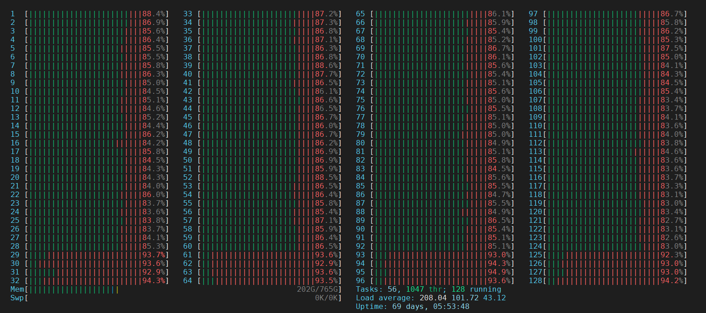

# Resource Pooling POC Performance Testing Guide

<!-- md-trans-meta sourceCommit=unknown translatedAt=2026-07-29T02:48:06.106Z pushedAt=2026-09-24T08:38:27.152Z -->

## Introduction

This section mainly describes the testing method for TPCC extreme performance under the resource pooling architecture, as well as the related GUC parameter tuning and OS tuning required to achieve optimal tpmC performance.

## Hardware Environment

- Compute

    The current best TPCC result is achieved using two 2-socket Kunpeng servers (128C, 512 GB–1024 GB memory).
    The OS version is openEuler 20.03 LTS.

- Storage

    Enterprise centralized storage is used. The currently verified hardware models are the OceanStor Dorado 5300/5500/18000/16000 V6 series.

- Network

    Kunpeng-compatible Hi1822 (if using a ROCE network, currently only Mellox CX5 NICs are supported)

## Software Environment

- Database: openGauss 5.0.1 official release

- TPCC client: BenchmarkSQL 5.0 optimized by tidb ([https://github.com/pingcap/benchmarksql](https://github.com/pingcap/benchmarksql))

- Dependency packages

    |Required Software|Recommended Version|
    |:--|:--|
    |numactl|–|
    |jdk|1.8.0-242|
    |ant|1.10.5|
    |htop|–|

## Host BIOS and OS Tuning

1. Host BIOS parameter settings

    - BIOS > Advanced > MISC Config, set Support Smmu to Disabled

    - BIOS > Advanced > MISC Config, set CPU Prefetching Configuration to Disabled

    - BIOS > Advanced > Memory Config, set Die Interleaving to Disable

    - BIOS > Advanced > Performance Config, set Power Policy to Performance

2. OS optimization

    - Set the OS kernel PAGESIZE to 64 KB (default value)

    - Disable irqbalance

        ```bash
        systemctl stop irqbalance
        ```

    - Adjust numa_balance

        ```bash
        echo 0 > /proc/sys/kernel/numa_balancing
        ```

    - Adjust transparent huge pages

        ```bash
        echo 'never' > /sys/kernel/mm/transparent_hugepage/enabled
        echo 'never' > /sys/kernel/mm/transparent_hugepage/defrag
        ```

3. Network configuration

- Network plane description

    Generally, the network of a database cluster can be divided into three planes: the storage network, the inter-compute node network, and the service network.

    - Storage network: the network connecting compute nodes and the storage array. It is recommended that the NIC bandwidth be no less than 10GE.

    - Compute network: the network connecting compute nodes. It is recommended that the NIC bandwidth be no less than 10GE.

    - Service network: the network connecting compute nodes to service clients (or TPCC benchmarking clients). It is recommended that the NIC bandwidth be no less than 10GE.

    In performance testing scenarios, interrupt binding to CPU cores must be configured for the NICs used by the storage network (because storage I/O traffic is the heaviest; if both the host and standby are benchmarked simultaneously, the compute network will also carry a certain amount of traffic). The compute network may be configured as needed.
    If BOND or VxLAN is used in the NIC configuration, interrupt binding to CPU cores must be configured for the actual physical NICs.
    If some network planes overlap — for example, the storage network and compute network are shared, or the compute network and service network are shared — interrupt binding to CPU cores must also be configured for the actual physical NICs.

- NIC multi-queue configuration

    ```text
    ##Here, enp4s0 is the physical NIC of the storage network.
    [root@localhost]# ethtool -L enp4s0 combined 16
    ```

- Enable TSO, LRO, GRO, and GSO features through interrupt tuning.

    ```bash
    ethtool -K enp4s0 tso on
    ethtool -K enp4s0 lro on
    ethtool -K enp4s0 gro on
    ethtool -K enp4s0 gso on
    ```

- NIC firmware verification and update

    ```text
    [root@localhost]# ethtool -i enp4s0
    driver: hinic
    version: 2.3.2.11
    firmware-version: 2.4.1.0
    expansion-rom-version:
    bus-info: 0000:04:00.0
    supports-statistics: yes
    supports-test: yes
    supports-eeprom-access: no
    supports-register-dump: no
    supports-priv-flags: no
    ```

    The NIC firmware version should be 2.4.1.0.

## Installing the Database

Install a primary-standby openGauss resource pooling environment. See [Resource Pooling OM Installation and Deployment](./resource_pooling_om_installation_and_deployment.md).

## Disk I/O Queue Scheduling Mechanism Configuration

- For the disk I/O queue scheduling mechanism configuration, sb* here refers to the block device names of the LUNs mapped from the disk array to the host side. Since OM modifies this configuration during the installation process, this step must be performed after the installation is complete.

    ```bash
    echo none > /sys/block/sb*/queue/scheduler
    ```

## NIC Interrupt Core Binding

First, obtain the interrupt numbers corresponding to the NIC.

    [root@localhost]# cat /proc/interrupts | grep enp4s0 | awk '{print $1$NF}'
    405:enp4s0_qp0
    406:enp4s0_qp1
    407:enp4s0_qp2
    408:enp4s0_qp3
    409:enp4s0_qp4
    410:enp4s0_qp5
    411:enp4s0_qp6
    412:enp4s0_qp7
    413:enp4s0_qp8
    414:enp4s0_qp9
    415:enp4s0_qp10
    416:enp4s0_qp11
    417:enp4s0_qp12
    418:enp4s0_qp13
    419:enp4s0_qp14
    420:enp4s0_qp15

Bind the corresponding CPU cores.

    [root@localhost]# echo 28 >  /proc/irq/405/smp_affinity_list
    [root@localhost]# echo 29 >  /proc/irq/406/smp_affinity_list
    [root@localhost]# echo 30 >  /proc/irq/407/smp_affinity_list
    [root@localhost]# echo 31 >  /proc/irq/408/smp_affinity_list
    [root@localhost]# echo 60 >  /proc/irq/409/smp_affinity_list
    [root@localhost]# echo 61 >  /proc/irq/410/smp_affinity_list
    [root@localhost]# echo 62 >  /proc/irq/411/smp_affinity_list
    [root@localhost]# echo 63 >  /proc/irq/412/smp_affinity_list
    [root@localhost]# echo 92 >  /proc/irq/413/smp_affinity_list
    [root@localhost]# echo 93 >  /proc/irq/414/smp_affinity_list
    [root@localhost]# echo 94 >  /proc/irq/415/smp_affinity_list
    [root@localhost]# echo 95 >  /proc/irq/416/smp_affinity_list
    [root@localhost]# echo 124 > /proc/irq/417/smp_affinity_list
    [root@localhost]# echo 125 > /proc/irq/418/smp_affinity_list
    [root@localhost]# echo 126 > /proc/irq/419/smp_affinity_list
    [root@localhost]# echo 127 > /proc/irq/420/smp_affinity_list

## Prepare Test Tools

- Prepare the TPCC test client

    1. Download the TPCC standard testing tool BenchmarkSQL 5.0.

        ```bash
        [root@localhost]# git clone -b 5.0-mysql-support-opt-2.1 https://github.com/pingcap/benchmarksql.git
        Cloning into 'tpcc-mysql'...
        remote: Enumerating objects: 106, done.
        remote: Total 106 (delta 0), reused 0 (delta 0), pack-reused 106
        Receiving objects: 100% (106/106), 64.46 KiB | 225.00 KiB/s, done.
        Resolving deltas: 100% (30/30), done.
        ```

    2. Download and install JDK and Ant dependency packages.

        ```bash
        [root@localhost]# rpm -ivh ant-1.10.5-6.oe1.noarch.rpm jdk-8u281-linux-aarch64.rpm --force --nodeps
        warning: ant-1.10.5-6.oe1.noarch.rpm: Header V3 RSA/SHA1 Signature, key ID b25e7f66: NOKEY
        warning: jdk-8u281-linux-aarch64.rpm: Header V3 RSA/SHA256 Signature, key ID ec551f03: NOKEY
        Verifying...                          ################################# [100%]
        Preparing...                          ################################# [100%]
        Updating / installing...
           1:jdk1.8-2000:1.8.0_281-fcs        ################################# [ 50%]
        Unpacking JAR files...
                tools.jar...
                rt.jar...
                jsse.jar...
                charsets.jar...
                localedata.jar...
           2:ant-0:1.10.5-6.oe1               ################################# [100%]
        ```

    3. Configure JAVA environment variables

        ```bash
        [root@localhost]# tail -3  /root/.bashrc
        export JAVA_HOME=/usr/java/jdk1.8.0_281-aarch64
        export PATH=$JAVA_HOME/bin:$PATH
        export CLASSPATH=.:JAVA_HOME/lib:$BENCHMARKSQLPATH/run/ojdbc7.jar
        ```

    4. Enter the ant command in the BenchmarkSQL directory to compile. After successful compilation, two directories, build and dist, will be generated.

        ```bash
        [root@localhost]# pwd
        /tmp/benchmarksql-5.0-mysql-support-opt-2.1
        [root@localhost]# ant
        Buildfile: /tmp/benchmarksql-5.0-mysql-support-opt-2.1/build.xml
        
        init:
            [mkdir] Created dir: /tmp/benchmarksql-5.0-mysql-support-opt-2.1/build
        
        compile:
            [javac] Compiling 12 source files to /tmp/benchmarksql-5.0-mysql-support-opt-2.1/build
        
        dist:
            [mkdir] Created dir: /tmp/benchmarksql-5.0-mysql-support-opt-2.1/dist
              [jar] Building jar: /tmp/benchmarksql-5.0-mysql-support-opt-2.1/dist/BenchmarkSQL-5.0.jar
        
        BUILD SUCCESSFUL
        Total time: 1 second
        ```

    5. [Download the corresponding JDBC driver](https://opengauss.org/en/download/) to the lib/postgresql folder in the BenchmarkSQL directory, decompress it, and delete the built-in JDBC driver.

        ```bash
        [root@localhost]# pwd
        /tmp/benchmarksql-5.0-mysql-support-opt-2.1/lib/postgres/
        [root@localhost]# ls
        openGauss-5.1.0-JDBC.tar.gz  postgresql-9.3-1102.jdbc41.jar
        [root@localhost]# rm -f postgresql-9.3-1102.jdbc41.jar
        [root@localhost]# tar -xf openGauss-5.1.0-JDBC.tar.gz
        [root@localhost]# ls
        openGauss-5.1.0-JDBC.tar.gz  postgresql.jar
        ```

    6. Adjust performance testing-related configurations

    - Connection string

        ```bash
        conn=jdbc:opengauss://20.0.0.103:26000/tpcc?prepareThreshold=1&batchMode=on&fetchsize=10&loggerLevel=off
        ```

    - Modify the file content to distribute data, adjust FILLFACTOR, and partition data.

        ```sql
        [root@localhost]# ls benchmarksql-5.0-mysql-support-opt-2.1/run/sql.common/tableCreates.sql
        benchmarksql-5.0-mysql-support-opt-2.1/run/sql.common/tableCreates.sql
        [root@localhost]# cat tableCreates.sql
        CREATE TABLESPACE example2 relative location 'tablespace2';
        CREATE TABLESPACE example3 relative location 'tablespace3';
        
        create table bmsql_config (
          cfg_name    varchar(30),
          cfg_value   varchar(50)
        );
        
        create table bmsql_warehouse (
          w_id        integer   not null,
          w_ytd       decimal(12,2),
          w_tax       decimal(4,4),
          w_name      varchar(10),
          w_street_1  varchar(20),
          w_street_2  varchar(20),
          w_city      varchar(20),
          w_state     char(2),
          w_zip       char(9)
        ) WITH (FILLFACTOR=80);
    
       create table bmsql_district (
         d_w_id       integer       not null,
         d_id         integer       not null,
         d_ytd        decimal(12,2),
         d_tax        decimal(4,4),
         d_next_o_id  integer,
         d_name       varchar(10),
         d_street_1   varchar(20),
         d_street_2   varchar(20),
         d_city       varchar(20),
         d_state      char(2),
         d_zip        char(9)
        ) WITH (FILLFACTOR=80);
       
       create table bmsql_customer (
         c_w_id         integer        not null,
         c_d_id         integer        not null,
         c_id           integer        not null,
         c_discount     decimal(4,4),
         c_credit       char(2),
         c_last         varchar(16),
         c_first        varchar(16),
         c_credit_lim   decimal(12,2),
         c_balance      decimal(12,2),
         c_ytd_payment  decimal(12,2),
         c_payment_cnt  integer,
         c_delivery_cnt integer,
         c_street_1     varchar(20),
         c_street_2     varchar(20),
         c_city         varchar(20),
         c_state        char(2),
         c_zip          char(9),
         c_phone        char(16),
         c_since        timestamp,
         c_middle       char(2),
         c_data         varchar(500)
       ) WITH (FILLFACTOR=80) tablespace example2;
       
       create sequence bmsql_hist_id_seq;
       
       create table bmsql_history (
         hist_id  integer,
         h_c_id   integer,
         h_c_d_id integer,
         h_c_w_id integer,
         h_d_id   integer,
         h_w_id   integer,
         h_date   timestamp,
         h_amount decimal(6,2),
         h_data   varchar(24)
       ) WITH (FILLFACTOR=80);
       
       create table bmsql_new_order (
         no_w_id  integer   not null,
         no_d_id  integer   not null,
         no_o_id  integer   not null
       ) WITH (FILLFACTOR=80);
       
       create table bmsql_oorder (
         o_w_id       integer      not null,
         o_d_id       integer      not null,
         o_id         integer      not null,
         o_c_id       integer,
         o_carrier_id integer,
         o_ol_cnt     integer,
         o_all_local  integer,
         o_entry_d    timestamp
       ) WITH (FILLFACTOR=80);
       
       create table bmsql_order_line (
         ol_w_id         integer   not null,
         ol_d_id         integer   not null,
         ol_o_id         integer   not null,
         ol_number       integer   not null,
         ol_i_id         integer   not null,
         ol_delivery_d   timestamp,
         ol_amount       decimal(6,2),
         ol_supply_w_id  integer,
         ol_quantity     integer,
         ol_dist_info    char(24)
       ) WITH (FILLFACTOR=80);
       
       create table bmsql_item (
         i_id     integer      not null,
         i_name   varchar(24),
         i_price  decimal(5,2),
         i_data   varchar(50),
         i_im_id  integer
       );
       
       create table bmsql_stock (
         s_w_id       integer       not null,
         s_i_id       integer       not null,
         s_quantity   integer,
         s_ytd        integer,
         s_order_cnt  integer,
         s_remote_cnt integer,
         s_data       varchar(50),
         s_dist_01    char(24),
         s_dist_02    char(24),
         s_dist_03    char(24),
         s_dist_04    char(24),
         s_dist_05    char(24),
         s_dist_06    char(24),
         s_dist_07    char(24),
         s_dist_08    char(24),
         s_dist_09    char(24),
         s_dist_10    char(24)
       ) WITH (FILLFACTOR=80) tablespace example3;
       ```

- Prepare the sysbench client

    1. Download the sysbench testing tool.

        ```bash
        [root@localhost]# git clone https://gitee.com/mirrors/sysbench.git
        ```

    2. Switch to the 1.0.18 branch, and then perform compilation.

        ```bash
        [root@localhost]# cd sysbench
        [root@localhost]# git checkout 1.0.18 -b test_1.0.18
        [root@localhost]# ./autogen.sh
        ##If the configure command reports an error, install the corresponding third-party dependencies based on the error message. In most cases, use yum install postgresql-devel and yum install postgresql-libs.
        [root@localhost]# ./configure --without-mysql --with-pgsql
        [root@localhost]# make -sj
        [root@localhost]# make install -sj
        ```

## Compute Node Database Process Core Binding

- Install numactl on the compute node.

   ```bash
   yum install numactl -y
   ```

- Bind database processes to cores on the compute node.

  Shut down the cluster.

   ```bash
   [omm@localhost]$ cm_ctl stop
   ``` 

  Replace the command for starting database nodes:

   ```bash
   ## $GAUSSHOME is the directory where the database binary is installed.
   [omm@localhost]$ sed -i 's/nohup/nohup numactl -C 1-28,32-60,64-92,96-124/' $GAUSSHOME/bin/dms_contrl.sh
   ```

## Setting Performance Testing Database Parameters (for Extreme Performance Testing)

- Switch to the database installation user and run the following commands:

    ```bash
    gs_guc set -N all -I all -h "host all all  0.0.0.0/0 sha256"
    gs_guc set -N all -I all -c "listen_addresses ='*'"
    gs_guc set -N all -I all -c "max_connections = 4096"
    gs_guc set -N all -I all -c "remote_read_mode = non_authentication"
    gs_guc set -N all -I all -c "allow_concurrent_tuple_update = true"
    gs_guc set -N all -I all -c "audit_enabled = off"
    gs_guc set -N all -I all -c "cstore_buffers = 16MB"
    gs_guc set -N all -I all -c "enable_alarm = off"
    gs_guc set -N all -I all -c "enable_codegen = false"
    gs_guc set -N all -I all -c "enable_data_replicate = off"
    gs_guc set -N all -I all -c "full_page_writes = off"
    gs_guc set -N all -I all -c "max_files_per_process = 100000"
    gs_guc set -N all -I all -c "max_prepared_transactions = 2048"
    gs_guc set -N all -I all -c "max_process_memory = 500GB"
    gs_guc set -N all -I all -c "shared_buffers = 300GB"
    gs_guc set -N all -I all -c "use_workload_manager = off"
    gs_guc set -N all -I all -c "wal_buffers = 1GB"
    gs_guc set -N all -I all -c "work_mem = 1MB"
    gs_guc set -N all -I all -c "transaction_isolation = 'read committed'"
    gs_guc set -N all -I all -c "default_transaction_isolation = 'read committed'"
    gs_guc set -N all -I all -c "synchronous_commit = on"
    gs_guc set -N all -I all -c "fsync = on"
    gs_guc set -N all -I all -c "maintenance_work_mem = 2GB"
    gs_guc set -N all -I all -c "vacuum_cost_limit = 10000"
    gs_guc set -N all -I all -c "autovacuum = on"
    gs_guc set -N all -I all -c "autovacuum_mode = vacuum"
    gs_guc set -N all -I all -c "autovacuum_max_workers = 20"
    gs_guc set -N all -I all -c "autovacuum_naptime = 5s"
    gs_guc set -N all -I all -c "autovacuum_vacuum_cost_delay = 10"
    gs_guc set -N all -I all -c "update_lockwait_timeout = 20min"
    gs_guc set -N all -I all -c "enable_mergejoin = off"
    gs_guc set -N all -I all -c "enable_nestloop = off"
    gs_guc set -N all -I all -c "enable_hashjoin = off"
    gs_guc set -N all -I all -c "enable_material = off"
    gs_guc set -N all -I all -c "wal_log_hints = off"
    gs_guc set -N all -I all -c "log_duration = off"
    gs_guc set -N all -I all -c "checkpoint_timeout = 15min"
    gs_guc set -N all -I all -c "autovacuum_vacuum_scale_factor = 0.1"
    gs_guc set -N all -I all -c "autovacuum_analyze_scale_factor = 0.02"
    gs_guc set -N all -I all -c "enable_save_datachanged_timestamp = false"
    gs_guc set -N all -I all -c "enable_double_write = off"
    gs_guc set -N all -I all -c "enable_incremental_checkpoint = on"
    gs_guc set -N all -I all -c "enable_opfusion = on"
    gs_guc set -N all -I all -c "advance_xlog_file_num = 5"
    gs_guc set -N all -I all -c "track_activities = off"
    gs_guc set -N all -I all -c "enable_instr_track_wait = off"
    gs_guc set -N all -I all -c "enable_instr_rt_percentile = off"
    gs_guc set -N all -I all -c "track_counts = off"
    gs_guc set -N all -I all -c "track_sql_count = off"
    gs_guc set -N all -I all -c "enable_instr_cpu_timer = off"
    gs_guc set -N all -I all -c "plog_merge_age = 0"
    gs_guc set -N all -I all -c "session_timeout = 0"
    gs_guc set -N all -I all -c "enable_instance_metric_persistent = off"
    gs_guc set -N all -I all -c "enable_logical_io_statistics = off"
    gs_guc set -N all -I all -c "enable_page_lsn_check = off"
    gs_guc set -N all -I all -c "enable_user_metric_persistent = off"
    gs_guc set -N all -I all -c "enable_xlog_prune = off"
    gs_guc set -N all -I all -c "enable_resource_track = off"
    gs_guc set -N all -I all -c "instr_unique_sql_count=0"
    gs_guc set -N all -I all -c "remote_read_mode=non_authentication"
    gs_guc set -N all -I all -c "wal_level = archive"
    gs_guc set -N all -I all -c "hot_standby = off"
    gs_guc set -N all -I all -c "hot_standby_feedback = off"
    gs_guc set -N all -I all -c "client_min_messages = ERROR"
    gs_guc set -N all -I all -c "log_min_messages = FATAL"
    gs_guc set -N all -I all -c "enable_asp = off"
    gs_guc set -N all -I all -c "enable_bbox_dump = off"
    gs_guc set -N all -I all -c "bgwriter_flush_after = 32"
    gs_guc set -N all -I all -c "wal_keep_segments = 1025"
    gs_guc set -N all -I all -c "enable_bitmapscan = off"
    gs_guc set -N all -I all -c "enable_seqscan = off"
    gs_guc set -N all -I all -c "enable_beta_opfusion=on"
    gs_guc set -N all -I all -c "checkpoint_segments=8000"
    gs_guc set -N all -I all -c "enable_stmt_track=false"
    gs_guc set -N all -I all -c "bgwriter_delay = 5s"
    gs_guc set -N all -I all -c "incremental_checkpoint_timeout = 5min"
    gs_guc set -N all -I all -c "xloginsert_locks = 16"
    gs_guc set -N all -I all -c "walwriter_cpu_bind = 0"
    gs_guc set -N all -I all -c "wal_file_init_num = 20"
    gs_guc set -N all -I all -c "pagewriter_sleep = 5s"
    gs_guc set -N all -I all -c "walwriter_sleep_threshold = 50000"
    gs_guc set -N all -I all -c "gs_clean_timeout = 0"
    gs_guc set -N all -I all -c "undo_zone_count = 0"
    gs_guc set -N all -I all -c "pagewriter_thread_num = 4"
    gs_guc set -N all -I all -c "max_redo_log_size = 400GB"
    gs_guc set -N all -I all -c "max_io_capacity = 10GB"
    gs_guc set -N all -I all -c "local_syscache_threshold = 32MB"
    gs_guc set -N all -I all -c "segment_buffers = 1GB"
    gs_guc set -N all -I all -c "numa_distribute_mode ='all'"
    gs_guc set -N all -I all -c "enable_cachedplan_mgr = off"
    gs_guc set -N all -I all -c "light_comm = on"
    gs_guc set -N all -I all -c "enable_indexscan_optimization = on"
    gs_guc set -N all -I all -c "ss_enable_ssl = off"
    gs_guc set -N all -I all -c "ssl = off"
    gs_guc set -N all -I all -c "ss_interconnect_channel_count = 32"
    gs_guc set -N all -I all -c "ss_work_thread_count = 128"
    gs_guc set -N all -I all -c "ss_recv_msg_pool_size = 1GB"
    gs_guc set -N all -I all -c "enable_global_syscache = on"
    ```

## Creating the Test Database and User

- Create the database tpcc and the user tpcc on the host.

    ```bash
    [omm@localhost]$ gsql -d postgres -p 26000 -r
    postgres=# create database tpcc;
    CREATE DATABASE
    postgres=# \q
    [omm@localhost]$ gsql -d tpcc -p 26000 -r
    tpcc=# CREATE USER tpcc WITH PASSWORD "xxxxxx";
    CREATE ROLE
    tpcc=# GRANT ALL ON schema public TO tpcc;
    GRANT
    tpcc=# ALTER User tpcc sysadmin;
    ALTER ROLE
    ```

## Modify the Test Client Configuration

- Go to the run folder under the BenchmarkSQL directory, edit the benchmarksql configuration file, and modify the test parameters, including the database username, password, IP address, port, and database.

    ```bash
    [root@localhost]# cd /tmp/benchmarksql-5.0-mysql-support-opt-2.1/run
    [root@localhost]# vim props.og
    db=postgres
    driver=org.opengauss.Driver
    conn=jdbc:opengauss://20.20.20.103:26000/tpcc?prepareThreshold=1&batchMode=on&fetchsize=10&loggerLevel=off #Modify the connection string, including the IP address, port number, and database. 
    user=tpcc #Username
    password=tpcc@123 #Password
    warehouses=1000  #Number of warehouses
    terminals=600 #Number of concurrent connections
    runMins=15  #Runtime
    runTxnsPerTerminal=0
    loadWorkers=100
    limitTxnsPerMin=0
    terminalWarehouseFixed=true
    newOrderWeight=45
    paymentWeight=43
    orderStatusWeight=4
    deliveryWeight=4
    stockLevelWeight=4
    ```

## Import Test Data

- For TPCC testing, run the following command to import test data (TPCC test).

    ```bash
    [root@localhost]# sh runDatabaseBuild.sh props.og
    # ------------------------------------------------------------
    # Loading SQL file ./sql.common/tableCreates.sql
    # ------------------------------------------------------------
    create table bmsql_config (
    cfg_name    varchar(30) primary key,
    cfg_value   varchar(50)
    );
    ......
    # ------------------------------------------------------------
    # Loading SQL file ./sql.postgres/buildFinish.sql
    # ------------------------------------------------------------
    -- ----
    -- Extra commands to run after the tables are created, loaded,
    -- indexes built and extra's created.
    -- PostgreSQL version.
    -- ----
    vacuum analyze;
    ```

- For sysbench testing, run the following command to import test data (sysbench test).

    ```bash
    ##The username used in the following commands is tpcc, the database name is tpcc, the user password is tpcc@123, and the database port is 26000.
    [root@localhost]# sysbench --pgsql-password=xxxxxx --pgsql-port=26000 --report-interval='1' --pgsql-host=20.20.20.103 --tables='8' --db-driver='pgsql' --events='0' --histogram='on' --percentile='95' --threads='512' --table-size='64000000' --time='1200' --pgsql-user=tpcc --rand-type='uniform' --pgsql-db=tpcc oltp_read_write prepare
    ```

## Execute Tests

- TPCC Testing

    1. Run the following command to start the test.

        ```bash
        [root@localhost]# sh runBenchmark.sh props.og
        ```

    2. To prevent excessive data accumulation from multiple tests, which may affect performance, you can clear the data and start over.

        ```bash
        [root@localhost]# sh runDatabaseDestroy.sh props.og
        # ------------------------------------------------------------
        # Loading SQL file ./sql.common/tableDrops.sql
        # ------------------------------------------------------------
        drop table bmsql_config;
        drop table bmsql_new_order;
        drop table bmsql_order_line;
        drop table bmsql_oorder;
        drop table bmsql_history;
        drop table bmsql_customer;
        drop table bmsql_stock;
        drop table bmsql_item;
        drop table bmsql_district;
        drop table bmsql_warehouse;
        drop sequence bmsql_hist_id_seq;
        ```

    3. If you retest after adjusting the configuration or perform a repeat test, you need to re-execute Build / Run / Destroy.

- sysbench testing

    1. Execute the following command to start the test.

        ```bash
        [root@localhost]# sysbench --pgsql-password=xxxxxx --pgsql-port=26000 --report-interval='1' --pgsql-host=20.20.20.103 --tables='8' --db-driver='pgsql' --events='0' --histogram='on' --percentile='95' --threads='512' --table-size='64000000' --time='1200' --pgsql-user=tpcc --rand-type='uniform' --pgsql-db=tpcc oltp_read_write run
        ```

    2. To avoid excessive data volume from multiple tests affecting performance, you can clear the data and start over.

        ```bash
        [root@localhost]# sysbench --pgsql-password=xxxxxx --pgsql-port=26000 --report-interval='1' --pgsql-host=20.20.20.103 --tables='8' --db-driver='pgsql' --events='0' --histogram='on' --percentile='95' --threads='512' --table-size='64000000' --time='1200' --pgsql-user=tpcc --rand-type='uniform' --pgsql-db=tpcc oltp_read_write cleanup
        ```

    3. If you retest after adjusting the configuration, or repeat the test, you need to re-execute prepare / run / cleanup.

## Host Read/Write with Standby Read-Only Performance Testing

- The preceding steps describe testing that stresses only the host for read/write operations. If you need to test host read/write with simultaneous standby read-only, an additional database configuration parameter is required.

    ```bash
    gs_guc set -N all -I all -c ""ss_enable_bcast_snapshot = on"
    ```

- If you need to test TPCC with host read/write and simultaneous standby read-only, you must start two BenchmarkSQL instances to stress the host and standby respectively.

    - The BenchmarkSQL test configuration on the host side is as follows (same as testing host read/write only):

    ```text
    db=postgres
    driver=org.opengauss.Driver
    conn=jdbc:opengauss://20.20.20.103:26000/tpcc?prepareThreshold=1&batchMode=on&fetchsize=10&loggerLevel=off #Modify the connection string, including the IP address, port number, and database.
    user=tpcc #user name
    password=xxxxxx #password
    warehouses=1000  #number of warehouses
    terminals=600 #number of concurrent connections
    runMins=15  #Run duration
    runTxnsPerTerminal=0
    loadWorkers=100
    limitTxnsPerMin=0
    terminalWarehouseFixed=true
    newOrderWeight=45
    paymentWeight=43
    orderStatusWeight=4
    deliveryWeight=4
    stockLevelWeight=4
    ```

    - The BenchmarkSQL test configuration on the standby side is as follows:

    ```text
    db=postgres
    driver=org.opengauss.Driver
    conn=jdbc:opengauss://20.20.20.104:26000/tpcc?prepareThreshold=1&batchMode=on&fetchsize=10&loggerLevel=off # Modify the connection string, including the IP address, port number, and database.
    user=tpcc #Username
    password=xxxxxx #Password
    warehouses=1000  #Number of warehouses
    terminals=100 #Number of concurrent connections
    runMins=15  #Run time
    runTxnsPerTerminal=0
    loadWorkers=100
    limitTxnsPerMin=0
    terminalWarehouseFixed=true
    newOrderWeight=0
    paymentWeight=0
    orderStatusWeight=50
    deliveryWeight=0
    stockLevelWeight=50
    ```

- If testing with sysbench, where the host performs read/write operations while the standby performs read-only operations, two sysbench clients need to be started to stress the host and the standby respectively.

    - Execute a read/write mixed workload on the host side.

    ```bash
    ##The username used in the following command is tpcc, the database name is tpcc, the user password is tpcc@123, and the database port is 26000.
    [root@localhost]# sysbench --pgsql-password=xxxxxx --pgsql-port=26000 --report-interval='1' --pgsql-host=20.20.20.103 --tables='8' --db-driver='pgsql' --events='0' --histogram='on' --percentile='95' --threads='512' --table-size='64000000' --time='1200' --pgsql-user=tpcc --rand-type='uniform' --pgsql-db=tpcc oltp_read_write run
    ```

    - Execute a read-only test on the standby side.

    ```bash
    ##The username used in the following command is tpcc, the database name is tpcc, the user password is tpcc@123, and the database port is 26000.
    [root@localhost]# sysbench --pgsql-password=xxxxxx --pgsql-port=26000 --report-interval='1' --pgsql-host=20.20.20.105 --tables='8' --db-driver='pgsql' --events='0' --histogram='on' --percentile='95' --threads='256' --table-size='64000000' --time='1200' --pgsql-user=tpcc --rand-type='uniform' --pgsql-db=tpcc oltp_read_only run
    ```

- Except for starting two independent test clients to execute the tests and the newly added configuration items, the remaining database parameters, OS parameters, NIC interrupt binding, and other configurations are the same as those for testing the host alone.

- For sysbench testing, due to the randomness of data generated by sysbench, it is recommended to load all data into memory on both the host and standby sides before testing to achieve optimal test results. This can be done by concurrently executing select commands to query and load the data.

## Testing Based on Typical Production Parameters

- In certain POC tests, customers prefer to test with typical production parameters of the database rather than extreme performance parameter settings. Therefore, a set of typical production parameters is provided here as an example.

- For typical production parameter examples, switch to the database installation user and execute the following commands:

    ```
    gs_guc set -N all -I all -h "host all all  0.0.0.0/0 sha256"
    gs_guc set -N all -I all -c "authentication_timeout=15s"
    gs_guc set -N all -I all -c "cstore_buffers = 32MB"
    gs_guc set -N all -I all -c "enable_alarm = off"
    gs_guc set -N all -I all -c "enable_delta_store = on"
    gs_guc set -N all -I all -c "enable_double_write = off"
    gs_guc set -N all -I all -c "enable_incremental_checkpoint = on"
    gs_guc set -N all -I all -c "enable_wdr_snapshot = off"
    gs_guc set -N all -I all -c "enable_xlog_prune = on"
    gs_guc set -N all -I all -c "log_min_duration_statement = 1s"
    gs_guc set -N all -I all -c "maintenance_work_mem=2GB"
    gs_guc set -N all -I all -c "max_connections = 2000"
    gs_guc set -N all -I all -c "max_files_per_process = 10000"
    gs_guc set -N all -I all -c "max_prepared_transactions = 2000"
    gs_guc set -N all -I all -c "modify_initial_password = off"
    gs_guc set -N all -I all -c "password_effect_time = 0"
    gs_guc set -N all -I all -c "password_lock_time = 0"
    gs_guc set -N all -I all -c "password_reuse_time=0"
    gs_guc set -N all -I all -c "password_min_digital=1"
    gs_guc set -N all -I all -c "password_min_length=8"
    gs_guc set -N all -I all -c "password_min_lowercase=1"
    gs_guc set -N all -I all -c "password_min_special=1"
    gs_guc set -N all -I all -c "password_min_uppercase=1"
    gs_guc set -N all -I all -c "password_policy=1"
    gs_guc set -N all -I all -c "session_timeout = 0"
    gs_guc set -N all -I all -c "shared_buffers = 150GB"
    gs_guc set -N all -I all -c "synchronous_commit = on"
    gs_guc set -N all -I all -c "temp_buffers = 1GB"
    gs_guc set -N all -I all -c "update_lockwait_timeout = 20min"
    gs_guc set -N all -I all -c "wal_buffers = 64MB"
    gs_guc set -N all -I all -c "wdr_snapshot_interval = 10min"
    gs_guc set -N all -I all -c "work_mem = 512MB"
    gs_guc set -N all -I all -c "log_temp_files = 100MB"
    gs_guc set -N all -I all -c "most_available_sync = ON"
    gs_guc set -N all -I all -c "enable_mergejoin = ON"
    gs_guc set -N all -I all -c "enable_nestloop = ON"
    gs_guc set -N all -I all -c "advance_xlog_file_num = 10"
    gs_guc set -N all -I all -c "pagewriter_sleep = 1000ms"
    gs_guc set -N all -I all -c "xloginsert_locks = 50"
    gs_guc set -N all -I all -c "lockwait_timeout = 20min"
    gs_guc set -N all -I all -c "enable_opfusion = off"
    gs_guc set -N all -I all -c "max_process_memory=200GB"
    gs_guc set -N all -I all -c "log_file_mode = 0755"
    gs_guc set -N all -I all -c "audit_enabled=on"
    gs_guc set -N all -I all -c "audit_resource_policy=on"
    gs_guc set -N all -I all -c "audit_space_limit=10GB"
    gs_guc set -N all -I all -c "audit_set_parameter=0"
    gs_guc set -N all -I all -c "audit_system_object=524287"
    gs_guc set -N all -I all -c "audit_grant_revoke=1"
    gs_guc set -N all -I all -c "audit_database_process=1"
    gs_guc set -N all -I all -c "audit_user_locked=1"
    gs_guc set -N all -I all -c "audit_login_logout=2"
    gs_guc set -N all -I all -c "max_size_for_xlog_prune=10GB"
    gs_guc set -N all -I all -c "wal_sender_timeout=180s"
    gs_guc set -N all -I all -c "wal_receiver_timeout=180s"
    gs_guc set -N all -I all -c "log_hostname=off"
    gs_guc set -N all -I all -c "instr_unique_sql_count=20000"
    gs_guc set -N all -I all -c "track_activity_query_size=10240"
    gs_guc set -N all -I all -c "enable_asp=on"
    gs_guc set -N all -I all -c "listen_addresses='*'"
    gs_guc set -N all -I all -c "wal_keep_segments=640"
    gs_guc set -N all -I all -c "pagewriter_sleep=500ms"
    gs_guc set -N all -I all -c "bgwriter_delay=1s"
    gs_guc set -N all -I all -c "enable_auto_clean_unique_sql=on"
    gs_guc set -N all -I all -c "autoanalyze_timeout=1200"
    gs_guc set -N all -I all -c "autovacuum_max_workers=10"
    gs_guc set -N all -I all -c "autovacuum_naptime=300"
    gs_guc set -N all -I all -c "autovacuum_vacuum_threshold=1000"
    gs_guc set -N all -I all -c "autovacuum_analyze_threshold=1000"
    gs_guc set -N all -I all -c "autovacuum_vacuum_scale_factor=0.05"
    gs_guc set -N all -I all -c "autovacuum_vacuum_cost_delay=0"
    gs_guc set -N all -I all -c "autovacuum_vacuum_cost_limit=10000"
    gs_guc set -N all -I all -c "vacuum_cost_delay=0"
    gs_guc set -N all -I all -c "vacuum_cost_limit=10000"
    gs_guc set -N all -I all -c "log_lock_waits=on"
    gs_guc set -N all -I all -c "wal_level=logical"
    gs_guc set -I all -N all -c "enable_segment=on"
    gs_guc set -I all -N all -c "recovery_max_workers=4"
    gs_guc set -I all -N all -c "local_syscache_threshold=32MB"
    gs_guc set -I all -N all -c "idle_in_transaction_session_timeout=3600"
    gs_guc set -N all -I all -c "ss_interconnect_channel_count = 32"
    gs_guc set -N all -I all -c "ss_work_thread_count = 128"
    gs_guc set -N all -I all -c "ss_recv_msg_pool_size = 1GB"
    gs_guc set -N all -I all -c "enable_global_syscache = on"
    ```

- Apart from the differences in the database parameters mentioned above, other configurations such as OS parameters and NIC interrupt binding remain the same as those used in testing with extreme performance parameter settings.

## System Resource Monitoring Tools

- htop: monitors CPU usage. On the ARM platform, it must be compiled from source code.

    Use htop to monitor the CPU utilization of the database server and the TPCC client. Under optimal performance testing conditions, the CPU utilization of each service CPU is very high (> 80%). If any CPU utilization fails to reach this threshold, it may be due to incorrect core binding or other issues, and the root cause must be identified and resolved.

- iostat: checks system I/O usage.

- sar: checks network usage.

## Partial Data Screenshots

- Under ideal conditions, when running stress testing, the database htop display should appear as follows. It can be observed that the CPU cores bound to NIC interrupts exhibit high system calls, while the CPU cores used by the database exhibit high user-mode calls.

    

## Ideal Results

- On a 2-socket Kunpeng 128C server + OceanStor Dorado 18000 V6 centralized storage environment, the reference results of TPCC testing performed according to the preceding steps are as follows, with a test data volume of 1000 warehouses:

<table>
    <tr>
        <th colspan="2">Test Scenario</th><th colspan="2">Concurrency</th><th rowspan="2">Test Parameters</th><th colspan="2">Test Results</th>
    </tr>
    <tr>
        <th>Host</th><th>Standby</th><th>Host</th><th>Standby</th><th>Host (tpmC)</th><th>Standby (tpmTOTAL)</th>
    </tr>
    <tr>
        <td>Read/Write</td><td>No-load</td><td>600</td><td>NA</td><td>Extreme performance parameter</td><td>120W</td><td>NA</td>
    </tr>
    <tr>
        <td>Read/write</td><td>Read-only</td><td>600</td><td>100</td><td>Extreme performance parameters</td><td>97W</td><td>105.1W</td>
    </tr>
    <tr>
        <td>read/write</td><td>no-load</td><td>600</td><td>NA</td><td>Typical production parameters</td><td>54W</td><td>NA</td>
    </tr>
    <tr>
        <td>Read/write</td><td>Read-only</td><td>600</td><td>100</td><td>Typical production parameters</td><td>514,000</td><td>1,022,000</td>
    </tr>
</table>

- On a server equipped with 2-way Kunpeng 128C and OceanStor Dorado 18000 V6 centralized storage, the reference TPCC test results obtained by following the above steps are as follows, with a test data volume of 1000 warehouses:

<table>
    <tr>
        <th colspan="2">Test Scenario</th><th colspan="2">Test Concurrency</th><th rowspan="2">Test Parameters</th><th colspan="2">Test Results</th>
    </tr>
    <tr>
        <th>Host</th><th>Standby</th><th>Host</th><th>Standby</th><th>Host (TPS)</th><th>Standby (TPS)</th>
    </tr>
    <tr>
        <td>read/write</td><td>no-load</td><td>512</td><td>NA</td><td>Extreme Performance Parameter</td><td>3–3.3W</td><td>NA</td>
    </tr>
    <tr>
        <td>Read/Write</td><td>Read-Only</td><td>512</td><td>256</td><td>Extreme performance parameter</td><td>13,000</td><td>22,000</td>
    </tr>
    <tr>
        <td>Read/write</td><td>No-load</td><td>512</td><td>NA</td><td>Typical production parameters</td><td>1.6–1.9W</td><td>NA</td>
    </tr>
    <tr>
        <td>read/write</td><td>read-only</td><td>512</td><td>256</td><td>Typical production parameters</td><td>8K</td><td>21,000</td>
    </tr>
</table>

