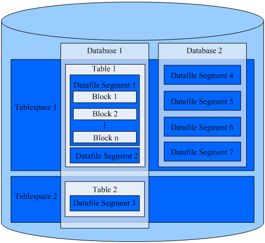
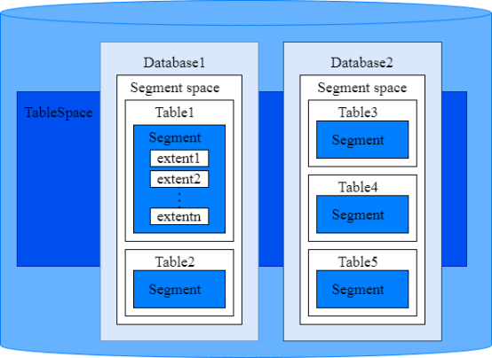
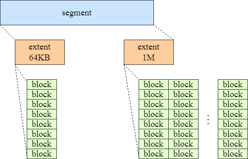

# Storage Structure

<!-- md-trans-meta sourceCommit=unknown translatedAt=2026-07-29T02:47:09.881Z pushedAt=2026-09-24T09:25:45.166Z -->

## Database Logical Structure Diagram

The database node of openGauss is responsible for storing data, and its storage medium is also disk. This section mainly introduces the objects in the database node and the relationships between them from a logical perspective. The database logical structure is shown in [Figure 1](#zh-cn_topic_0237120245_zh-cn_topic_0059779316_fb2fa3b3cc8824dea95318504e0537913).

**Figure 1**  Database logical structure diagram  

>[!NOTE]
>
> 1. Tablespace: a directory that can exist in multiples, storing various physical files of the databases it contains. Each tablespace can correspond to multiple databases.  
> 2. Database: used to manage various data objects, with each database isolated from others. The objects managed by a database can be distributed across multiple tablespaces.  
> 3. Datafile Segment: a data file. Typically, each table corresponds to only one data file. If the data of a table exceeds 1 GB, it will be split into multiple data files for storage.  
> 4. Table: each table can belong to only one database and can correspond to only one tablespace. The data files corresponding to each table must reside in the same tablespace.  
> 5. Block: a data block, which is the basic unit of database management, with a default size of 8 KB.  

## Segment-Page Storage Structure

This section introduces the database segment-page storage structure from a logical perspective. The segment-page storage structure is shown in Figure 1.

**Figure 1** Segment-page storage structure diagram  
  

>[!NOTE] Note
>
> 1. Tablespace: a directory that can exist in multiples, storing various physical files of the databases it contains. Each tablespace can correspond to multiple databases.  
> 2. Database: used to manage various data objects, with databases isolated from each other. Objects managed by a database can be distributed across multiple tablespaces.  
> 3. Segment space: each database has exactly one segment space, which is created when the database is created. Each segment space contains five files, named 1, 2, 3, 4, and 5. File 1 stores metadata related to segment-page storage, while files 2 through 5 store user data and some segment-page-related metadata.  
> 4. Table: each table can belong to only one database and can correspond to only one tablespace. The data files corresponding to each table must reside in the same tablespace.  
> 5. Segment: used to store table data. Each table has a logical segment.  
> 6. Extent: all data of a segment is stored in the five files of the segment space in units of extents. There are four extent types: 64 KB, 1 MB, 8 MB, and 64 MB. Extents of the same type are stored in the same physical file. The distribution of extents within a segment is shown in Figure 2.  

**Figure 2** Extent distribution structure diagram of a segment  
  

>[!NOTE] Note
>
>Each segment is attached with multiple extents. Extents are not necessarily contiguous with each other, but the pages (blocks, each 8 KB in size) within the same extent are contiguous.