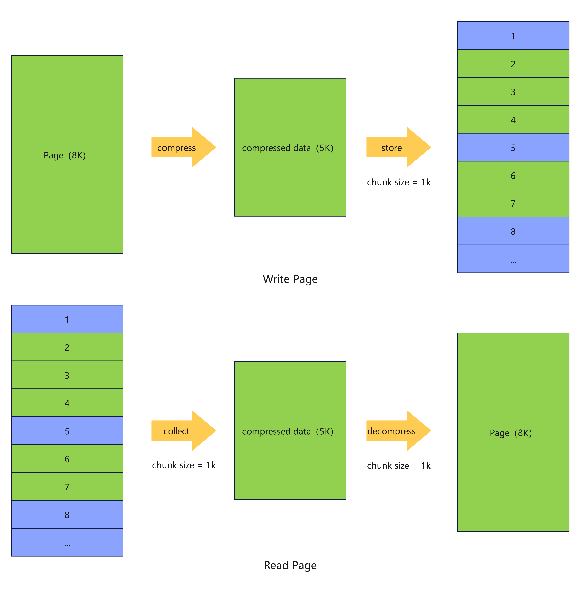
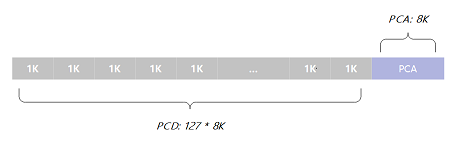
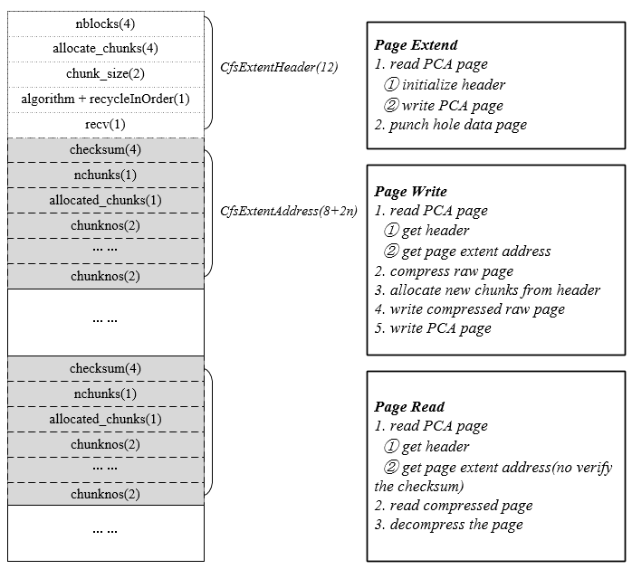
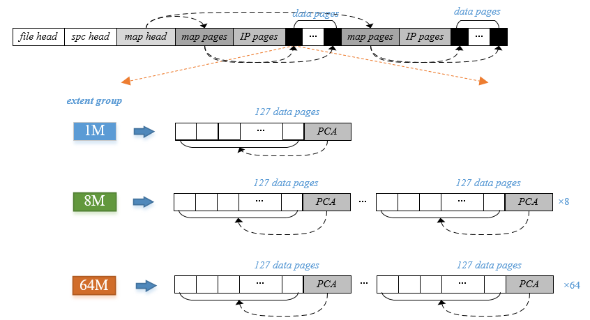

# Supporting Data Compression in OLTP Scenarios

<!-- md-trans-meta sourceCommit=unknown translatedAt=2026-07-29T02:47:40.504Z pushedAt=2026-09-11T11:59:02.102Z -->

## Availability

This feature is introduced since openGauss 3.0.0.

In openGauss 3.1.0, the pca file and pcd file are consolidated into a single file; pca performs independent loading and eviction management, no longer relying on mmap operations; and chunk defragmentation is added.

In openGauss 5.1.0, modification of compression-related parameters for row-store tables is supported.

The official commercial release will be available in openGauss 7.0.0.

## Feature Overview

In OLTP scenarios, for data and index pages of row-store tables (including Ustore and Astore), openGauss provides a transparent page compression feature based on a general-purpose compression algorithm, reducing disk space usage while maintaining high performance in OLTP scenarios.

## Customer Value

Data compression reduces storage space usage while maintaining high OLTP performance.

## Feature Description

openGauss OLTP scenario data compression is implemented through transparent page compression. During the write-to-disk process of a single page, the compression algorithm is first invoked to compress the data, and the compressed data is organized in units of chunks before being written to disk. The chunk size can be configured in the table definition and is related to the page size, with configurable options of 1/2, 1/4, 1/8, or 1/16 of the page size. The read-from-disk logic is the reverse: all chunks belonging to the same page are first read, assembled into the compressed data, decompressed, and then loaded into the buffer cache. The above modifications are implemented at the file interface layer, and for upper-layer interfaces, these modifications are transparent.

Taking a page of 8 KB, a chunk size of 1 KB, and a compressed size of 5 KB as an example, the correspondence between the original data and the compressed stored data during the read and write process is illustrated in the following figure:



The compressed data is stored in a certain number of chunks, and the quantity and location information of these chunks must also be stored. These two parts of content are stored in two areas: pcd (page compressed data) and pca (page compression address). The pcd area stores the compressed data in units of chunks, while the pca area stores information such as the number of chunks and their addresses corresponding to each page, as shown in the following figure:



One pca page manages the space equivalent to 127 pcd pages, corresponding to 128 uncompressed data pages, which is referred to as a `cfsExtent` in compression. Since the compressed data is less than or equal to the original page size (if compression would increase the size, the page is not compressed), there is typically unused free space at the end of a `cfsExtent`. This portion of space is allocated using the file system punch hole method and does not occupy actual disk space, thereby achieving disk space compression.

openGauss compression employs general-purpose compression algorithms, with the following options available: ZSTD, PGLZ, and ZLIB. The decompression performance of these general-purpose compression algorithms is typically much better than their compression performance, so the compression feature has a relatively minor impact on page read performance. As for page write operations, they are usually performed asynchronously by background threads, and therefore have a relatively minor impact on user SQL performance as well.

## Feature Constraints

- Only row-store tables and indexes support compression, that is, ordinary row-store tables and B-tree/UB-tree indexes support compression, and both page-based storage and segment-page storage are supported.
- The operating system must support the punch hole operation.
- The data backup media must support the punch hole operation.
- Modifying compression-related parameters of row-store tables is supported, and doing so will rebuild the row-store table. Modifying compression-related parameters of indexes is not supported.
- Compression and decompression operations have a certain impact on CPU and performance. The advantage is that they increase disk storage capacity, improve disk utilization, and simultaneously save disk I/O, reducing disk I/O pressure.
- From version 3.1.0 to versions prior to 7.0.0, this feature is converted to a non-commercial feature. When creating or modifying row-store compressed database objects, the GUC parameter `support_extended_features` must be enabled.
- Segment-page storage is not supported in versions prior to 7.0.0.

## Dependencies

- The database must support dual-write operations.
- Compression uses the open-source compression algorithms PGLZ, ZSTD, and ZLIB.
- If KAE is installed on the server and the corresponding paths are configured in LD_LIBRARY_PATH, hardware-accelerated KAEZstd and KAEZlib can be used in place of native ZSTD and ZLIB, improving the efficiency of the corresponding compression and decompression interfaces and reducing CPU usage. For an introduction to KAE and installation instructions, see: [KAE Product Introduction](https://www.hikunpeng.com/document/detail/en/kunpengaccel/kae/usermanual/kunpengaccel_16_0002.html).

## Basic Principles

### Compressed Page Read and Write

A compressed data `cfsExtent` is managed by a pca page, and its detailed structure is shown in the following figure:



A pca page consists of a `CfsExtentHeader` at the head and multiple `CfsExtentAddress` entries. In `CfsExtentHeader`, `nblocks` indicates the number of logical pages in the `cfsExtent`, `allocate_chunks` indicates the number of chunks already allocated in the current pcd and also represents the number of the last chunk that has been allocated, `chunk_size` is the size of a single chunk, the byte following `chunk_size` stores the compression algorithm and defragmentation information, and the last byte `recv` is reserved.

Each `CfsExtentAddress` corresponds one-to-one with a logical data page. The first 4 bytes are `chunksum`, while `nchunks` and `allocated_chunks` each occupy 1 byte, representing the number of chunks currently occupied by the compressed data and the number of chunks actually allocated for the logical page, respectively. Following these is the `chunknos` list, with each entry occupying 2 bytes, totaling the maximum possible number of chunks for one logical page, of which the first `allocated_chunks` entries are valid. For example, if the page size is 8 KB and `chunk_size` is 1 KB, then there are 8 `chunknos` entries here; if the compressed data occupies 5 KB and only 5 chunks are allocated, the last 3 `chunknos` entries are invalid.

The conversion between in-memory logical pages and on-disk compressed data storage was introduced earlier, and the figure above illustrates the page read/write process for compressed data in conjunction with pca.

Page write:

- Calculate the cfsExtent where the logical page resides and its sequence number within the cfsExtent based on the logical page number, read the pca page within the cfsExtent, and obtain the CfsExtentHeader and the address information structure CfsExtentAddress for that logical page;
- Compress the data using a general-purpose compression algorithm, and split the data into units of chunk_size;
- Allocate the corresponding number of chunks from within the extent, and update the in-memory CfsExtentHeader and CfsExtentAddress;
- Write the compressed data to the corresponding chunks on the disk;
- Write the modifications to `CfsExtentHeader` and `CfsExtentAddress` to the disk.

Page read:

- Calculate the `cfsExtent` where the logical page resides and its sequence number within the `cfsExtent` based on the logical page number, read the pca page within the `cfsExtent`, and obtain the `CfsExtentHeader` and the address information structure `CfsExtentAddress` of the logical page;
- Read all chunks and concatenate them into the compressed data;
- Decompress by calling the general decompression algorithm.

Extent expansion:

- Initialize `CfsExtentHeader`, and flush the pca page to disk;
- Allocate pcd space for 128 pages using the punch hole method (does not occupy actual disk space).

#### Defragmentation

Under normal circumstances, when a new page is compressed and written to disk, it occupies contiguous chunks within the pcd space. However, as data changes, the size of the compressed data also changes, which may necessitate the allocation of new chunks or result in previously allocated chunks that are not actually filled with data. The former leads to additional I/O read operations during disk access, affecting performance, while the latter causes degradation of the compression ratio. To address these issues, the compression feature provides a defragmentation interface. After defragmentation, the chunks corresponding to a page become fully contiguous and are arranged sequentially according to the `CfsExtentAddress` in the pca.

#### Segment-Page Storage Adaptation

For a detailed introduction to segment-page storage, see [Segment-Page Storage Structure](../database_administration_guide/storage_structure.md). Under segment-page storage, data distribution satisfies the following characteristics:

- Each `<tablespace, database>` shares the same segment-page space (`SegSpace`), which contains five `Group`s. Each `Group` corresponds to one logical file, and extents of the same type are stored in the same logical file. A logical file consists of multiple 1 GB physical files. For example, the logical file corresponding to `Group 0` is named 1, and it consists of a series of physical files such as 1, 1.1, and 1.2. Each physical file has a maximum size of 1 GB, and exceeding 1 GB triggers the creation of the next physical file.

- Each table/index has one logical `segment`, and all data of that table is stored on that `segment`.

- Each `segment` is attached to multiple `extent`s (extents in segment-page storage, which are different from the compression `cfsExtent`). Each `extent` is a contiguous block of physical pages. `Extent`s are not necessarily contiguous with each other, but `page`s within the same `extent` are contiguous. At the same time, the number and order of each type of `extent` that each `segment` can request are fixed. The range of `extent`s stored in the remaining four `Group`s for each `segment` is shown in the following table `Extent count range`. For example, each `segment` can only request 16 extents in `Group 1`, that is, logical file 2, and each extent is 64 KB in size. (Note that `extent count` from 1 to 16 here refers to the sequence number within a single `segment`. In fact, logical file 2 contains the first 16 `extent`s of all `segment`s in that segment-page space.)

| Group | Extent size | Extent logical page count | Extent count range | Total logical page count | Total size | File Name |
| ----- | ----------- | ------------------------- | ------------------ | ------------------------ | ---------- | --------- |
| 0     | 8K          | 1                         | /                  | /                        | /          | 1         |
| 1     | 64K         | 8                         | [1, 16]            | 128                      | 1M         | 2         |
| 2     | 1M          | 128                       | [17, 143]          | 16384                    | 128M       | 3         |
| 3     | 8M          | 1024                      | [144, 255]         | 128K                     | 1G         | 4         |
| 4     | 64M         | 8192                      | [256, ...]         | ...                      | ...        | 5         |

Segment-page tables and indexes also support compression. However, since segment-page data itself is organized at the segment-page `extent` granularity, while compressed data is organized at the `cfsExtent` granularity, an adaptation between the two is required for segment-page compression scenarios.

Since a cfsExtent contains 128 pages (127 logical pages + 1 PCA page), taking group 2 as an example, one extent is exactly 128 pages. If allocated to a compressed table, it actually consists of one cfsExtent and therefore can store only 127 logical pages. Similarly, each extent in group 3 and group 4 consists of 8 and 64 cfsExtents, respectively. The processing logic within each cfsExtent is consistent with that of page-based storage: after 128 pages are allocated, the pcd area is initialized using the punch hole technique, which does not occupy actual space, and space is allocated only when data is written. For group 1, since its extent size is smaller than one cfsExtent, its data will not be compressed even if allocated to a compressed table.



| Group | Extent size | Extent logical page count | Extent count range | Total logical page count | Total size | File Name |
| ----- | ----------- | ------------------------- | ------------------ | ------------------------ | ---------- | --------- |
| 0     | 8K          | 1                         | /                  | /                        | /          | 1         |
| 1     | 64K         | 8                         | [1, 16]            | 128                      | 1M         | 2         |
| 2     | 1M          | 127                       | [17, 143]          | 16252                    | 128M       | 3         |
| 3     | 8M          | 1016                      | [144, 255]         | 127K                     | 1G         | 4         |
| 4     | 64M         | 8128                      | [256, ...]         | ...                      | ...        | 5         |

Due to the existence of pca pages, a segment-page extent allocated to a compressed table can only represent the original `127/128` of the pages. For example, a 1 MB extent can hold 128 pages for an uncompressed table, but if the table is compressed, this extent can only hold 127 logical pages. Therefore, for segment-page compressed tables, the conversion between logical page numbers and physical page numbers is as shown in the figure above: the pages that can be represented by extents in groups 2, 3, and 4 are reduced to the original `127/128`.

#### Enabling KAE

After installing KAE, configure the lib path of KAEZlib in the environment variable, then start openGauss to use the KAEZlib library (note that the KAE lib path must be placed before the zlib library bundled with openGauss). The configuration method is as follows:

```shell
#Configure the lib path of KAEZlib to the environment variable.
export LD_LIBRARY_PATH=/usr/local/kaezip/lib:$LD_LIBRARY_PATH
```

## Usage Guide

For related parameters, see [Parameters Related to Efficient Data Compression Algorithms](../database_reference/parameters_related_to_efficient_data_compression_algorithms.md).

### Usage Examples

- Creating a compressed table

```sql
-- -- Page-based storage
create table tbl (c_int1 int, c_int2 int) with (compresstype=2,compress_chunk_size=1024,compress_level=1);
-- -- Segment-page storage
create table tbl (c_int1 int, c_int2 int) with (segment=on, compresstype=2,compress_chunk_size=1024,compress_level=1);
```

- Creating compressed primary keys and indexes

```sql
-- Specify compression when creating a primary key.
alter table tbl add constraint tbl_pkey primary key (c_int) WITH (compresstype=2, compress_chunk_size=1024, compress_level=1);
-- Specify compression when creating an index.
create index tbl_idx on tbl (c_int2) WITH (compresstype=2, compress_chunk_size=1024, compress_level=1);
```

- ALTER TABLE supports compression.

```sql
create table tbl (c_int1 int, c_int2 int);
alter table tbl set (compresstype=2,compress_chunk_size=1024,compress_level=1);
```

- Defragmentation

```sql
shrink table tbl;
```
