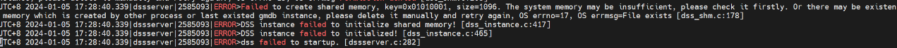

# Header File Not Erased

<!-- md-trans-meta sourceCommit=unknown translatedAt=2026-07-29T02:47:16.791Z pushedAt=2026-09-11T11:59:34.594Z -->

## Symptoms

When installing the database again in the same environment where a database was previously installed, the following error occurs.



## Cause

The header file was not erased or the database installation directory was not deleted before reinstallation.

## Solution

- Erase the header files.

 ```shell
 #/home/test/dss/dev/dss-dba is $DSS_HOME. You can directly replace the path with $DSS_HOME.
  dd if=/dev/zero of=/home/test/dss/dev/dss-dba bs=2M count=51200 >/dev/null 2>&1
  ```

  - Delete the database installation directory.

```shell
#The data directory is the database installation directory.
rm -rf /home/test/data/node1 /home/test/data/node2
```
