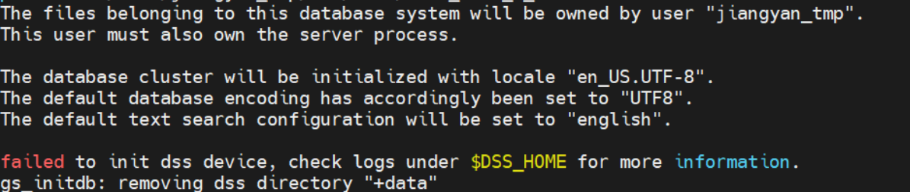

# Unable to Start a Node Independently

<!-- md-trans-meta sourceCommit=unknown translatedAt=2026-07-29T02:47:39.599Z pushedAt=2026-09-11T12:00:12.494Z -->

## Symptom

Starting a single node independently using gs_ctl start fails and remains in a waiting state. The log displays the following error.

## Cause

The primary and standby nodes were not started simultaneously.

## Solution

In the cm_config.ini file, set REFORMER_ID to 0 and BITMAP_ONLINE to 1, and the node can then be started independently.

> [!NOTE]Note
  >
  > - The above scenario applies to a database installed under a primary-standby configuration.
  > - The /data/node1 directory is the installation directory of data node 1.
  > - The cm_comfig.ini file is located under the /openGauss-server/src/test/ss/ directory.
