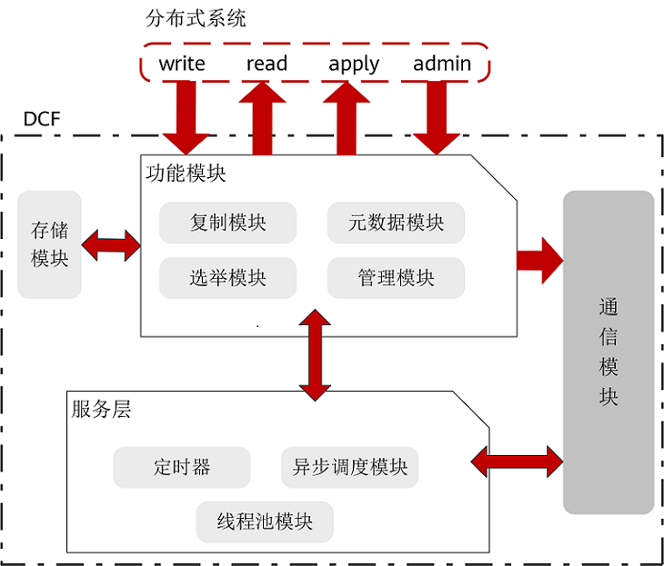
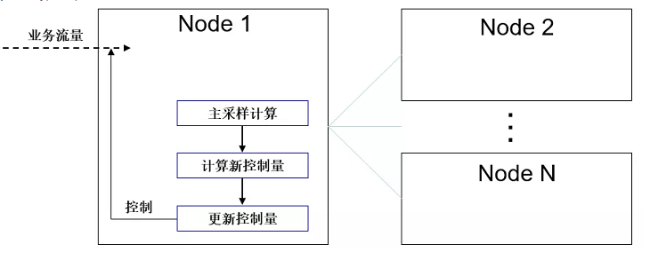

# DCF Usage

<!-- md-trans-meta sourceCommit=unknown translatedAt=2026-07-14T08:04:15.558Z -->

DCF stands for Distributed Consensus Framework. It implements consensus algorithms such as Paxos and Raft to solve typical distributed consistency problems. Using DCF provides capabilities including log replication and cluster high availability. DCF offers leader election, supports minority startup, and allows dynamic traffic adjustment for log replication. It also provides multiple Paxos-based node role types that can be adjusted as needed.

DCF is a high-performance, mature, reliable, scalable, and user-friendly standalone foundational library. Other systems can easily integrate with DCF through its interfaces to gain the strong consistency, high availability, and automatic disaster recovery capabilities provided by the Paxos algorithm.

## Architecture Overview<a name="section1667455612274"></a>

The DCF functional architecture is shown in [Figure 1](#fig31591049102410), which mainly includes: functional modules, storage modules, communication modules, service layer, etc.

**Figure 1**  DCF functional architecture<a name="fig31591049102410"></a>  


- **Algorithm module:**

    The algorithm module is implemented based on the Multi-Paxos protocol. To meet specific business scenarios and requirements for high performance and ecosystem compatibility, DCF introduces numerous functional extensions and performance optimizations. Compared to basic Multi-Paxos, DCF offers richer functionality and significantly improves performance across various deployment scenarios. It mainly includes the leader election module, log replication module, metadata module, and cluster management module.

- **Storage module:**

    For specific business scenarios and ultimate high performance, DCF extracts a set of public interfaces for log storage and implements a default high-performance storage module. Users with specific scenarios or demanding ultra-high performance and cost optimization can integrate their existing storage systems with DCF's log storage interfaces to meet their needs. This is one of the key advantages of DCF as a third-party standalone library.

- **Communication module:**

    The communication module is primarily based on MEC (Message Exchange Component) and provides inter-instance communication capabilities within the DCF component, along with an asynchronous event processing framework. Its main features include extensible communication protocols, unicast, broadcast, and loopback sending interfaces, an asynchronous message processing framework, multi-channel mechanisms, multi-priority queues, and support for compression and batch sending.

- **Service layer:**

   The service layer is the foundation that drives the entire DCF operation, providing essential services required for program execution. These include locks, asynchronous task scheduling, thread pool services, and timer capabilities.

## Feature Description<a name="section392523316281"></a>

- **Support for Online Node Addition/Removal and Leader Transfer**

    Building upon standard Multi-Paxos, DCF supports adding and removing nodes online, as well as transferring the leader role to other nodes online. This makes DCF suitable for a wider range of business scenarios and fosters an open ecosystem.

- **Support for Priority-Based Leader Election and Policy-Based Quorum**

    - **Policy-based quorum:** In classic Paxos theory, data can be committed once a majority is reached. However, the majority is non-deterministic, meaning there is no guarantee that specific nodes will hold complete data. In practical applications, nodes in geographically closer locations often maintain strongly consistent data, while remote nodes remain in a non-strongly consistent state. Consequently, these remote nodes cannot be activated as primaries during city-level disaster recovery scenarios, rendering them ineffective. The policy-based quorum capability allows users to dynamically configure specific nodes to mandatorily retain strongly consistent data, enabling immediate activation as primaries when disaster recovery is required.

    - **Priority-based leader election:** Users can specify priorities for each node. DCF strictly follows the configured priorities for leader election. Nodes with lower priority are activated only when all higher-priority nodes are unavailable.

- **Support for diverse node roles**

    In addition to classic roles such as Leader, Follower, and Candidate, DCF provides customized roles. Examples include the Passive role (holds logs and data, but has no eligibility for election and does not participate in quorum voting) and the Logger role (holds logs but no data, has no eligibility for election, but participates in quorum voting). With support for these roles, DCF enables multi-cluster deployment methods such as node synchronization and mixed synchronous-asynchronous deployments.

- **Batch & Pipeline**

    - **Batch:** DCF supports multi-level batch operations, mainly including:

        - Merging multiple logs into a single message for sending.

        - Merging multiple logs for disk writing.

        - Merging multiple logs for replication.

        Batching effectively reduces overhead caused by small message granularity and improves throughput.

    - **Pipeline:** This refers to the mechanism of concurrently sending the next message to the corresponding node before receiving the response for the previous message. By increasing the number of concurrently sent messages (pipeline depth), single-request latency can be effectively reduced, thereby improving performance. DCF adopts a fully asynchronous approach in stages such as log persistence, network transmission, and log replication to maximize pipeline performance.

- **Efficient Flow Control Algorithm**

    While batching and pipelining improve overall system throughput and performance, excessively large batches can increase single-request latency, leading to high concurrency and subsequently degrading both throughput and request latency. To address this, DCF designs and implements an efficient adaptive flow control algorithm. It automatically probes network bandwidth, network transmission latency, and request concurrency, then dynamically adjusts batch and pipeline parameters to regulate business traffic injection.

    The flow control algorithm process is shown in [Figure 2](#fig548518330404):

    **Figure 2**  Flow control algorithm process<a name="fig548518330404"></a>  
    

    The core algorithm flow is as follows:

    1. The DCF primary node periodically samples and calculates consensus metrics. These metrics mainly include end-to-end consensus latency, end-to-end log bandwidth for consensus, and overall system log replay bandwidth.

    2. Based on current sampling results and historical data, the primary node determines the performance trend. It then adjusts the control direction and step size according to historical control values and trends, calculating a new control variable toward optimal performance.

    3. Update the control variable upon the arrival of the control cycle.

    4. Continuously apply the control variable to business traffic to regulate the frequency of traffic injection.

## Usage Example<a name="section763763217423"></a>

Assume a three-node cluster with IP addresses 192.168.0.11, 192.168.0.12, and 192.168.0.13. The node IDs are 1, 2, and 3, respectively. The node roles are LEADER, FOLLOWER, and FOLLOWER.

To use DCF capabilities, enable `enable_dcf` (default is `off`) in the configuration file during OM-based installation and deployment, and configure the DCF parameters accordingly.

Obtain the XML template file from `script/gspylib/etc/conf/centralized/cluster_config_template_HA.xml`.

Each line contains comments for clarification. The bold content relates to DCF. An example is as follows:

```
<?xml version="1.0" encoding="UTF-8"?>
<ROOT>
  <!-- Global Information -->
  <CLUSTER>
  <!-- Database name -->
    <PARAM name="clusterName" value="Sample1" />
  <!-- Database node name (hostname) -->
    <PARAM name="nodeNames" value="node1,node2,node3" />
  <!-- Node IPs, corresponding to nodeNames in order-->
    <PARAM name="backIp1s" value="192.168.0.11,192.168.0.12,192.168.0.13"/>
  <!-- Database installation directory-->
    <PARAM name="gaussdbAppPath" value="/opt/huawei/newsql/app" />
  <!--Log directory-->
    <PARAM name="gaussdbLogPath" value="/opt/huawei/logs/gaussdb" />
  <!--Temporary file directory-->
    <PARAM name="tmpMppdbPath" value="/opt/huawei/logs/temp" />
  <!--Database tool directory-->
    <PARAM name="gaussdbToolPath" value="/opt/huawei/tools" />
  <!--Cluster database type. This example shows a non-distributed (centralized) type.-->
    <PARAM name="clusterType" value="single-inst"/>
  <!--Enable DCF Mode: on to enable, off to disable-->
    <PARAM name="enable_dcf" value="on/off"/>
  <!-- DCF config information -->
    <PARAM name="dcf_config" value="[{&quot;stream_id&quot;:1,&quot;node_id&quot;:1,&quot;ip&quot;:&quot;192.168.0.11&quot;,&quot;port&quot;:17783,&quot;role&quot;:&quot;LEADER&quot;},{&quot;stream_id&quot;:1,&quot;node_id&quot;:2,&quot;ip&quot;:&quot;192.168.0.12&quot;,&quot;port&quot;:17783,&quot;role&quot;:&quot;FOLLOWER&quot;},{&quot;stream_id&quot;:1,&quot;node_id&quot;:3,&quot;ip&quot;:&quot;192.168.0.13&quot;,&quot;port&quot;:17783,&quot;role&quot;:&quot;FOLLOWER&quot;}]"/> 
  </CLUSTER>
...
```

1. Query the cluster status after installation is complete.

    Use `gs_ctl` to query the cluster status.

    ```
    # gs_ctl query –D <data_dir>
    # gs_ctl query -D /nvme0/gaussdb/cluster/nvme0/dn1
    HA state:
           local role                     : Primary   
           static connections             : 2   
           db state                       : Normal 
           detail information             : Normal 
    Paxos replication info:
           paxos write location           : 964/87134528  
           paxos commit location          : 964/87134528  
           local write location           : 964/87134528  
           local flush location           : 964/87134528  
           local replay location          : 964/87134528  
           dcf replication info           : {"stream_id":1,"local_node_id":1,"role":"LEADER","term":3,"run_mode":0,"work_mode":0,"hb_interval":1000,"elc_timeout":3000,"applied_index":14300633605."commit_index":14300633605,"first_index":14300625186,"last_index":14300633605,"cluster_min_apply_idx'14300633605,"leader_id":1,"leader_ip":"172.16.137.38","leader_port":17783,"nodes":[{"node_id":1,"id":"172.16.137.38","port":17783,"role":"LEADER","next_index":14300633606,"match_index":14300633605,"apply_index":14300633605},{"node_id":2,"ip":"172.16.137.40","port":17783,"role":"FOLLOWER","next_index":14300633606,"match_index":14300633605,"apply_index":14300633605},{"node_id":3,"ip":"172.16.137.42","port":17783,"role":"FOLLOWER","next_index":14300633606,"match_index":14300633605,"apply_index":14300633605}}}
    ```

    Where:

    - `dcf_replication_info`: indicates the DCF information of the current node.

    - `role`: Indicates the current node role. Possible roles include LEADER, FOLLOWER, LOGGER, PASSIVE, PRE_CANDIDATE, CANDIDATE, and UNKNOW. The output above shows the current node is the LEADER.

    - `term`: Election term.

    - `run_mode`: Currently, `0` indicates automatic election mode, and `2` indicates manual election mode.

    - `work_mode`: DCF working mode. `0` indicates quorum mode; `1` indicates minority mode.

    - `hb_interval`: Heartbeat interval between DCF nodes, in ms.

    - `elc_timeout`: DCF election timeout, in ms.

    - `applied_index`: Log position that has been applied to the state machine.

    - `commit_index`: Log position that has been persisted by the majority of DCF nodes. Logs prior to this index are fully persisted.

    - `first_index`: The earliest log position retained by the DCF node. This position advances forward when the DN calls `dcf_truncate`, and logs prior to this position are purged.

    - `last_index`: The latest log position retained by the DCF node. This position includes logs stored in memory but not yet persisted; therefore, `last_index >= commit_index`.

    - `cluster\_min\_apply\_idx`: The minimum applied log position across the cluster.

    - `leader\_id`: Leader node ID.

    - `leader\_ip`: Leader node IP.

    - `leader\_port`: Leader node port, used internally by DCF.

    - `nodes`: Information about other nodes in the cluster.

2. Online cluster scaling.

    To add a replica online, execute the following command:

    ```
     # gs_ctl member --operation=add --nodeid=<node_id> --ip=<ip> --port=<port> -D <data_dir>
    ```

    To remove a replica online, execute the following command:

    ```
     # gs_ctl member --operation=remove --nodeid=<node_id> -D <data_dir>
    ```

    Under normal cluster conditions, removing a single replica takes approximately 5 minutes.

3. Forced startup with a minority of nodes.

    In scenarios where a majority of nodes fail, consensus cannot be reached under the standard Paxos protocol, and the system cannot continue to provide services. To offer emergency service capabilities, the system must be forcibly started with a minority of nodes to resume operations immediately.

    Use the following command:

    ```
     # cm_ctl setrunmode -n <node_id> -D <data_dir> --xmode=minority --votenum=<num>
    ```

    In a 3-replica cluster, if two replicas fail, consensus can be reached and committed once the single surviving replica agrees.

    Use the following command:

    ```
     # cm_ctl setrunmode -n <node_id> -D <data_dir> --xmode=normal --votenum=<num>
    ```

4. Active switchover operation.

    Switch primary and standby database instances in a one-primary-multiple-standby deployment to facilitate mutual switching between Availability Zones (AZs). Switchover is a maintenance operation. Ensure the database instance status is normal, all business transactions are completed, and there is no primary-standby lag before performing the switchover.

    For example, to promote a standby node to primary, use the following command:

    ```
     # cm_ctl switchover –n <node_id> -D <data_dir>
    ```

5. Standby build functionality.

   Full build capability in primary-standby mode: Upon receiving a full build request, the primary DN suspends DCF log recycling. The standby DN replicates xlog logs and data files from the primary DN. After the standby DN starts, it sets the starting point for DCF log replication.

   Example command:

   ```
   gs_ctl build -b full -D <new_node_data_dir>
   ```