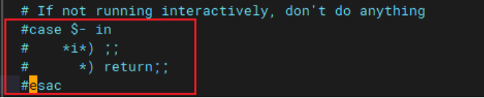

# Pre-installation Operations

<!-- md-trans-meta sourceCommit=unknown translatedAt=2026-07-10T08:50:59.852Z pushedAt=2026-07-14T07:15:07.667Z -->

## OM Adaptation for Ubuntu

### Note

Installing openGauss on Ubuntu 20.04

```shell
omm@sdr-0007:~$ uname -a
Linux sdr-0007 5.4.0-190-generic #210-Ubuntu SMP Fri Jul 5 17:03:38 UTC 2024 x86_64 x86_64 x86_64 GNU/Linux
omm@sdr-0007:~$ cat /etc/os-release NAME="Ubuntu"
VERSION="20.04.6 LTS (Focal Fossa)"
ID=ubuntu ID_LIKE=debian
PRETTY_NAME="Ubuntu 20.04.6 LTS"
```

The Linux kernel version of this OS is 5.4.0.
Those for CentOS 7, openEuler 20.03, and openEuler 22.03 are 3.10, 4.19, and 5.10, respectively.
To use the above openGauss image, you need to choose openEuler 20.03.

1. Ubuntu uses `dash` as the default sh interpreter, which means regular users do not have the `source` command. Additionally, all scripts in OM are of the bash type, so the system's `sh` must first be changed to `bash`.

    ```shell
    unlink /bin/sh
    In -s /bin/bash /bin/sh
    ```

2. Install the dependencies required by the database. Additionally, a soft link for the readline.so.7 version needs to be created. (Whether this step is necessary depends on the specific situation. If readline.so.7 cannot be found, execute the following commands.)

    ```shell
    apt install libreadline-dev libaio-devel
    In -s /usr/lib/x86_64-linux-gnu/libreadline.so.8 /usr/lib/x86_64-linux-gnu/libreadline.so.7
    ```

3. Create user groups and users, modify `.bashrc`, and comment out the `case..esac` block.

    ```shell
    groupadd dbgrp
    useradd -G dbgrp -U omm
    echo "omm:test@123" | chpasswd
    ```

Edit`/home/omm/.bashrc` and comment out these lines: (Note: These lines are designed to allow `source` only in interactive shells (CLI). If `.bashrc` is sourced from a script, the `return` guards will abort `.bashrc`, preventing any subsequently appended environment variables from being loaded.)


