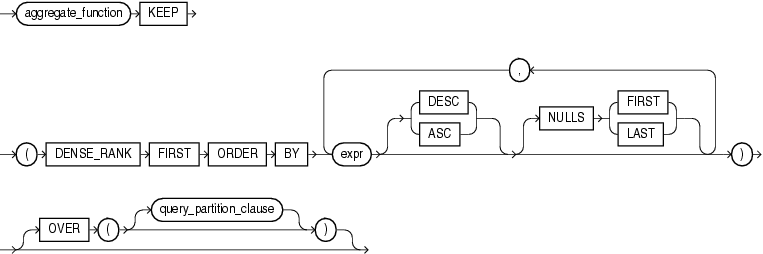

# KEEP Function

<!-- md-trans-meta sourceCommit=unknown translatedAt=2026-07-31T09:22:38.056Z -->

## KEEP Function<a name="zh-cn_topic_0283137174_zh-cn_topic_0237121983_zh-cn_topic_0059778391_s454ef5048f3142508bc4f06cb3454ebe"></a>

The KEEP function is supported only in openGauss database A mode. This function operates on values in a group of rows, sorts the group according to the specified sorting rule, and returns the element at the first or last position. It can be used as an aggregate or analytical function.

Column store tables are currently not supported.

The syntax of this function is as follows:
aggregate_function KEEP ( DENSE_RANK { FIRST | LAST } ORDER BY expr [ DESC | ASC ] [ NULLS { FIRST | LAST } ] [, expr [ DESC | ASC ] [ NULLS { FIRST | LAST } ]]...
)[ OVER ( [query_partition_clause] ) ]




Parameter description:

| Name                      | Description                                                                                               |
|---------------------------|-------------------------------------------------------------------------------------------------------|
| aggregate_function        | Specifies the type of aggregate function.                                                                                    |
| DENSE_RANK                | Generates consecutive ranking numbers for values within each group, where identical values have the same ranking number.                                                     |
| expr                      | Can be any expression.                                                                                      |
| FIRST/LAST                | Specifies which position's value of the sorted expr to return. FIRST indicates returning the element at the first position. LAST returns the element at the last position.                         |
| DESC/ASC                  | Specifies the sorting method of the list. This is optional. ASC indicates ascending order, which is the default. DESC indicates descending order.                                       |
| NULLS { FIRST/LAST }      | Specifies the position of NULL values in the sorted expr. This is optional. NULLS FIRST indicates that NULL values are placed before non-null values. NULLS LAST indicates that NULL values are placed after non-null values, which is the default.                                                                                                                        |
| OVER                      | Uses the OVER clause to define a window for computation.                                             |
| query_partition_clause    | Used to define the partitioning criterion for the window function, specifying which columns to group by. Data is divided based on the values of these columns, and window computation is performed independently within each partition.|

List of aggregate functions supported by the KEEP function:

| Function Name      | Description                                                        |
|---------------|-------------------------------------------------------------|
| min(expression) | Minimum value of expression among all input rows.                       |
| max(expression) | Maximum value of expression among all input rows.                       |
| sum(expression) | Sum of expression across all input rows.                           |
| avg(expression) | Mean (arithmetic average) of all input values.                             |
| count(expression) | Number of rows returned by the query.                                 |
| stddev(expression) | Alias of stddev_samp. Computes the sample standard deviation of a set of values.           |
| variance(expression) | Alias of var_samp. Computes the sample variance of a set of values.               |

>[!NOTE]Note
>
>The KEEP function operates on values in a group of rows, sorts the group according to the specified sorting rule, and returns the element at the first or last position. It can be used as an aggregate or analytical function.

- Example

 ```
---- Create table employees and insert data into it.

create database db dbcompatibility 'A';
CREATE DATABASE

\c db
Non-SSL connection (SSL connection is recommended when requiring high-security)
You are now connected to database "db" as user "hmy".

CREATE TABLE employees (department_id INT,manager_id INT,last_name varchar(50),hiredate varchar(50),SALARY INT);
CREATE TABLE

INSERT INTO employees VALUES
(30, 100, 'Raphaely', '2017-07-01', 1700),
(30, 100, 'De Haan', '2018-05-01',11000),
(40, 100, 'Errazuriz', '2017-07-21', 1400),
(50, 100, 'Hartstein', '2019-10-05',14000),
(50, 100, 'Raphaely', '2017-07-22', 1700),
(50, 100, 'Weiss',  '2019-10-05',13500),
(90, 100, 'Russell', '2019-07-11', 13000),
(90,100, 'Partners',  '2018-12-01',14000);
INSERT 0 8

---- (1) Aggregate function example
---- Sort by salary, sum the salary of the employee ranked first; sort by hire date, sum the salary of the employee ranked last.
SELECT SUM(salary) KEEP (DENSE_RANK FIRST ORDER BY salary) "W", SUM(salary) KEEP (DENSE_RANK LAST ORDER BY hiredate) "B" FROM employees;
  W   |   B   
------+-------
 1400 | 27500
(1 row)
---- (2) Analytical function example
--For each department, sorted by salary, sum the salary of the employee ranked first; sorted by hire date, sum the salary of the employee ranked last.
SELECT last_name,department_id,salary, SUM(salary) KEEP (DENSE_RANK FIRST ORDER BY salary) OVER (PARTITION BY department_id) "W", SUM(salary) KEEP (DENSE_RANK LAST ORDER BY hiredate) OVER (PARTITION BY department_id) "B" FROM employees ORDER BY department_id, salary, last_name;
 last_name | department_id | salary |   W   |   B   
-----------+---------------+--------+-------+-------
 Raphaely  |            30 |   1700 |  1700 | 11000
 De Haan   |            30 |  11000 |  1700 | 11000
 Errazuriz |            40 |   1400 |  1400 |  1400
 Raphaely  |            50 |   1700 |  1700 | 27500
 Weiss     |            50 |  13500 |  1700 | 27500
 Hartstein |            50 |  14000 |  1700 | 27500
 Russell   |            90 |  13000 | 13000 | 13000
 Partners  |            90 |  14000 | 13000 | 13000
(8 rows)
 ```
