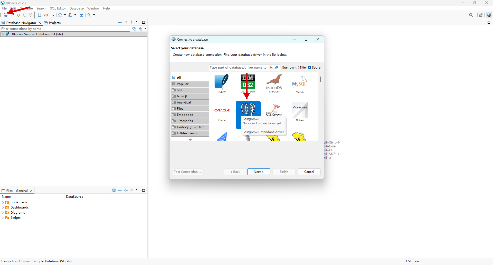
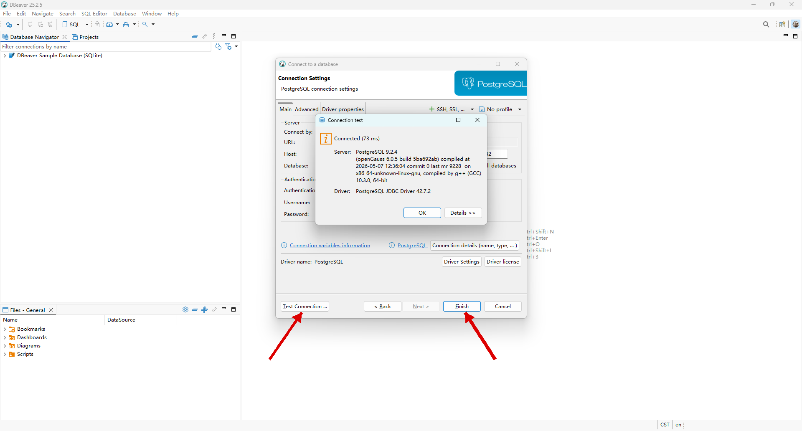

# DBeaver Connecting to an openGauss Database

This document describes how to use the DBeaver client to connect to and operate an openGauss database.

## Prerequisites

- DBeaver is installed and runs normally.
- An openGauss database is installed (this document uses version 6.0.3 as an example).
- Network connectivity: the client can reach the listening port of the openGauss server.

## Prepare an openGauss Connection User

1. Connect to the database using gsql.

   ```bash
   gsql -d postgres -p 5432 -r
   ```

2. Configure the user password encryption method.

   Modify the system parameter [password_encryption_type](https://docs.opengauss.org/zh/docs/latest/database_reference/security_and_authentication_postgresql_conf.html#password_encryption_type) so that the database uses MD5 encryption.

   ```sql
   ALTER SYSTEM SET password_encryption_type TO 0;
   ```

3. Create a connection user.

   ```sql
   create user test_user with password '******';
   ```

   > [!NOTE] Note
   > Under the MD5 encryption method, when you create a new user or modify a user password, the password is encrypted using MD5.

4. Grant privileges to the user.

   The example directly grants administrator privileges. In a production environment, apply fine-grained privilege control based on actual business requirements.

   ```sql
   grant all privileges to test_user;
   ```

5. Exit gsql.

   ```sql
   \q
   ```

## Configure Client Access Authentication

By default, openGauss forbids remote connections. You must manually configure client access authentication before remote access is allowed.

1. Add a client authentication rule.

   ```bash
   gs_guc set -N all -I all -h "host all test_user 0.0.0.0/0 md5"
   ```

   > [!NOTE] Note
   > - `test_user` is the database connection user name.
   > - Do not use the initial user `omm` for remote connections.

2. Restart openGauss to apply the configuration.

   ```bash
   gs_om -t restart
   ```

For more configuration details, see [Configuring Client Access Authentication](https://docs.opengauss.org/zh/docs/latest/database_administration_guide/configuring_client_access_authentication.html).

## Connect to openGauss Using DBeaver

### Step 1: Open DBeaver

Launch the DBeaver client.

### Step 2: Create a New Connection

Click the connection button at the top, select **PostgreSQL** as the database driver, and double-click to confirm.



### Step 3: Fill in Connection Information

In the pop-up configuration window, fill in the following information:

| Setting | Description |
| :------ | :---------- |
| Host | openGauss server address |
| Port | Default 5432 |
| Username | test_user |
| Password | The corresponding password |


### Step 4: Test and Add the Connection

Click **Test Connection**. If the connection succeeds, the openGauss version number is displayed. After confirming the settings are correct, click **Finish** to add the connection.



### Step 5: Create an SQL Editor

In the left-side connection list, right-click the added connection, choose **SQL Editor**, and then choose **SQL Editor** again from the expanded options to create an SQL editing window.


### Step 6: Execute SQL Operations

In the SQL editor, enter the following example statements:

```sql
-- Create a test table
create table test_table (
    id int,
    name varchar(50)
);

-- Insert data
insert into test_table values (1, 'zhangsan');

-- Query data
select * from test_table;
```

Select the SQL statement to execute and click the **Execute SQL Statement** button. The SQL runs and the execution result is output below the SQL editor.


## Common Issue Troubleshooting

| Symptom | Possible Cause | Suggested Resolution |
| :------ | :------------ | :------------------- |
| Connection timeout | Network unreachable or firewall blocking | Check whether the server port is open and whether the firewall rules are correct. |
| Authentication failed | Wrong username/password | Confirm the username and password are correct and check whether the password has expired. |
| Connection refused | Client authentication not configured | Follow this document to configure client access authentication. |
