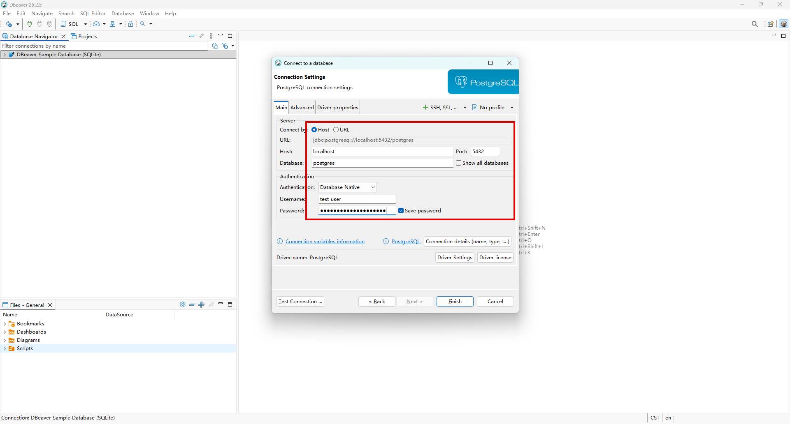
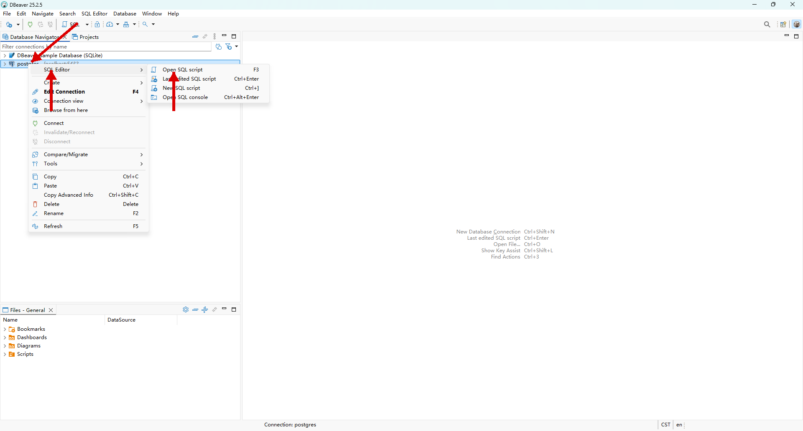
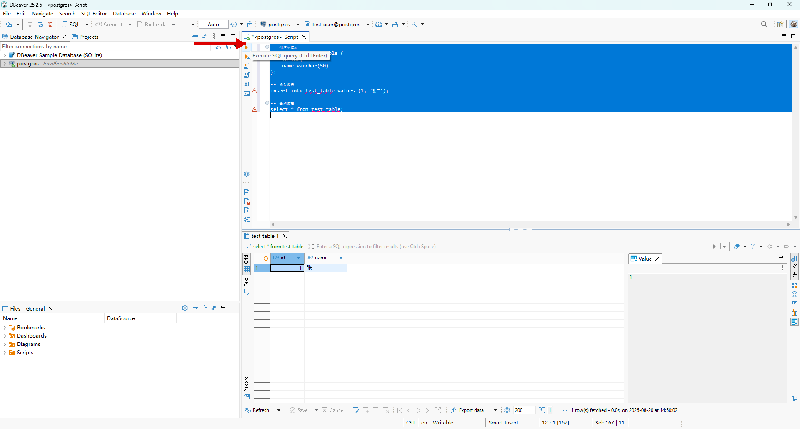

# Connecting to openGauss Using DBeaver

This document describes how to use the DBeaver client tool to connect to and operate an openGauss database.

## Prerequisites

- DBeaver has been installed and can run properly.
- openGauss has been installed. This document uses openGauss 6.0.3 as an example.
- Network connectivity: the client can access the listening port of the openGauss server.

## Preparing the openGauss Connection User

1. Use gsql to connect to the database.

   ```bash
   gsql -d postgres -p 5432 -r
   ```

2. Configure the user encryption mode.

   Change the value of the system parameter [password_encryption_type](https://docs.opengauss.org/en/docs/latest/database_reference/security_and_authentication_postgresql_conf.html#password_encryption_type) so that the database uses the MD5 encryption mode.

   ```sql
   ALTER SYSTEM SET password_encryption_type TO 0;
   ```

3. Create a connection user.

   ```sql
   create user test_user with password '******';
   ```

   > [!NOTE]
   >
   > In MD5 encryption mode, the password is encrypted using MD5 when a user is created or the password is changed.

4. Grant permissions to the user.

   In this example, the administrator permissions are granted directly. In the actual production environment, control permissions in a fine-grained manner based on service requirements.

   ```sql
   grant all privileges to test_user;
   ```

5. Exit gsql.

   ```sql
   \q
   ```

## Configuring Client Access Authentication

By default, openGauss prohibits remote connections. You need to manually configure client access authentication before accessing openGauss remotely. The configuration method is as follows:

1. Add a client authentication rule.

   ```bash
   gs_guc set -N all -I all -h "host all test_user 0.0.0.0/0 md5"
   ```

   > [!NOTE]
   >
   > - test_user is the username for connecting to the database.
   > - Remote connections cannot use the initial user omm.

2. Restart openGauss for the configuration to take effect.

   ```bash
   gs_om -t restart
   ```

For details about the configuration, see [Configuring Client Access Authentication](https://docs.opengauss.org/en/docs/latest/database_administration_guide/configuring_client_access_authentication.html).

## Connecting to openGauss Using DBeaver

### Step 1: Open DBeaver

Start the DBeaver client.

### Step 2: Create a Connection

Click the connection button at the top of the window, select "PostgreSQL" as the database driver, and double-click to confirm.


### Step 3: Enter the Connection Information

Enter the following information in the displayed configuration window:

| Configuration Item | Description              |
| :----------------- | :----------------------- |
| Host               | openGauss server address |
| Port               | 5432 (default)           |
| Username           | test_user                |
| Password           | Corresponding password   |



### Step 4: Test and Add the Connection

Click "Test Connection". If the connection is successful, the openGauss version number is displayed. After confirming that the information is correct, click "Finish" to add the connection.


### Step 5: Create an SQL Editor

In the connection list on the left, right-click the added connection and choose "SQL Editor". In the displayed submenu, choose "Open SQL script" to create an SQL editing window.



### Step 6: Execute SQL Operations

Enter the following sample statements in the SQL editor:

```sql
-- 创建测试表
create table test_table (
    id int,
    name varchar(50)
);

-- 插入数据
insert into test_table values (1, '张三');

-- 查询数据
select * from test_table;
```

Select the SQL statements to be executed and click the "Execute SQL query" button. The execution result is displayed in the lower part of the SQL editor.



## Troubleshooting

| Symptom                | Possible Cause                              | Suggestion                                                                                    |
| :--------------------- | :------------------------------------------ | :-------------------------------------------------------------------------------------------- |
| Connection timeout     | Network disconnection or firewall blocking  | Check whether the server port is open and whether the firewall rules are correct.             |
| Authentication failure | Incorrect username or password              | Ensure that the username and password are correct and check whether the password has expired. |
| Connection refused     | Client access authentication not configured | Configure client access authentication as instructed in this document.                        |
