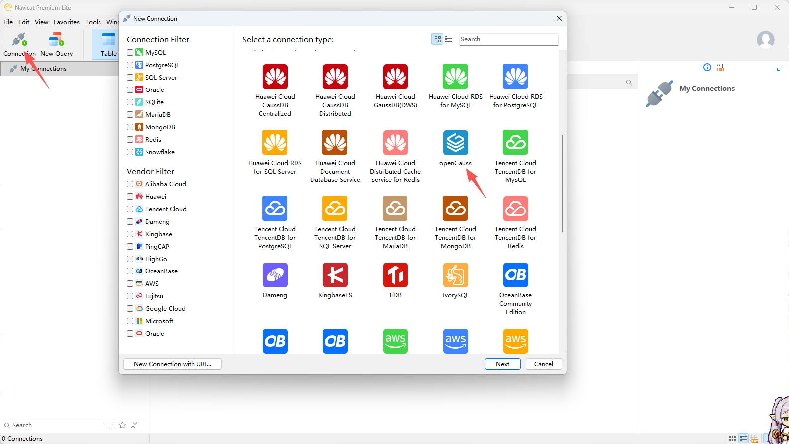
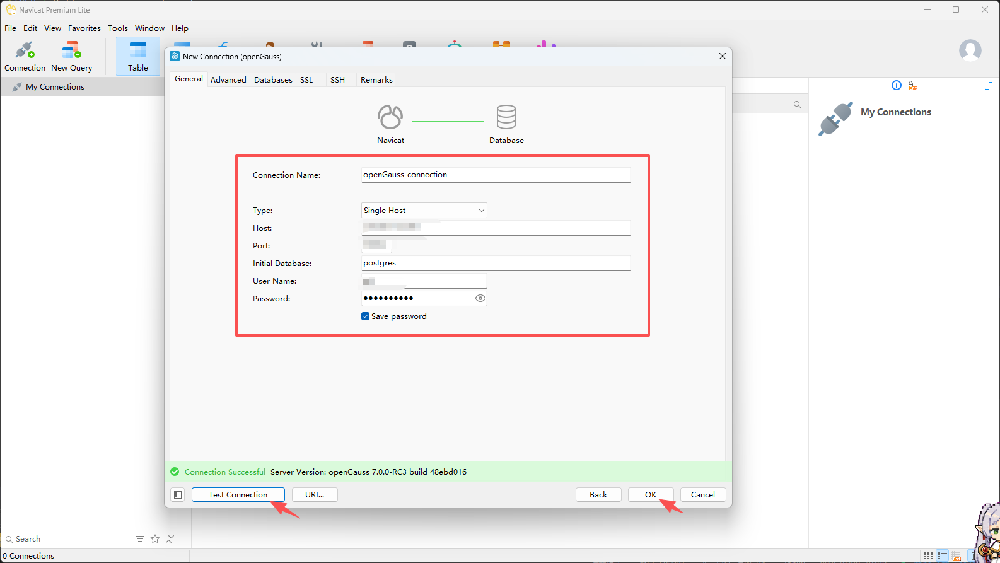
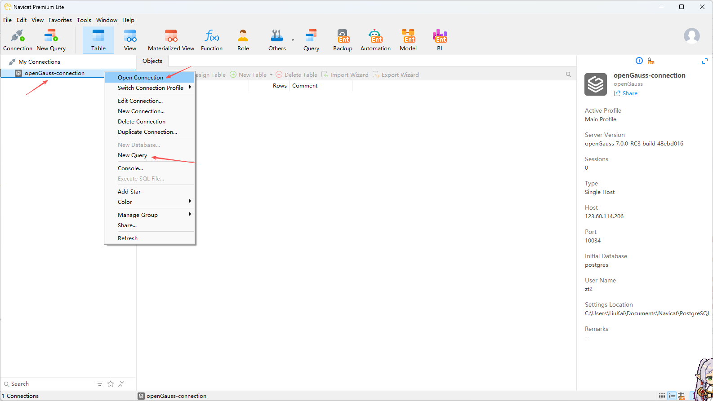
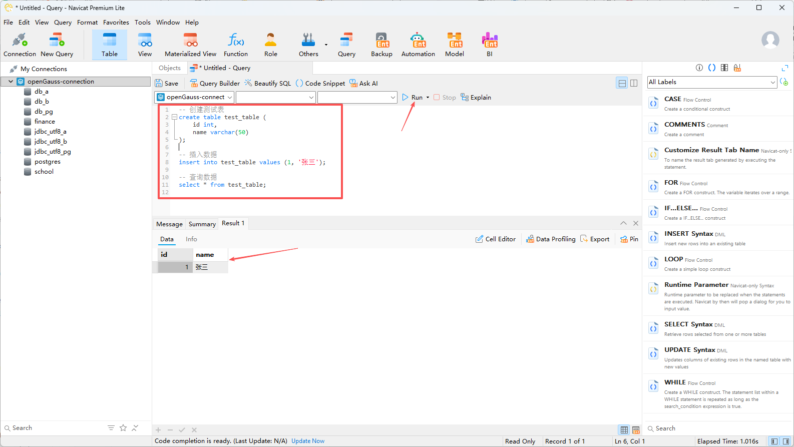

# Operation Guide for Connecting Navicat 17 to openGauss

This document describes how to use the Navicat 17 client to connect to and operate an openGauss database.

## Prerequisites

- Navicat 17 software is installed and can run normally.
- The openGauss database is installed. (This document uses version 6.0.3 as an example.)
- The network is reachable: the client can access the listening port of the openGauss server.

## Prepare the openGauss Connection User

1. Connect to the database using gsql.

    ```bash
    gsql -d postgres -p 5432 -r
    ```

2. Create a connection user.

    ```sql
    create user test_user with password '******';
    ```

3. Grant privileges to the user.

    For simplicity, this example grants administrator privileges directly. In production environments, apply fine-grained privilege control based on actual business requirements.

    ```sql
    grant all privileges to test_user;
    ```

4. Exit gsql.

    ```sql
    \q
    ```

## Configure Client Access Authentication

By default, openGauss prohibits remote connections. You must manually configure client access authentication before remote access is allowed. The configuration steps are as follows:

1. Add a client authentication rule.

    ```bash
    gs_guc set -N all -I all -h "host all test_user 0.0.0.0/0 sha256"
    ```

    > [!NOTE] Note
    >
    > - test_user is the database connection username.
    > - Remote connections must not use the initial user omm.

2. Restart openGauss to apply the configuration.

    ```bash
    gs_om -t restart
    ```

For more configuration details, refer to [Configuring Client Access Authentication](https://docs.opengauss.org/en/docs/latest/database_administration_guide/configuring_client_access_authentication.html).

## Connect to openGauss Using Navicat

### Step 1: Open Navicat

Launch the Navicat 17 client.

### Step 2: Create a New Connection

Click **Connection** in the top menu, select **openGauss** as the connection type, and double-click to confirm.



### Step 3: Fill in Connection Information

Fill in the following information in the pop-up configuration window:

| Configuration Item | Description |
| :--- | :--- |
| Host | openGauss server address |
| Port | Default: 5432 |
| Username | test_user |
| Password | Corresponding password |

After filling in the information, click **Test Connection**. If the connection succeeds, the openGauss version number will be displayed. Click **OK** to save the connection after confirming that everything is correct.



### Step 4: Open the Connection and Create a New Query

1. In the left connection list, right-click the added connection and choose **Open Connection**.
2. Right-click the connection again and choose **New Query** to open the SQL editor window.



### Step 5: Execute SQL Operations

Enter the following sample statements in the SQL editor window:

```sql
-- Create a test table
create table test_table (
    id int,
    name varchar(50)
);

-- Insert data
insert into test_table values (1, 'Zhang San');

-- Query data
select * from test_table;
```

Select the SQL statements you want to execute and click **Run** to view the execution results.



## Troubleshooting

| Issue | Possible Cause | Suggested Solution |
| :--- | :--- | :--- |
| Connection timeout | Network unreachable or firewall blocking | Check whether the server port is open and whether the firewall rules are correct. |
| Authentication failed | Incorrect username or password | Confirm that the username and password are correct, and check whether the password has expired. |
| Connection refused | Client access authentication not configured | Follow the instructions in this document to complete the client access authentication configuration. |
