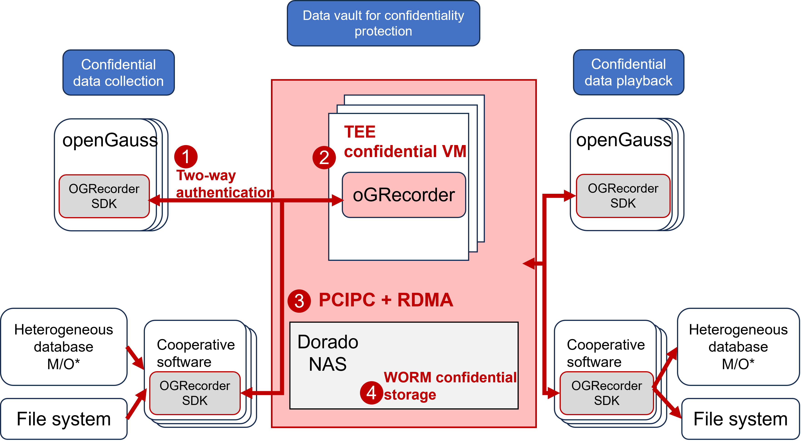

# oGRecorder (Data Vault)

GR (oGRecorder) is a database log protection software. Its typical deployment scenario runs inside virtCCA, where it connects southbound to Dorado WORM storage and interfaces northbound with the database through the oGRecorder SDK. This enables real-time synchronization of database WAL logs, forming an integrated hardware-software solution for log security protection of user database systems.

- **virtCCA** is based on hardware-enforced isolation and confidential computing capabilities, providing oGRecorder with a secure TEE (Trusted Execution Environment) that is isolated from the host OS and the REE (Rich Execution Environment).
- **Dorado WORM** storage provides Write Once Read Many technology, allowing data to be appended but never deleted or modified. This implements tamper-proof protection for database logs, preventing unrecoverable data loss when database files or backup data are hit by ransomware attacks.
- **oGRecorder** implements a VFS-like (Virtual File System) interface that supports high-performance data writing and reading, as well as secure authentication and safe data writing between the SDK and the storage layer.
- **oGRecorder SDK** provides a comprehensive set of file operation APIs for third-party software to call, enabling real-time synchronization and disaster recovery replay of database logs.

## Related Documents

- **[oGRecorder SDK API Introduction](ogrecorder_api_introduction.md)**
- **[oGRecorder Configuration Parameters](ogrecorder_configuration_parameters.md)**
- **[oGRecorder Error Log Reference](ogrecorder_error_log_reference.md)**
- **[oGRecorder Two-Way Authentication](ogrecorder_two_way_authentication.md)**
- **[oGRecorder Deployment and Operations Guide](ogrecorder_deployment_guide.md)**
- **[oGRecorder Primary-Standby Parameter Synchronization](ogrecorder_primary_standby_sync.md)**
- **[grcmd Tool Usage Guide](grcmd.md)**
