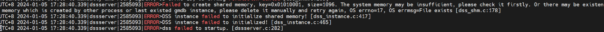

# 共享内存不足

## 现象

启动dssserver失败，并出现"dss failed to startup"字样报错。

## 原因

共享内存不足，可以进入/dss/dss0/dssdba/run目录查看日志，出现如下图的报错。

## 解决方案

利用ipcrm -m xxxx或者ipcrm -a命令清理共享内存。
> [!WARNING]注意 
>
>+ 在root用户下慎用ipcrm -a命令,会影响其他进程。
