# 慢sql问题 常见问题与解决方法


## **问题1：localsyscache不足偶发慢sql**

### 问题现象

某个sql正常执行小于10ms，但是在每天偶发会出现数次执行耗时超过1s。

statment_history里面开启L1记录执行计划，发现出现慢sql时刻也是走了索引，和正常的执行计划一致。
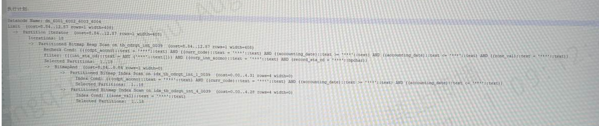


在发生慢sql后，使用 `explain analyze <sql>` 加上真实数据执行，实际耗时1ms以内：

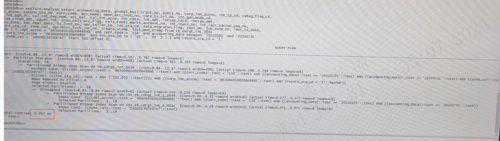

分析statment_history信息，该sql执行耗时超过1s，比较突出的是访问到的 tuples和blocks数量很大，而从上面的explain里面看，不应该访问到这么多元祖； lock_count和lock_time较大。从这几类time来看，plan_time占比最高。
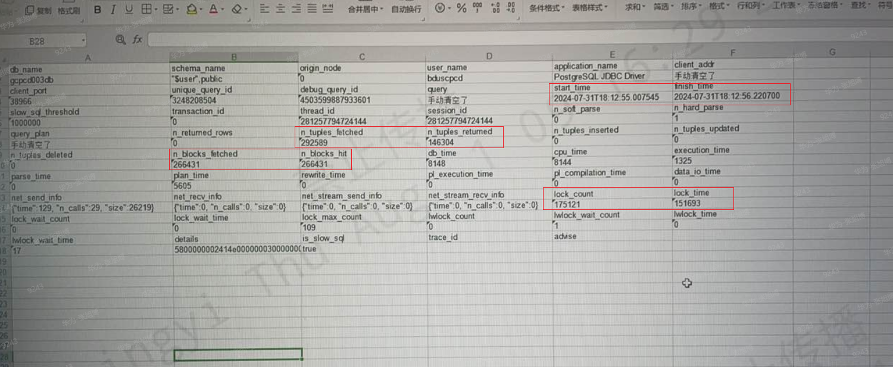
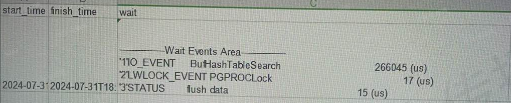

排查死元祖情况，该表只有3万多行，pg_stat_user_tables查询该表死元祖很少，没达到触发autovacuum阈值条件，也可以排查访问了很多页不可见的页面碎片导致。

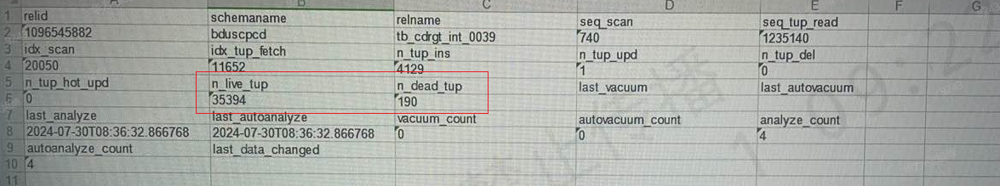


### 问题原因

对于耗时主要集中在plan_time上，后面通过脚本在遇到慢sql时候打印堆栈(gs_stack(pid)),发现问题出现在localsyscahce的清理上面。

因此在排查gs_session_memory_detail视图，发现数据库 local cache 的usedsize达到了31M+（local_syscache_theshold为32M），通过打印数据堆栈确实发现因local cache不足触发了清理缓存的动作，该库涉及的数据库表分区较多（74个），因数据库问题（清理分区cache时性能存在问题）导致分区表的cache清理较慢，sql涉及跨分区查询需等待分区cache清理完毕，进而导致出现慢SQL，最终导致交易超时。

### 问题处理

开启gloablsyscache，或者增加 local_syscache_threshold,能够覆盖会话使用。

## **问题2：存储过程中第二条查询执行慢的问题**

### 问题描述

源表过滤出6800万数据然后聚合插入到目标表，第一次性能正常，第二次性能下降。总结通用问题现象为一个存储过程里包含两个查询，查询单独拿出来都跑得很快，但是若执行存储过程，总是前面的查询跑得快，后面的查询会很慢，交换两个查询的位置也是如此，存储过程如下：

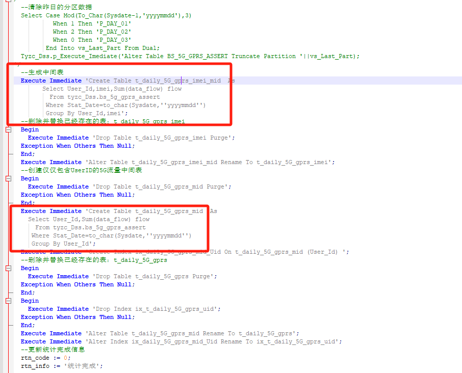

### 问题定位

获取存储过程中这两个查询的执行计划

```sh
set enable_auto_explain=on;
set auto_explain_level=notice;
```

执行存储过程，日志查看：

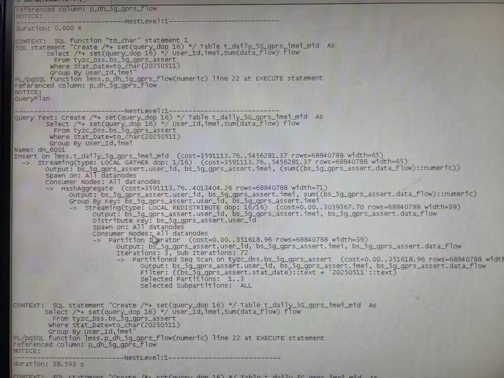
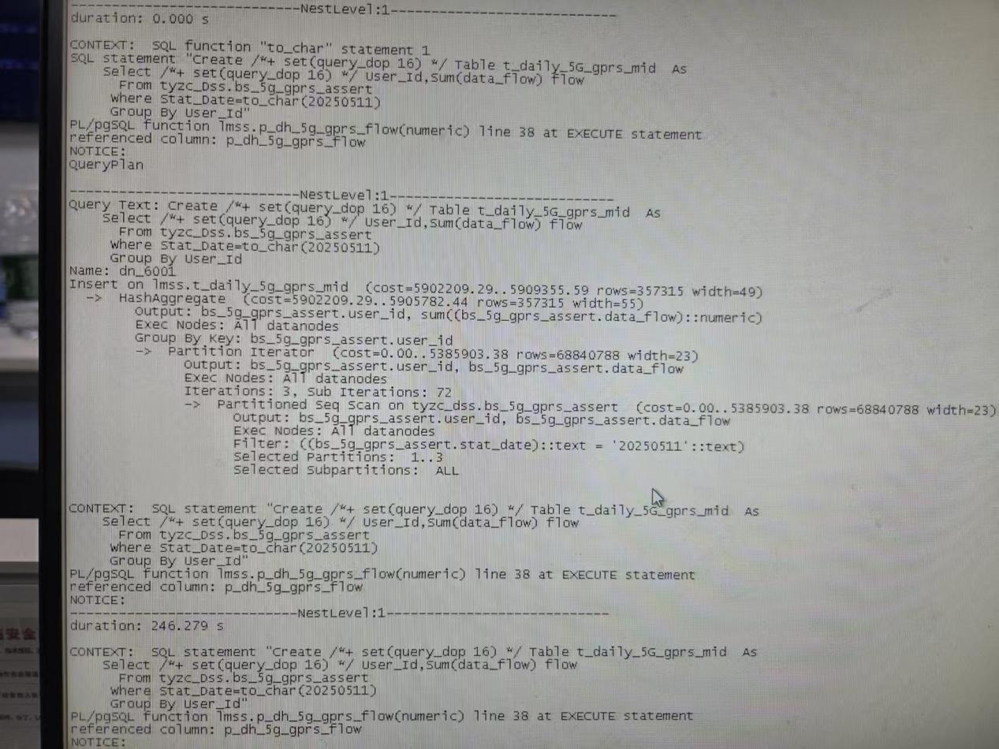

第一个执行计划中有并行线程间实现数据交换的stream算子，可见第一个查询走了SMP并行查询，但是第二个查询没有，因此第一个查询快而第二个查询慢。

### 问题原因总结

根据issue中的用例跟踪代码可发现，在存储过程中执行第二条SQL时，在 pgxc_planner 处会执行 set_default_stream，判断能否支持SMP，此时和第一次执行SQL不同之处在于 u_sess->stream_cxt.global_obj 不为NULL，导致u_sess->opt_cxt.is_stream为false，后续无法使用SMP。

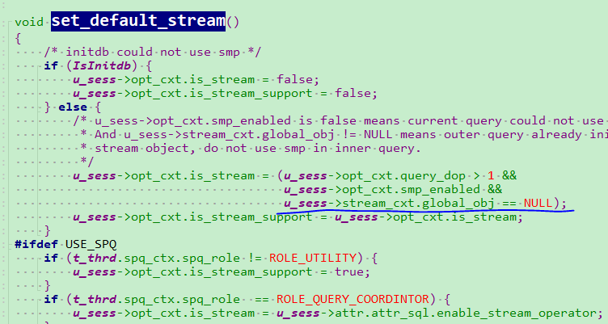

### 规避&处理措施

**规避措施：**历史版本，存储过程中的语句不支持SMP并行执行，实际存储过程中的第一条语句会走并行，此类问题可以写成两个存储过程
**处理措施：**在spi执行结束时的 _SPI_end_call处增加释放SMP group的逻辑。同时为了不释放外层的SMP，在smp里面新增变量记录SPI的_connected数量，当前smp对应的_connected必须大于等于 spi的_connected才能释放。详见：[pr](https://gitcode.com/opengauss/openGauss-server/pull/7757)

## **问题3：freeze引发sql超时故障分析**

### 问题描述

某个业务出现2次sql查询慢的情况（正常耗时<1min，异常时刻查询5小时未结束（表数据100w行左右））。同样的业务有多套集群，两次问题发生在不同的集群上。对表做analyze后恢复。此外近期也出现几次其他业务sql超时。

### 问题定位

1. 5小时未执行完sql，对比和正常的执行计划有差异。正常情况走的hashjoin，而慢sql时刻走的mergejoin。

    异常sql执行计划：
    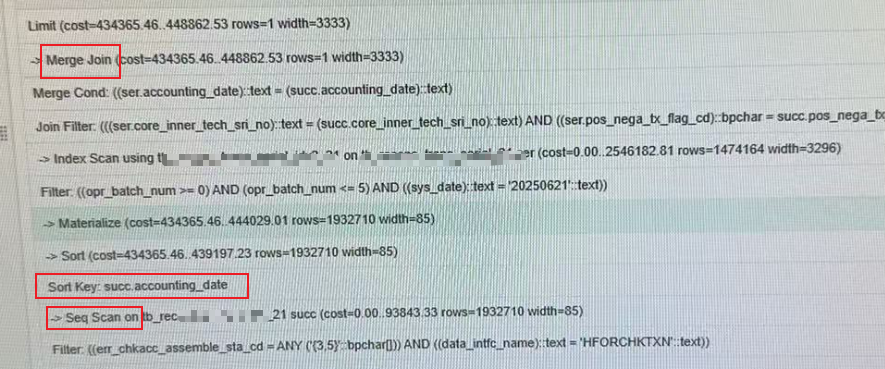

    异常时刻走了mergejoin，mergejoin要求有序，200w行数据联表的seqscan + sort，导致等待事件全部在sort上面，也是耗时长的原因。

2. 查看表的统计信息更新情况（pg_stat_user_tables）
    最近两次出异常的表，上次的更新统计时间在上个月。（该表属于按日进行的分表，前一天会truncate清理数据，在当日会有大量的业务进来）。 按照autoanalyze的配置，当日应该会触发自动analyze（阈值0.02）。但是从早上到下午都没有触发autoanalyze更新。

    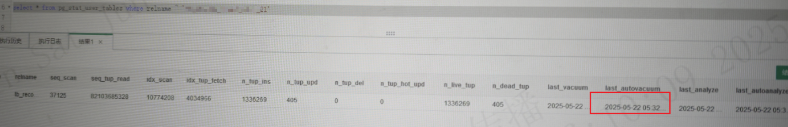
    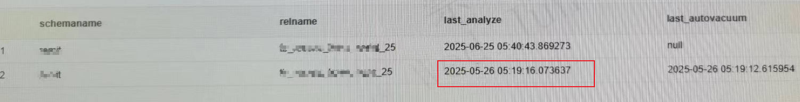

3. 自动清理说明
    `autovacuum_mode=fix` 配置在做 vacuum 时候也会触发 analyze
    `autovacuum_naptime=20s` 配置每20s轮训一次是否需要做 `vacuum|anlayze`
    `autovacuum_analyze_scale_factor=0.02` 配置当变更的元祖数（增删改）超过总行书的2%，就会出发自动analyze。
    检查上述配置没问题，那么autovacuum清理受到了阻塞。

4. 查看autovacuum线程
    `Select query from pg_stat_activity where query ~ ‘vacuum’;`
    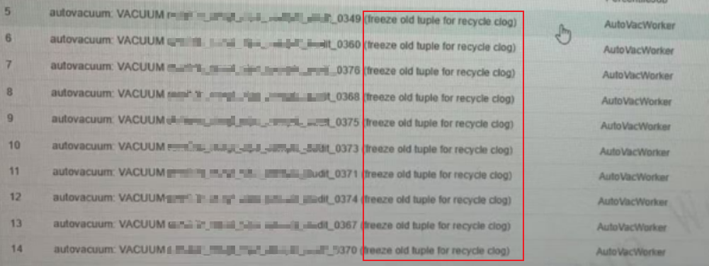

    `autovacuum_max_workers=10` 即只有10个autovacuum清理的工作线程。
    但是从视图查询出来看，发现这10个worker线程被占满了，都在做 freeze 操作，导致资源倾斜，影响了正常业务的analyze。

5. Freeze是为了避免事务回卷，主动对老表的xid进行更新的操作。
    Freeze操作将xmin标记为2，表明对所有事务都可见，同时进行清理clog文件。
     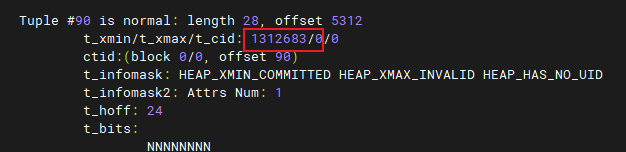
     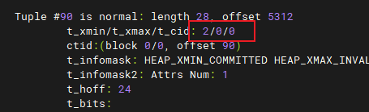     

6. 查询是否满足触发freeze。
    查询当前xid：`select txid_current();`
          
    查询数据库frozenxid： `select datname,datfrozenxid64 from pg_database;`
     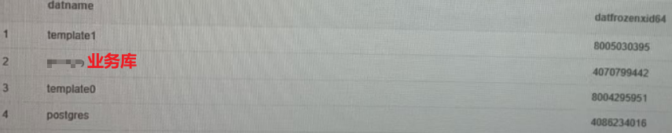    
    Autovacuum触发freeze的xid配置：autovacuum_freeze_max_age 该集群配置400亿。
    可以看到，最新xid 454亿，业务表的最小frozenxid=40亿，差值超过了400亿，满足触发freeze条件。  

7. 该系统最大的特点是表+分区+toast表很多，导致freeze需要做很长的时间才能完成。
    
    排查范围 4-55亿是当前触发freeze的表数量，还有2w张待做。其他范围也有很多表即将满足触发条件。
    select count(*)  from pg_class where relfrozenxid64::text::bigint between 4 and 5500000000;

    | Xid 范围 | 表数量 |
    | :--- | ---: |
    | 4 - 55亿 | 23404 |
    | 55亿 - 100亿 | 13029 |
    | 100亿 - 200亿 | 4565 |
    | 200亿 - 300亿 | 50126 |


### 问题原因

由于数据库触发了freeze机制，需要对大量的表做freeze推进xid，将10个worker全部占满，导致资源倾斜，影响了正常表的清理，进而引发多次sql超时现象。

### 规避&处理措施

**规避措施：**Freeze属于数据库的正常行为，有几个方案可以优化下进度：

1. 增加autovacuum_max_workers个数（改配置需要重启）
当前只有10个在处理，但是考虑到XX的表多，而且主机的负载不是很高，可以考虑增加worker个数（20 - 30个），提升freeze速度。

2. 增加autovacuum_freeze_max_age延迟清理（改配置需要重启）
   autovacuum_freeze_max_age目前是400亿，即最新事务id(当前450亿) 和表的xid差距超过400亿才会触发freeze。 将改配置调大，可以将清理往后面拖延，增加清理触发的周期。

**处理措施：**针对影响业务查询的表，每天定时做vacum analyze更新统计信息，避免影响sql耗时。

## **问题4：union 语句谓词不下推故障分析**

### 问题描述&问题定位

业务存在慢sql，sql较长，截取主要耗时的子查询与对应执行计划如下：

1. 观察openGauss的执行耗时，发现主要的耗时在union两端子句的join上：

    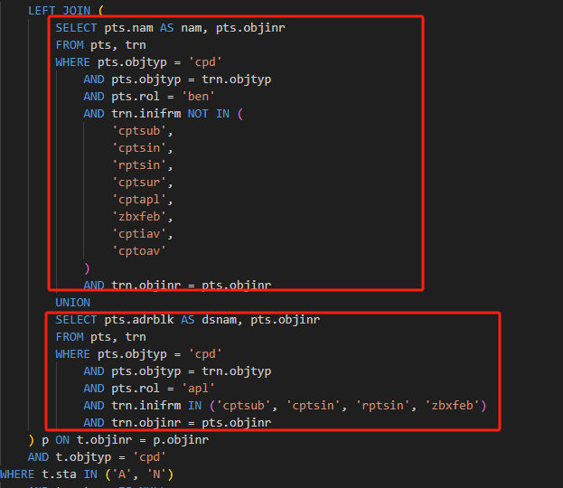

    执行计划：

    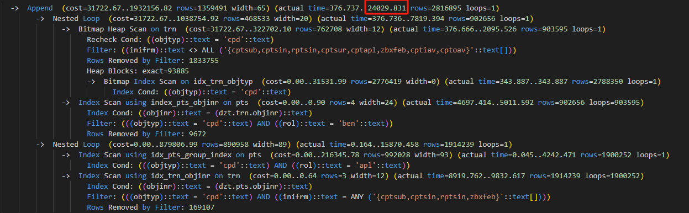

2. 分析一段子句的执行计划，该子句也是由一个join构成。扫描trn在过滤条件下扫出了90万行，因此后续采用nestloop join也要循环90万次以上。另一端子句同理。并且我们发现sql本身在外层有对trn表的谓词过滤，因此可以确定性能的瓶颈点在于谓词没有下推给union两端的子句。

3. 分析oracle的执行计划来验证我们的结论

    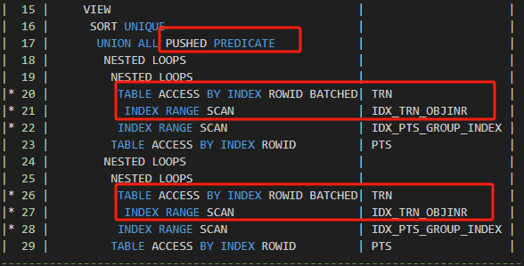
    首先我们发现oracle有明显的谓词下推关键词
    我们聚焦21行与27行，这两行为union两端子句扫描trn表的行，其对应的过滤条件如下：
    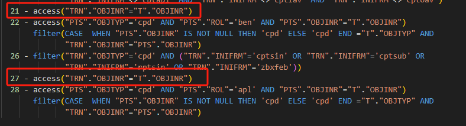    
    我们发现在oracle中，已经将对应的谓词下推（t.objinr = p.objinr），而其中t表已经做过了一轮过滤，所以union两端的时间会大大缩减，后续所有的操作都会因为join一端结果获取行数的大幅度减小而缩短时间。

4. 至此得出结论，openGauss在此种场景下不支持谓词下推。

### 问题原因

谓词下推为oracle本身自己做的特性，openGauss与postgres均没有该特性
构造最小化复现用例（参考Oracle官网对该特性描述的sql）

```sh
select prod.* from PROMOTIONS prod join (
select p.PROD_ID,AMOUNT_SOLD,s.PROMO_ID from sales s, PRODUCTS p
where s.prod_id = p.prod_id 
union 
select p.PROD_ID,UNIT_PRICE,c.PROMO_ID from COSTS c, PRODUCTS p
where c.prod_id = p.prod_id) V on prod.PROMO_ID=v.PROMO_ID and prod.prod_id = 'P8289';
```

考虑上述sql，如果存在谓词下推，那么外表prod会根据prod_id = ‘P8289’先进行一轮过滤，过滤后的表prod.PROMO_ID = v.PROMO_ID这个谓词条件会下推至V中union两端的子句，相当于添加了条件s.PROMO_ID in (select PROMO_ID from PROMOTIONS where prod_id = 'P8289') 因此效率得以提升。
在oracle中执行该语句：

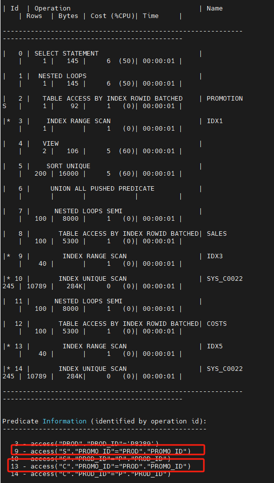  

可以看到9与13发生了谓词下推。
在openGauss中做如下实验：

1. 执行sql：

    ```sh
    select prod.* from PROMOTIONS prod join (
    select p.PROD_ID,AMOUNT_SOLD,s.PROMO_ID from sales s, PRODUCTS p
    where s.prod_id = p.prod_id 
    union 
    select p.PROD_ID,UNIT_PRICE,c.PROMO_ID from COSTS c, PRODUCTS p
    where c.prod_id = p.prod_id) V on prod.PROMO_ID=v.PROMO_ID and prod.prod_id = 'P8289';
    ```

    耗时如下：
    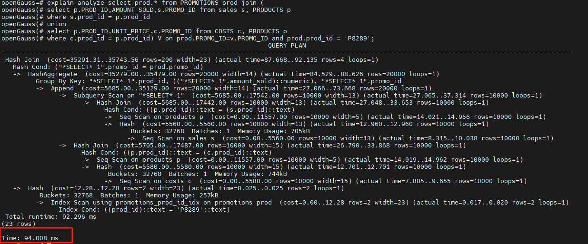 

2. 执行手动进行谓词下推的sql：

    ```sh
    select prod.* from PROMOTIONS prod join (
    select p.PROD_ID,AMOUNT_SOLD,s.PROMO_ID from sales s, PRODUCTS p
    where s.prod_id = p.prod_id and s.PROMO_ID in (select PROMO_ID from PROMOTIONS where prod_id = 'P8289')
    union 
    select p.PROD_ID,UNIT_PRICE,c.PROMO_ID from COSTS c, PRODUCTS p
    where c.prod_id = p.prod_id and c.PROMO_ID in (select PROMO_ID from PROMOTIONS where prod_id = 'P8289')) V on prod.PROMO_ID=v.PROMO_ID and prod.prod_id = 'P8289';
    ```

    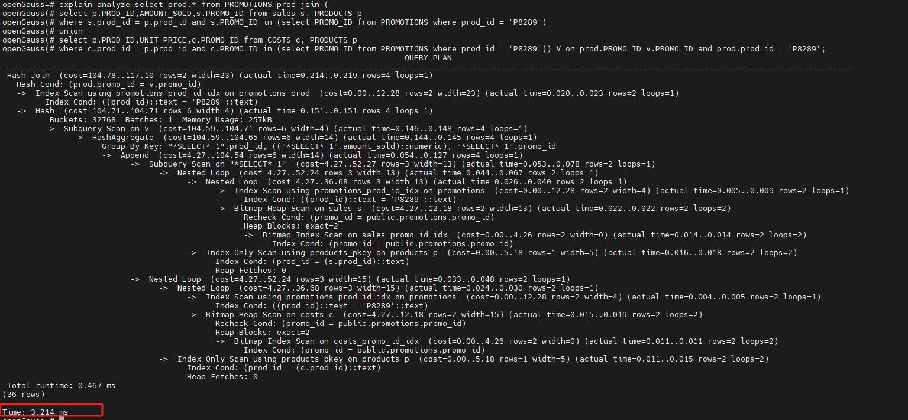 
    因此手动谓词下推是有效的。
    用例构造：

    ```sh
    -- 创建 PROMOTIONS 表
    CREATE TABLE PROMOTIONS (
        PROMO_ID INT PRIMARY KEY,
        PROD_ID VARCHAR(50),
        PROMO_NAME VARCHAR(100)
    );

    -- 创建 SALES 表
    CREATE TABLE SALES (
        PROD_ID VARCHAR(50),
        AMOUNT_SOLD INT,
        PROMO_ID INT
    );
    -- 创建 COSTS 表
    CREATE TABLE COSTS (
        PROD_ID VARCHAR(50),
        UNIT_PRICE DECIMAL(10, 2),
        PROMO_ID INT
    );
    -- 创建 PRODUCTS 表
    CREATE TABLE PRODUCTS (
        PROD_ID VARCHAR(50) PRIMARY KEY,
        PROD_NAME VARCHAR(100),
        CATEGORY VARCHAR(50),
        DESCRIPTION varchar(50)
    );
    create index idx1 on PROMOTIONS(PROD_ID);
    create index idx2 on SALES(PROD_ID);
    create index idx3 on SALES(PROMO_ID);
    create index idx4 on COSTS(PROD_ID);
    create index idx5 on COSTS(PROMO_ID);
    CREATE OR REPLACE PROCEDURE GenerateData(IN numRows INT)
    LANGUAGE plpgsql
    AS $$
    DECLARE
        i INT := 0;
    BEGIN
        -- 生成 PRODUCTS 数据
        WHILE i < numRows LOOP
            INSERT INTO PRODUCTS (PROD_ID, PROD_NAME, CATEGORY, DESCRIPTION) 
            VALUES (CONCAT('P', i), CONCAT('Product ', i), 'Category ' || (i % 5), 'Description for product ' || (i % 10));
            i := i + 1;
        END LOOP;

        i := 0;
        -- 生成 PROMOTIONS 数据
        WHILE i < numRows LOOP
            INSERT INTO PROMOTIONS (PROMO_ID, PROD_ID, PROMO_NAME) 
            VALUES (i, CONCAT('P', FLOOR(RANDOM() * numRows)), CONCAT('Promotion ', i));
            i := i + 1;
        END LOOP;
        i := 0;
        -- 生成 SALES 数据
        WHILE i < numRows LOOP
            INSERT INTO SALES (PROD_ID, AMOUNT_SOLD, PROMO_ID) 
            VALUES (CONCAT('P', FLOOR(RANDOM() * numRows)), FLOOR(RANDOM() * 1000), FLOOR(RANDOM() * numRows));
            i := i + 1;
        END LOOP;
        i := 0;
        -- 生成 COSTS 数据
        WHILE i < numRows LOOP
            INSERT INTO COSTS (PROD_ID, UNIT_PRICE, PROMO_ID) 
            VALUES (CONCAT('P', FLOOR(RANDOM() * numRows)), ROUND(RANDOM() * 100, 2), FLOOR(RANDOM() * numRows));
                i := i + 1;
         END LOOP;
    END;
    $$;
    -- 使用存储过程
    CALL GenerateData(10000);  -- 生成 10000 行数据        
        ```

### 规避措施

如上所述，问题出现的场景可以总结为，凡是出现union场景作为子句与另一张表join的情况，都会出现谓词不下推的场景。例如继续简化上述用例：

```sh
select prod.* from PROMOTIONS prod join (
select AMOUNT_SOLD,s.PROMO_ID from sales s 
union 
select UNIT_PRICE,c.PROMO_ID from COSTS c ) V on prod.PROMO_ID=v.PROMO_ID and prod.prod_id = 'P8289';
```

此种情况也无法下推，
因此规避可以采用手动将条件下推至union两端的方式，如下：

```sh
select prod.* from PROMOTIONS prod join (
select AMOUNT_SOLD,s.PROMO_ID from sales s where s.PROMO_ID in (select PROMO_ID from PROMOTIONS where prod_id = 'P8289')
union 
select UNIT_PRICE,c.PROMO_ID from COSTS c where c.PROMO_ID in (select PROMO_ID from PROMOTIONS where prod_id = 'P8289')) V on prod.PROMO_ID=v.PROMO_ID and prod.prod_id = 'P8289';
```

## **问题5：hot_standby_feedback与延迟备库不能同时打开**

### 问题描述

在某一套业务配备了延迟备库后，突然发现某些sql性能开始下降，直至sql性能完全不可用，产生严重事故。

### 临时解决方案

对于性能逐渐变差的问题，我们首先考虑的是索引失效。通过对表进行索引重建，或者进行vacuum后均可使得业务恢复正常状态。

### 问题定位

1. 死元组未被及时清理
    业务保留了现场，恢复至出问题的环境，上去查询死元组数量如下：

    ```sh
    bcpdb=# select * from pg_stat_user_tables where relname='t_task_inst';
    -[ RECORD 1 ]-----+------------------------------
    relid             | 25013
    schemaname        | bcpapp
    relname           | t_task_inst
    seq_scan          | 0
    seq_tup_read      | 0
    idx_scan          | 0
    idx_tup_fetch     | 0
    n_tup_ins         | 0
    n_tup_upd         | 0
    n_tup_del         | 0
    n_tup_hot_upd     | 0
    n_live_tup        | 2515872
    n_dead_tup        | 549191
    last_vacuum       | 
    last_autovacuum   | 
    last_analyze      | 2024-08-19 17:26:16.497666+08
    last_autoanalyze  | 
    vacuum_count      | 0
    autovacuum_count  | 0
    analyze_count     | 1
    autoanalyze_count | 0
    last_data_changed | 
    ```

    我们发现，死元组数量较多，这会极大的影响执行效率。

2. 死元组未被及时清理的原因：延迟备与hot_standby_feedback同时开启，导致oldestxmin很小，vacuum无法清理。

    观察日志，发现虽然autovacuum有在执行，但是每次vacuum处理的死元组数量非常有限。
    所有autovacuum相关参数参考[社区文档](https://docs.opengauss.org/zh/)
    主要的参数为autovacuum_vacuum_threshold，autovacuum_vacuum_scale_factor
    这里附上整个autovacuum的执行逻辑如下：

    - Autovacuum对应线程，通过检测表的死元组数量(pgstat模块进行统计, 并有视图可以展示查看)是否达到阈值（autovacuum_vacuum_threshold，autovacuum_vacuum_scale_factor参数控制）；来判断是否对表做vacuum。
    - 在vacuum过程中，需要根据oldestxmin判断能否进行实际的清理。这里的oldestxmin指的是可能用到的最小事务号（由多种因素共同计算得出，例如活跃的最小事务号等）。死元组涉及的事务号必须要小于oldestxmin才会被清理。
     
    那么现在问题很明确了，正确触发了vacuum但是没有清理死元组，我们联想到延迟备库，因为延迟备才造成了这个问题，自然而然我们发现了一个可疑参数hot_standby_feedback
    这个参数的原理参考如下文章：<https://www.modb.pro/db/1718899640635564032>。
    简而言之，hot_standby_feedback 可以解决备库读可能被中断的问题，他的原理上是主机在更新oldestxmin时，会综合考虑备机上的事务oldestxmin信息。
    因此，当开启了延迟备后，oldestxmin实际上采用的是延迟备同步过来的，而备机配置了延迟了12h，这也就意味着12h内事务产生的死元组，是一定无法清理的。所以也就造成了上述问题。

### 解决方案

关闭延迟备的hot_standby_feedback即可，本身延迟备没有读的需求。

* 补充说明 
> 在数据库重启等场景下，备机会主动同步主机的配置参数，因此有可能改了延迟备机参数后，后面重启实例参数又被重置回去了。
> 对于这个场景，可以配置sync_config_strategy=none_node，表示主备节点各自维护各自的配置，不进行同步。
